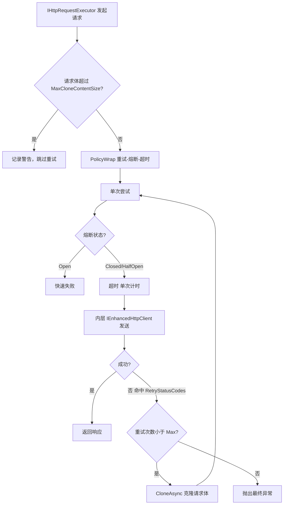
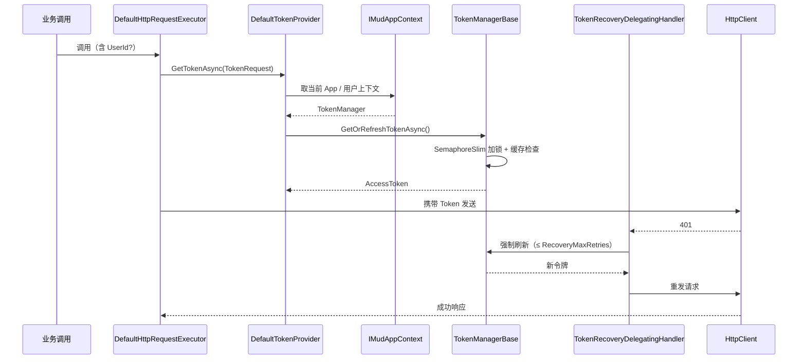

# HttpUtils：一个编译时生成的声明式 HTTP 客户端框架

> 本文介绍 [Mud.HttpUtils](https://gitee.com/mudtools/MudHttpUtils) 的设计思路、能力边界，以及它和 Refit / RestEase 这类成熟库的差异。文中代码均可在 .NET 6+ 下运行，配置片段来自项目内置的选项绑定约定。

## 背景：HTTP 客户端调用的真实成本

只要项目需要对接外部 HTTP 服务，你就绕不开这一套重复劳动：拼 URL、序列化请求体、反序列化响应、处理非 2xx 状态码、配置 `HttpClient` 生命周期。一个两个接口手写还能接受，当接口涨到几十个、对接的第三方服务有好几家时，这些样板代码会迅速膨胀，而且每一处都可能是不一致的来源（有人用 `Newtonsoft.Json`，有人用 `System.Text.Json`；有人忘了 `using`，有人忘了 `EnsureSuccessStatusCode`）。

[Refit](https://github.com/reactiveui/refit) 和 [RestEase](https://github.com/canton7/RestEase) 用「接口 + 特性」的声明式方式解决了样板代码的问题，这是个被广泛验证的好思路。但它们普遍止步于「把接口变成一次 HTTP 调用」。一旦进入生产环境，下面这些事情仍然要你自己拼：

- 网络抖动时的重试、单次调用的超时、故障时的熔断；
- Access Token 的获取、缓存、刷新，以及 401 后的自动恢复重试；
- 请求体 / 响应体的字段级加密；
- 多租户场景下，每个租户的令牌和弹性策略彼此隔离；
- 出问题时在链路追踪里看到每一次调用的耗时、重试次数、熔断状态。

这些东西单独看都不难，难的是「每个 API 客户端都要来一遍」，而且很容易写得不一致。Mud.HttpUtils 的思路是：把上面这些能力做进框架，让它们成为声明式接口上的特性或注册时的一行配置，而不是每次重新拼装的乐高。

需要提前说明的立场：Mud.HttpUtils 不是要取代 Refit，它在生态成熟度、社区规模上远不如后者。本文会在后面专门讨论它的局限和适用边界，方便你判断要不要引入。

## 它是什么

Mud.HttpUtils 由两部分组成：

1. **编译时（Roslyn 增量源生成器）**：扫描标记了 `[HttpClientApi]` 的接口，为每个接口生成一份强类型实现（落在 `.Internal` 命名空间），并在注册阶段生成 DI 代码。
2. **运行时（装饰器栈）**：生成的实现调用 `IHttpRequestExecutor`，运行时外层依次套上弹性策略（`ResilientHttpClient`）、令牌恢复、追踪 `DelegatingHandler`，最内层是 `EnhancedHttpClient`。

整个框架拆成 7 个 NuGet 包，可以只引用需要的子集：

| 组件 | 作用 | 何时单独引用 |
| --- | --- | --- |
| `Mud.HttpUtils` | 元包，聚合 Abstractions + Attributes + Client + Resilience，提供 `AddMudHttpUtils` | 大多数项目 |
| `Mud.HttpUtils.Abstractions` | 纯接口与契约，几乎无第三方依赖 | 只定义接口、不依赖实现的类库 |
| `Mud.HttpUtils.Attributes` | 特性定义 | 类库只想暴露特性给上游 |
| `Mud.HttpUtils.Client` | 客户端实现、加密、令牌管理、DI 注册 | 需要细粒度控制注册的场合 |
| `Mud.HttpUtils.Resilience` | Polly 弹性装饰器 | 只想加弹性不想引全套 |
| `Mud.HttpUtils.Generator` | 源生成器（编译期，不进运行时） | 必须随接口一起引用 |
| `Mud.HttpUtils.OpenTelemetry` | 可观测性适配 | 需要导出 Tracing / Metrics 时 |

下面是整体结构。注意「使用者代码」和「运行时核心」之间通过生成代码解耦——你的业务只依赖接口，不依赖具体实现。

```mermaid
graph TB
    subgraph "使用者代码"
        IFace["声明式接口 IUserApi"]
        Svc["业务服务注入 IUserApi"]
    end
    subgraph "编译时 Mud.HttpUtils.Generator"
        SG["HttpInvokeClassSourceGenerator 与 RegistrationGenerator"]
    end
    subgraph "运行时核心"
        Abs["Mud.HttpUtils.Abstractions 接口与契约"]
        Attr["Mud.HttpUtils.Attributes 特性"]
        Client["Mud.HttpUtils.Client 客户端 令牌 加密"]
        Res["Mud.HttpUtils.Resilience Polly 装饰器"]
        OTel["Mud.HttpUtils.OpenTelemetry 追踪与指标"]
    end
    Meta["Mud.HttpUtils 元包 AddMudHttpUtils"]

    IFace -->|"扫描特性"| SG
    SG -->|"生成 Internal.UserApi"| Svc
    Svc --> IFace
    Meta -. "聚合" .- Abs
    Meta -. .- Attr
    Meta -. .- Client
    Meta -. .- Res
    Res -. "装饰" .- Client
    OTel -. "采集" .- Abs
```

## 快速开始

```bash
dotnet add package Mud.HttpUtils
dotnet add package Mud.HttpUtils.Generator
```

```csharp
using Mud.HttpUtils.Attributes;

[HttpClientApi(HttpClient = "IEnhancedHttpClient")]
public interface IUserApi
{
    [Get("/users/{id}")]
    Task<UserInfo> GetUserAsync([Path] int id);

    [Post("/users")]
    Task<UserInfo> CreateUserAsync([Body] CreateUserRequest request);

    [Get("/users")]
    Task<List<UserInfo>> GetUsersAsync(
        [Query] string? name = null,
        [Query] int page = 1,
        [Query] int pageSize = 20);
}
```

注册时把弹性策略一并配好：

```csharp
services.AddMudHttpUtils("userApi", "https://api.example.com", options =>
{
    options.Retry.MaxRetryAttempts = 3;
    options.Retry.UseExponentialBackoff = true;
    options.Timeout.TimeoutSeconds = 30;
});
services.AddWebApiHttpClient();
```

之后像调用本地方法一样使用，构造函数注入的是接口而非具体类：

```csharp
public class UserService
{
    private readonly IUserApi _userApi;
    public UserService(IUserApi userApi) => _userApi = userApi;

    public Task<UserInfo> GetUserByIdAsync(int id) => _userApi.GetUserAsync(id);
}
```

所有弹性、序列化、错误处理都已经在框架内部完成。下面分模块看这些能力具体怎么用。

## 核心能力详解

### 1. 声明式接口与参数映射

支持的 HTTP 方法与参数特性如下（星号表示支持参数/方法/接口多级）：

| 特性 | 说明 | 示例 |
| --- | --- | --- |
| `[Path]` | URL 路径参数 | `[Get("/users/{id}")]` + `[Path] int id` |
| `[Query]` | URL 查询参数 | `[Query] string? name` |
| `[QueryMap]` | 对象/字典展开为查询参数 | `[QueryMap] SearchCriteria criteria` |
| `[ArrayQuery]` | 数组查询参数 | `[ArrayQuery] int[] ids` |
| `[RawQueryString]` | 原始查询字符串 | `[RawQueryString] string qs` |
| `[Header]`* | 请求头 | `[Header("X-API-Key")] string k` |
| `[Body]` | 请求体（支持原始串/加密） | `[Body] CreateUserRequest req` |
| `[Form]` | `application/x-www-form-urlencoded` 字段 | `[Form("username")] string user` |
| `[FormContent]` | 表单数据 | `[FormContent] IFormContent formData` |
| `[MultipartForm]` / `[Upload]` | 多部件表单 / 文件上传 | `[Upload] IFormFile file` |
| `[FilePath]` | 文件下载落盘 | `[FilePath] string savePath` |
| `[Token]`* | Token 注入 | `[Token(TokenTypes.UserAccessToken)]` |
| `[Retry]` / `[Timeout]` / `[CircuitBreaker]` | 方法级弹性策略 | `[Retry(MaxRetries = 3)]` |
| `[HeaderMerge]` | 同名头部合并策略 | `[HeaderMerge(HeaderMergeMode.Replace)]` |
| `[SerializationMethod]` | 序列化方式（接口/方法级） | `[SerializationMethod(SerializationMethod.Xml)]` |
| `[InterfacePath]` / `[InterfaceQuery]` | 接口级固定路径/查询参数 | `[InterfaceQuery("version", "2.0")]` |
| `[AllowAnyStatusCode]` | 不抛异常、允许任意状态码 | `[AllowAnyStatusCode]` |

**默认参数推断**是减少噪音的关键。没标任何特性的参数，生成器按类型推断：

| 参数类型 | 推断结果 |
| --- | --- |
| 简单类型及数组/可空（`string`、`int`、`Guid`、`DateTime`…） | `[Query]` |
| 复杂类型（自定义对象、`List<T>`、`Dictionary<K,V>`） | `[Body]`（JSON） |
| `CancellationToken` / `IProgress<T>` | 不参与推断，原样透传 |

```csharp
[HttpClientApi(HttpClient = "IEnhancedHttpClient")]
public interface IUserApi
{
    // keyword → [Query]，user → [Body]
    [Post("users/advanced-search")]
    Task<List<User>> AdvancedSearchAsync(string keyword, SearchCriteria criteria, CancellationToken ct = default);
}
```

**接口级动态属性**让你把「所有方法都带」的参数提升为接口属性，而不是每个方法重复写：

```csharp
[HttpClientApi(HttpClient = "IEnhancedHttpClient")]
[BasePath("{tenantId}/api/v1")]
public interface ITenantApi
{
    [Path("tenantId")]  string TenantId { get; set; }
    [Query("apiKey")]   string ApiKey   { get; set; }

    [Get("users")]
    Task<List<User>> GetUsersAsync();
}

// 使用
var api = provider.GetRequiredService<ITenantApi>();
api.TenantId = "tenant-123";
api.ApiKey   = "my-key";
await api.GetUsersAsync();   // → /tenant-123/api/v1/users?apiKey=my-key
```

`[BasePath]` 定义统一前缀；方法 URL 以 `/` 开头则忽略前缀。`[QueryMap]` 还支持嵌套属性分隔符、是否包含 null 值、JSON 还是 ToString 序列化等细粒度控制。

### 2. 三种运行模式

同一个接口生成出来的构造函数依赖，由 `[HttpClientApi]` 的配置决定：

| 模式 | 配置 | 构造函数依赖 | 适用场景 |
| --- | --- | --- | --- |
| HttpClient（推荐） | `HttpClient = "IEnhancedHttpClient"` | `IOptions<JsonSerializerOptions>` + `IEnhancedHttpClient` | 通用，配合 `AddMudHttpUtils` |
| TokenManager | `TokenManage = "IFeishuAppManager"` | `IOptions<JsonSerializerOptions>` + 令牌管理器 | 飞书/钉钉等需令牌管理 |
| 默认 | 不设置 | `IOptions<JsonSerializerOptions>` + `IMudAppContext` | 遗留兼容 |

`HttpClient` 与 `TokenManage` 互斥，同时设置时 `HttpClient` 优先（编译期报 `HTTPCLIENT007`）。

### 3. 弹性策略

弹性基于 Polly，以装饰器形式套在 `IEnhancedHttpClient` 外层。默认配置：重试开启（3 次，指数退避）、超时开启（30s）、熔断关闭（可手动开启）。策略组合顺序固定为 **重试（外层）→ 熔断（中间）→ 超时（内层）**——超时只约束单次尝试，每次重试独立计时。

全局配置支持代码与 `appsettings.json` 两种方式：

```json
{
  "MudHttpResilience": {
    "Retry":         { "Enabled": true, "MaxRetryAttempts": 3, "UseExponentialBackoff": true },
    "Timeout":       { "Enabled": true, "TimeoutSeconds": 30 },
    "CircuitBreaker":{ "Enabled": true, "FailureThreshold": 5, "BreakDurationSeconds": 30 }
  }
}
```

也可以在方法上用特性覆盖全局策略：

```csharp
[Get("/reports/export")]
[Retry(MaxRetries = 5)]
[Timeout(120000)]
[CircuitBreaker(FailureThreshold = 10, BreakDurationSeconds = 60)]
Task<byte[]> ExportReportAsync();
```

单次请求在装饰器内的执行流程如下，重试时通过 `HttpRequestMessageCloner` 克隆请求体，因此请求体超过 `MaxCloneContentSize`（默认 10MB）时会自动跳过重试，避免大文件上传时克隆开销：



### 4. 令牌管理

这部分是 Mud.HttpUtils 和 Refit 差异最大的地方。框架内置：

- `TokenManagerBase` / `UserTokenManagerBase`：并发安全的令牌缓存与刷新抽象基类，用 `SemaphoreSlim(1,1)` 保证同一时刻只有一个线程刷新；
- `StandardOAuth2TokenManager`：覆盖 Authorization Code / Client Credentials / ROPC / Refresh Token 流程；
- `TokenRecoveryDelegatingHandler`：401 时自动刷新令牌并重试；
- `TokenRefreshHostedService`（.NET 6+）/ `TokenRefreshBackgroundService`（netstandard2.0）：后台主动刷新，避免临界过期。

自定义一个令牌管理器只需要实现两个方法：

```csharp
public class MyTokenManager : TokenManagerBase
{
    protected override Task<TokenInfo?> GetCachedTokenAsync(string tokenType, CancellationToken ct)
        => Task.FromResult<TokenInfo?>(_cache.Get(tokenType));

    protected override async Task<TokenInfo> RefreshTokenCoreAsync(string tokenType, CancellationToken ct)
    {
        var resp = await FetchTokenAsync(ct);
        return new TokenInfo(resp.AccessToken, resp.ExpireTime);
    }
}
```

Token 注入有多种模式，支持 Header / Query / Path / ApiKey / HmacSignature / BasicAuth / Cookie：

```csharp
[Token(TokenTypes.TenantAccessToken)]
public interface IApi { }

// 用户级令牌：自动注入 ICurrentUserContext
[HttpClientApi(TokenManage = "IFeishuAppManager")]
[Token(TokenType = "UserAccessToken", RequiresUserId = true)]
public interface IFeishuUserApi { }

// 用 TokenManagerKey 解耦业务概念和技术查找键
[Token(TokenType = "UserAccessToken", TokenManagerKey = "FeishuUser")]
public interface IFeishuContactApi { }
```

`DefaultTokenProvider` 的关键设计是**不持有 `IMudAppContext`，而是通过每次调用的 `TokenRequest`（含 `UserId`）接收上下文**。这意味着 `UseApp()` / `UseDefaultApp()` 的上下文切换不会因为共享状态而串味——这是手写 `DelegatingHandler` 时很容易踩的坑。

401 恢复与弹性重试是两条相互独立的链路：前者由 `TokenRecoveryExecutor` 在 `RecoveryMaxRetries` 次数内强制刷新令牌并重试，后者由 Polly 装饰器负责网络层面的重试，互不干扰。



### 5. 安全：加密与 SSRF 防护

请求体 / 字段级加密用 `IEncryptionProvider`，内置 `DefaultAesEncryptionProvider`（AES-CBC，v1.8.0 起 IV 自动随机生成，无需配置）：

```csharp
services.AddMudHttpClient("myApi", encryption =>
{
    encryption.Key = Convert.FromBase64String("your-base64-key");
}, client =>
{
    client.BaseAddress = new Uri("https://api.example.com");
});
```

```csharp
[Post("/api/secure")]
Task<Response> PostSecureAsync(
    [Body(EnableEncrypt = true, EncryptPropertyName = "data")] Request request);
```

`UrlValidator` 提供 SSRF 防护：域名白名单、HTTPS 强制、私有 IP 与内网域名检测。可从配置绑定，也可运行时增删：

```json
{
  "MudHttpClients": {
    "AllowedDomains": [ "api.example.com", "cdn.example.com" ],
    "Clients": {
      "ExternalApi": { "BaseAddress": "https://external.api.com", "AllowCustomBaseUrls": true }
    }
  }
}
```

`AllowCustomBaseUrls = true` 会放宽域名限制，但仍阻止私有 IP 和内网域名。

### 6. 多租户与 App 上下文

对接多个第三方应用（比如一个服务同时对接多个飞书租户）时，需要每个 App 有独立的令牌、配置和弹性策略。`IMudAppContext` / `IAppManager<T>` / `IAppContextHolder`（`AsyncLocalAppContextSwitcher`）提供这套隔离：

```csharp
services.AddSingleton<IAppManager<FeishuContext>, DefaultAppManager<FeishuContext>>();

// 切换上下文后发出的请求会使用对应 App 的令牌与弹性策略
using (appContext.UseApp("tenant-A"))
{
    await contactApi.GetUsersAsync();
}
```

`DefaultAppManager<T>` 还暴露 `ConfigurationChanged` 事件，支持配置热更新。`IResiliencePolicyResolver`（如 `AppResiliencePolicyResolver`）可按 App 维护独立策略。

### 7. 文件、流式与 Response&lt;T&gt;

文件上传用 `[Upload]` / `[MultipartForm]`，下载用 `[FilePath]` 落盘或返回 `byte[]`：

```csharp
[Post("/upload")]
Task<UploadResult> UploadAsync([Upload(FieldName = "doc")] IFormFile file);

[Get("/files/{fileId}")]
Task DownloadFileAsync([Path] string fileId, [FilePath(BufferSize = 81920)] string savePath);
```

大文件上传通过 `ProgressableStreamContent` 报告进度，不会整文件载入内存。.NET 6+ 还支持 `IAsyncEnumerable` 流式响应：

```csharp
await foreach (var message in _httpClient.SendAsAsyncEnumerable<ChatMessage>(request, ct))
    yield return message;
```

`Response<T>` 在返回业务数据的同时附带状态码与响应头：

```csharp
var r = await api.GetUserAsync(1);
var user = r.Data;          // 业务数据
var code = r.StatusCode;    // HttpStatusCode
var headers = r.Headers;    // 响应头
```

注意：不要把 `Response<T>` 与 `[Cache]` 组合使用——缓存会连同状态码和响应头一起存，可能导致后续请求返回过期的状态码。生成器会对此发出 `HTTPCLIENT011` 编译警告。

### 8. 缓存与拦截器

`IHttpRequestInterceptor` / `IHttpResponseInterceptor` 按 `Order` 升序执行。内置 `CacheResponseInterceptor`（`Order = 100`）配合 `MemoryHttpResponseCache` 实现内存响应缓存：

```csharp
services.AddMemoryCache();
services.AddSingleton<IHttpResponseCache, MemoryHttpResponseCache>();
services.AddSingleton<IHttpResponseInterceptor, CacheResponseInterceptor>();
```

你也可以写自己的拦截器，比如统一给响应做脱敏日志：

```csharp
public class LoggingInterceptor : IHttpResponseInterceptor
{
    public int Order => 50;
    public Task OnResponseAsync(HttpResponseContext context, CancellationToken ct)
    {
        // context.Response / context.Exception 可读
        return Task.CompletedTask;
    }
}
```

### 9. 可观测性

`Mud.HttpUtils.OpenTelemetry` 一键开启分布式追踪与指标：

```csharp
builder.Services.AddMudHttpOpenTelemetry(options =>
{
    options.OtlpEndpoint = new Uri("http://otel-collector:4317");
});
```

自动采集的指标包括：HTTP 请求计数、请求耗时、缓存命中、令牌刷新、重试次数、熔断器状态、下载字节数与耗时。`TracingDelegatingHandler` 会为每个请求创建 Activity，记录方法、URL、状态码、耗时，可直接接入 OTLP 收集器与主流 APM。

### 10. 编译期诊断

生成器会在编译阶段对不合理的接口定义报错或告警，把问题挡在运行前。常用的几个：

| Diagnostic | 级别 | 触发条件 |
| --- | --- | --- |
| `HTTPCLIENT007` | Error | 同时指定 `HttpClient` 和 `TokenManage` |
| `HTTPCLIENT011` | Warning | `[Cache]` 与 `Response<T>` 组合 |
| `HTTPCLIENT012` | Error | 泛型接口不支持生成 |
| `HTTPCLIENT013` | Error | URL 模板占位符与 `[Path]` 参数不匹配 |
| `HTTPCLIENT005` | Error | URL 模板格式无效 |

完整的诊断码列表见主仓库 README 的「编译警告参考」章节。

## 与 Refit / RestEase 的对比

先放一张对照表，标注含义：内置 = 框架直接提供；需集成 = 要自己接 Polly / 自定义 Handler 等；不支持 = 当前无对应能力。

| 维度 | Mud.HttpUtils | Refit | RestEase |
| --- | --- | --- | --- |
| 代码生成方式 | 编译时增量源生成 | 反射，或 6+ 的可选源生成 | 运行时反射 |
| 核心路径零反射 | 内置 | 源生成模式可接近 | 不支持 |
| 方法级弹性策略（重试/超时/熔断） | 内置 | 需集成 | 需集成 |
| 并发安全令牌管理 + 401 自愈 | 内置 | 不支持 | 不支持 |
| 请求/响应加解密 | 内置 | 不支持 | 不支持 |
| 多租户 App 上下文隔离 | 内置 | 不支持 | 不支持 |
| SSRF / URL 白名单 | 内置 | 不支持 | 不支持 |
| OpenTelemetry 可观测 | 内置 | 需集成 | 需集成 |
| 流式响应 / 文件上传下载 | 内置 | 内置 | 有限 |
| `Response<T>` 元数据包装 | 内置 | 用 `ApiResponse<T>` | 有限 |
| 接口级动态属性 | 内置 | 不支持 | 有限 |
| `netstandard2.0` | 内置 | 有限 | 内置 |
| 编译期诊断 | 内置 | 有限 | 不支持 |

几个客观的补充：

- **Refit 生态成熟、文档完善、使用者众多**，遇到坑更容易搜到答案；它还支持 `HttpClient` 拦截、鉴权头、多种内容协商，配合 `Microsoft.Extensions.Http.Resilience` 也能补上弹性。如果你只需要「少写样板代码」，Refit 完全够用且更稳。
- **RestEase 更轻、API 更朴素**，但纯反射实现在 AOT / 极高性能场景下不合适，社区活跃度也偏低。
- **Mud.HttpUtils 的差异化**集中在「生产级可靠性开箱即用」：令牌生命周期、加密、多租户、可观测这些它都做成了一等公民。代价是抽象更厚、学习面更宽，而且要接受它是一个相对年轻的库。

如果你的服务对接大量第三方 HTTP API，且每个 API 都要重复搭建重试/熔断/令牌刷新/加密/监控这套脚手架，Mud.HttpUtils 能显著减少这部分重复劳动。如果只是对接一两个简单接口，Refit 更轻、风险更低。

## 性能

核心路径（JSON 序列化、URL 构建、请求头处理）在生成代码里直接完成，没有运行时反射，可用于 AOT。仍有少量场景保留反射（已做缓存优化）：

| 场景 | 是否反射 | 范围 |
| --- | --- | --- |
| `application/x-www-form-urlencoded` Body | 是 | 仅该 Body 模式 |
| `[QueryMap]` 非字典复杂类型展开 | 是 | 仅 QueryMap |
| XML 序列化/反序列化 | 是（`XmlSerializer` 内部） | 仅 XML Content-Type |

性能敏感路径建议用 JSON + 简单类型查询参数。框架还用 `SemaphoreSlim` 替代 `lock`、`IMemoryCache` 替代裸 `ConcurrentDictionary` 管理用户令牌缓存，并在大文件上传时走流式进度上报而非整文件入内存。

## 适用与不适用

**适合：**
- 需要对接多个第三方 HTTP 服务，且都要生产级可靠性；
- 有 Token 生命周期管理、多租户隔离、字段加密诉求；
- 希望编译期就发现接口定义错误，而非运行期才崩。

**不太适合：**
- 只对接一两个简单接口，引入整套框架的复杂度不划算；
- 团队对 Refit 已有深厚积累，迁移收益有限；
- 对库的成熟度、社区支持有强要求（Mud.HttpUtils 尚年轻）；
- 需要极致轻量、零额外依赖的客户端（元包会带来 Abstractions/Client/Resilience 一整套引用）。

## 迁移自 Refit 的注意点

接口定义从 Refit 的 `[Get("...")]` 等特性迁移到 Mud.HttpUtils 同名特性成本不高，主要差异在：

- 注册方式从 `builder.Services.AddRefitClient<T>()` 改为 `AddMudHttpUtils` + `AddWebApiHttpClient`；
- 返回类型若用 `ApiResponse<T>`，对应改为 `Response<T>`（注意缓存组合限制）；
- 原本手写的 `DelegatingHandler`（鉴权、重试）可逐步迁移到框架内置的令牌恢复与 Polly 装饰器，先移除重复部分再迁移；
- 弹性策略从 `Microsoft.Extensions.Http.Resilience` 配置迁移到 `MudHttpResilience` 配置节或代码 `options`。

## 结语

Mud.HttpUtils 把「声明式接口」从「少写样板」推进到了「少搭生产级基础设施」：编译时生成换性能与类型安全，装饰器叠加换能力可组合且不侵入业务，令牌/加密/弹性/多租户/可观测内置换开箱可用性。它不是一个在所有维度都优于 Refit 的替代品，而是在「对接很多外部 API 且都需要可靠性」这个具体问题上，提供了更省心的默认方案。

项目基于 MIT 许可证开源，支持 .NET Standard 2.0 / 6.0 / 8.0 / 10.0。各子包的详细文档见仓库内对应的 README。
