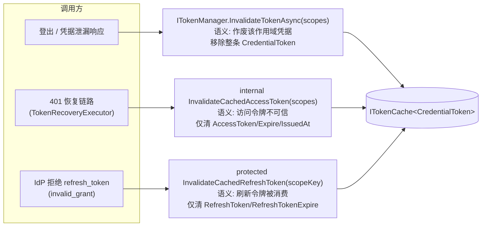
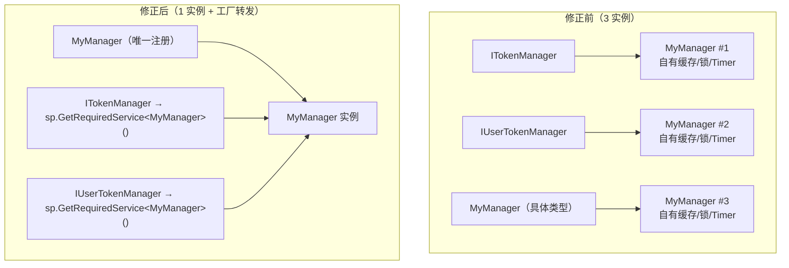

# Token 管理第二轮缺陷修复与能力完善方案（TR 轮）

| 项目 | 内容 |
| --- | --- |
| 文档类型 | 技术方案（缺陷修复 + 能力完善 + 测试护栏） |
| 适用范围 | `Mud.HttpUtils.Abstractions` / `Mud.HttpUtils.Client` / `Mud.HttpUtils.Resilience`（仅叠加语义与交叉校验）/ `Tests` |
| 基线版本 | 2.0.7（`Directory.Build.props`） |
| 目标版本 | **Phase 1 → 2.0.8**（Patch；公共 API 零变更）<br>**Phase 2/3 → 2.1.0**（新增 1 个公共只读属性） |
| 关联输入 | 《Token Manager 代码审查报告》（本轮编号 **TR-01 ~ TR-13**，对应审查报告 F-1-1 ~ F-5-2） |
| 目标框架 | `netstandard2.0;net6.0;net8.0;net10.0`（`Mud.HttpUtils.Client.csproj:3`，与 Abstractions 矩阵一致） |
| 约束 | 不引入新第三方依赖；公共 API 仅新增"可选 + 有默认行为"成员；不破坏既有 `ITokenManager` / `IUserTokenManager` 契约；AOT 严格模式保持绿；`PublicAPI/<tfm>/` 基线随 TFM 同步 |
| 编号约定 | 本轮前缀 **`TR`**（Token Remediation），与既有 `TM` / `TMX` / `TMR` / `TK` / `MT` / `SR` / `L` / `HC` / `M2-#` 不冲突（`grep -E "TR-\d"` 无命中） |

> 本方案与既有文档的关系：`.docs/Token管理缺陷修复与能力完善方案.md`（TK 轮）与 `.docs/多应用与令牌管理-Bug修复与功能完善方案.md`（MT 轮）已完成第一轮治理，本轮**不推翻**其设计结论（`KeyedLockTable` 锁生命周期、`TokenExpiryPolicy` 单一真相、`RefreshDedupTable` 条目即任务、恢复链路租户守卫与取消隔离全部保留），只在其上做**第二轮收口**。

---

## 0. 审查结论复核与实施前提

### 0.1 缺陷分级与置信度（高级程序员视角）

「置信度」标注的是**本方案对审查结论的把握程度**：`已确证` = 源码逐行可判定；`待复现` = 结论依赖第三方库契约推断，实施第一步必须以最小复现坐实（无论结论方向如何，修复动作不变）。

| 编号 | 审查项 | 现象摘要 | 严重级 | 置信度 | 一句话修复 |
| --- | --- | --- | --- | --- | --- |
| TR-01 | F-1-1 | `AddMudHttpTokenManager<T>` 三条 `ServiceDescriptor` ⇒ 3 个实例 | 🔴 高 | 已确证 | 具体类型注册一次，两接口工厂转发 |
| TR-02 | F-2-1 | 401 恢复用 `InvalidateTokenAsync` 整条清除 ⇒ 刷新令牌被销毁、刷新降级为 client_credentials | 🔴 高 | 已确证 | 失效语义分层，恢复链路改走"仅清访问令牌" |
| TR-03 | F-3-2 | `MemoryCacheTokenCache` 两参 `Set` 未登记驱逐回调（影子索引失真）；`SizeLimit` 已配置时未设 `Size` | 🟠 中高 | 待复现（见 0.1.1） | 两参 `Set` 收敛到五参重载 |
| TR-04 | F-2-2 | 登出不取锁 ⇒ 在途刷新把令牌写回，出现"登出后令牌复活" | 🟠 中（安全） | 已确证 | 写入代际守卫（见 D4） |
| TR-05 | F-2-3 | `HasValidTokenAsync` / `CanRefreshTokenAsync` 只读裸 `userId` 键，看不见 scope 化条目 | 🟠 中 | 已确证 | 前缀视图（接口签名不变） |
| TR-06 | F-1-2 | `ITokenStore` / `IUserTokenStore` 契约不被管线消费，但 `MemoryUserTokenStore` 示例诱导误用 | 🟡 中 | 已确证 | 文档与诊断澄清，明确"独立存储"边界 |
| TR-07 | F-2-4 | 恢复内部多轮重试在去重窗口内复用同一令牌 ⇒ 重试轮次为空转 | 🟡 中 | 已确证 | 去重窗口与重试轮次解耦（`bypassCache`） |
| TR-08 | F-1-3 | `MaxDedupEntries` 仅在构造期快照，热更新无效 | 🟡 中 | 已确证 | 上限改为委托按需读取 |
| TR-09 | F-3-1 | 用户令牌缓存未启用加密时明文驻留且**无任何提示** | 🟡 中（安全） | 已确证 | 一次性 Warning + `IsEncryptionEnabled` 可观测标记 |
| TR-10 | F-4-1 | `GetScopeKey` 位于每次取令牌热路径，单元素 scope 也走完整 LINQ + 记忆化 | 🟡 中（性能） | 已确证 | 单元素快路径 + 记忆化收益重估 |
| TR-11 | F-3-3 | `TokenInjectionMode.Path` 的令牌在 401 恢复日志中不被任何逻辑掩码 | 🟢 低（安全） | 已确证 | `RedactForLog` 对 Path 模式整体打码 |
| TR-12 | F-5-1 / F-5-2 | 四条关键路径零覆盖；AOT 源生成上下文缺独立回归 | 🟡 中 | 已确证 | 10 条红线用例 + AOT 往返用例 |
| TR-13 | F-1-4 / F-2-5 / F-2-6 / F-4-2 / F-4-3 | Timer 版热更新差异、负缓存不分类、后台仅刷默认作用域、记忆化抖动、双缓冲上限不一致 | 🟢 低 | 已确证 | 文档化 + 轻量加固（打包） |

#### 0.1.1 TR-03 的复现要求（必须前置执行）

审查结论中"`SizeLimit` 非空时两参 `Set` 抛 `InvalidOperationException`"源自 `Microsoft.Extensions.Caching.Memory` 的契约（`SizeLimit` 设置后条目必须指定 `Size`），非本仓库代码可判定。Phase 0 用最小复现坐实，两种结果对应两种收口：

```csharp
// Tests/Mud.HttpUtils.Client.Tests/Token/Cache/MemoryCacheTokenCacheContractTests.cs
[Fact]
public void TwoArgSet_WithSizeLimit_ShouldBehaveLikeFiveArgSet()
{
    using var cache = new MemoryCacheTokenCache<string>(sizeLimit: 16);
    var act = () => cache.Set("k", "v");          // 现状：未设置 Size
    act.Should().NotThrow();                      // 复现为抛异常 ⇒ 本条先红
    cache.TryGet("k", out var v).Should().BeTrue();
}

[Fact]
public void ShadowIndex_ShouldNotRetainEvictedKeys()
{
    using var cache = new MemoryCacheTokenCache<string>();
    for (var i = 0; i < 100; i++) cache.Set($"k{i}", new string('x', 64));
    cache.Compact(1.0);                            // 内部 MemoryCache.Compact ⇒ 条目被驱逐
    cache.Count.Should().Be(0);                    // 影子索引失真 ⇒ 本条先红
}
```

### 0.2 系统架构师视角：三处必须先定的取舍

1. **失效语义分层后 `InvalidateTokenAsync` 的定位（TR-02 核心）**
   现有 `ITokenManager.InvalidateTokenAsync` 承担了两个互相冲突的语义：① "凭据作废"（登出、密钥泄漏，必须连 refresh_token 一起销毁）；② "访问令牌不可信，请重新获取"（401 恢复，**必须保留 refresh_token 才能自愈**）。当前实现只有 ①（`TokenManagerBase.cs:276` 整体 `TryRemove`）。方案选择：**保留 ① 的既有语义不变（零破坏），新增 ② 的 internal 入口**，而不是修改 `InvalidateTokenAsync` 的行为——后者会让所有既有调用方（含第三方实现）语义漂移。

2. **登出线性化的三条路线（TR-04）**
   见 D4 的路线对比表。方案选 **代际守卫**：不引入登出阻塞（锁内串行会让登出等待最长 30s 的在途刷新），也不引入 tombstone 的额外状态机（`KeyedLockTable` 已有 `Retired` 语义，复用它表达"作废"会把缓存失效与锁退休两个维度耦合）。

3. **TR-01 属于"行为修正"而非纯修复**
   `AddMudHttpTokenManager<T>` 修正后，`GetRequiredService<ITokenManager>()` 与 `GetRequiredService<IUserTokenManager>()` 由"两个实例"变为"同一实例"。这是**修复**（文档 1197-1198 行本就承诺同一实例），但对"无意中依赖了实例隔离"的下游是行为变更，必须在 CHANGELOG 显式标注并给出迁移说明（§7.2）。

### 0.3 质量保障视角：可落地性

- **竞争窗口可制造**：仓库已有 `TaskCompletionSource(TaskCreationOptions.RunContinuationsAsynchronously)` 编排样板（如 `Tests/Mud.HttpUtils.Client.Tests/Token/Recovery/TokenRecoveryConcurrencyTests.cs:62-63、126-127`），本轮 TR-04 / TR-07 的用例直接复用该模式（`SyncPoint` 风格），满足"不接受纯顺序测试"的门禁。
- **内部状态可观测**：`KeyedLockTable` 已暴露 `internal int Count` / `Keys` / `SpinRetries`，`TokenManagerBase` 已暴露 `internal int CacheCountInternal`（`TokenManagerBase.cs:791`）与 `internal bool TimersActive`（`:780`），`UserTokenManagerBase` 已暴露 `UserLockTableCountForTest`（`:413`）、`UserRefreshFailureCountForTest`（`:536`）。本轮新增内部观测点沿用同一惯例，**不引入反射**。
- **IVT 前置**：`Mud.HttpUtils.Abstractions/AssemblyInfo.cs:3-8` 的 IVT 仅含 `Mud.HttpUtils.Client` / `Client.Tests` / `Mud.HttpUtils` / `Resilience` / `Resilience.Tests`。TR-02 的"仅清访问令牌"入口为 `internal`，Client 侧可直接调用（IVT 已覆盖）；若 T-12 需要在 `Tests/Mud.HttpUtils.Tests`（机器护栏工程）中访问 Abstractions 内部类型，需**新增** `[assembly: InternalsVisibleTo("Mud.HttpUtils.Tests")]`（§5 Phase 0 任务）。
- **TFM 对称**：TR-09 / TR-11 新增日志必须**同时**落在 `#if NET6_0_OR_GREATER` 与 `#else` 两个分支并使用同一 EventId（TMX-21 的跨 TFM 撞号教训，见 `CHANGELOG` 2.0.5 节）。

### 0.4 工作量与批次收敛

| 阶段 | 内容 | 项数 | 估算 |
| --- | --- | --- | --- |
| Phase 0 | 前提验证（TR-03 复现、IVT 补齐、代际守卫可行性） | 3 | 0.5 人日 |
| Phase 1 | 止血（TR-01 ~ TR-05，含 8 条用例：6 条先红 + 2 条新增） | 5 | 4.5 人日 |
| Phase 2 | 收口与可观测（TR-06 ~ TR-10、TR-13-1/2/3/4，含 6 条用例：1 条先红 + 5 条新增） | 8 | 4.0 人日 |
| Phase 3 | 加固与文档（TR-11 ~ TR-13-5，含 3 条用例） | 3 | 2.0 人日 |
| **合计** | | **13** | **≈11 人日** |

> 与 TK 轮（≈17.5 人日）相比总量更小：本轮无架构级重写，全部为方法级/注册级改动，最大改动面为 `TokenRecoveryExecutor` 的失效调用点与 `UserTokenManagerBase` 的写入路径。

### 0.5 三视角评审结论（2026-09-21，实施前终审）

> 评审方式：逐项对照源码核实 §0.1 全部证据行号与修复骨架，覆盖高级程序员 / 系统架构师 / 质量保障三个视角。评审结论：**方案批准实施**，13 项问题全部属实、无功能重复与冗余项；同时发现 5 处须在实施中修订的设计缺口（J1~J5），已并入对应章节，不改变分阶段结构。

#### 0.5.1 高级程序员视角：问题真实性与方案必要性

| 项 | 核实结论 |
| --- | --- |
| TR-01 | ✅ 已确证。`ServiceCollectionExtensions.cs:1213-1218` 三条 `implementationType` 注册，MS.DI 按 `ServiceIdentifier` 缓存单例 ⇒ 3 实例，与 1197-1198 行 XML 文档承诺矛盾。工厂转发为 MS.DI 表达"同一有状态组件"的最优解（替代方案 `TryAdd`/`Forward` 均无法保证三类型同实例）。 |
| TR-02 | ✅ 已确证。`TokenRecoveryExecutor.cs:875` → `TokenManagerBase.InvalidateTokenAsync`（`TokenManagerBase.cs:276`）整条 `TryRemove`；`StandardOAuth2TokenManager.RefreshTokenCoreAsync`（实际 `:394-418`，文档原引 `:397-399` 为轻微行号漂移）读 `GetCachedCredentialToken()?.RefreshToken` 为 null 即静默降级 client_credentials。语义分层（新增 internal 入口、保留 `InvalidateTokenAsync` 既有语义）是零破坏最优解。 |
| TR-03 | ✅ 已确证（较原"待复现"升级）。两参 `Set`（`MemoryCacheTokenCache.cs:101-118`）直接 `_cache.Set(key, value)`：① `SizeLimit` 非空时 BCL `MemoryCache` 契约确定性抛 `InvalidOperationException`（五参重载 `:135-141` 的 M-5 注释即为此契约的自证）；② 无驱逐回调 ⇒ Compact/过期驱逐后 `_keys` 残留。两条复现用例在当前代码上必红。 |
| TR-04 | ✅ 已确证。`GetOrRefreshTokenCoreAsync`（`UserTokenManagerBase.cs:290-296`）刷新成功即 `UpdateUserTokenCache` 写回，`RemoveUserCacheEntries`（`:351-370`）仅 `TryRemove`+`TryRetire`，无任何写入阻断。代际守卫为"登出线性化"三路线中的正确取舍。 |
| TR-05 | ✅ 已确证。`HasValidTokenAsync`/`CanRefreshTokenAsync`（`:211-222`）只读裸 `userId` 键，写入视图含 `userId␟scopeKey`（`:486-487`），查询/写入视图不对称。 |
| TR-07 / TR-08 | ✅ 已确证。`RefreshDedupTable.GetOrRefreshAsync`（`:88-138`）窗口内直接复用任务；`:103/121/128/134` 四处无条件 `TryRemove(key)`。`_maxEntries` 构造期快照（`:36/44-47`），`TokenRecoveryExecutor` 三处构造（`:102/125/157`）快照 `MaxDedupEntries`。 |
| TR-09 / TR-10 / TR-11 | ✅ 已确证。构造链（`UserTokenManagerBase.cs:117-154`）无任何明文提示；`ScopeKeyBuilder.Build`（`:98-123`）单元素也走完整 LINQ+记忆化，且 `s_memoCache.Count >= MemoCacheLimit` 时 `Clear()`（`:109-110`）；`RedactForLog`（`TokenRecoveryExecutor.cs:503-521`）仅处理 Query 模式，`SensitiveUrlRedactor`（`:42-44`）无 query 原样返回 ⇒ Path 内嵌令牌裸奔。 |
| 功能重复/冗余排查 | 无。`InvalidateCachedAccessToken`（新增）与 `InvalidateCachedRefreshToken`（既有 `:367-375`）为对称的字段级失效对，语义互斥不重叠；D4 代际守卫复用既有 `CleanupOrphanedLocks` 清扫点，不新增定时器；TR-13-5 沿用既有校验器体系。 |

#### 0.5.2 系统架构师视角：闭环与兼容性

1. **失效语义闭环成立**：三入口（登出整条清 / 恢复仅清访问令牌 / invalid_grant 仅清刷新令牌）互不代偿，且都不触碰锁表，与 `KeyedLockTable` 所有权模型一致。关键增强确认：恢复链路改走 internal 入口后，**不再触发派生类对 `InvalidateUserTokenAsync` 的覆写副作用**（如 IdP revoke）——401 恢复本就不应撤销 IdP 侧凭据，属正向收敛而非行为回归。
2. **IVT 闭环成立**：`Abstractions/AssemblyInfo.cs:3-8` 已含 `Mud.HttpUtils.Client`，TR-02 internal 入口可直接被恢复链路调用，无需新增 IVT（P0.2 仅保留"机器护栏工程按需"评估）。
3. **行为修正可控**：BE-1~BE-5 全部为"实现向文档承诺收敛"，无隐式契约漂移；R5（TR-05 false→true）风险已有缓解路径（宿主改用 `CanRefreshTokenAsync`）。
4. **评审修订 J2（并入 D4）**：精准失效路径 `InvalidateUserTokenAsync(userId, scopes)`（`UserTokenManagerBase.cs:448-465`）同样移除缓存条目，必须同步 `BumpWriteGeneration`，否则其与在途刷新并发时仍可"令牌复活"——原方案 D4 仅覆盖 `RemoveUserCacheEntries` 一个入口，存在闭环缺口。
5. **评审修订 J3（并入 P2.6）**：TR-13-2 的负缓存分类无法在 Abstractions 判定 `invalid_client`/`invalid_scope`（`OAuth2TokenException` 位于 Client 程序集，Abstractions 不引用）。改为在 `TokenManagerBase` 增加 `protected virtual bool ShouldNegativeCache(Exception)` 钩子（默认 true，零破坏），由 `StandardOAuth2TokenManager` 覆写按 `OAuth2TokenException.ErrorCode` 分类——保持分层边界。
6. **评审修订 J1（并入 P2.1/§7.1）**：TR-09 的 Warning 日志需要 `ILogger`，而 `UserTokenManagerBase` 全部构造函数均无日志参数（`:159-168` 自证"用户管理器可能无 ILogger"）。为不给既有受保护构造函数加可选参（会改变 PublicAPI 签名、破坏"diff 仅含新增"门禁），**新增 4 参受保护构造函数重载**（`IEncryptionProvider` + `ILogger?`），旧构造继续转发。公共 API 变更由 1 项调整为 2 项（见 §7.1 API-2）。

#### 0.5.3 质量保障视角：可落地性

1. 竞争窗口用例全部可制造（`TaskCompletionSource(RunContinuationsAsynchronously)` 样板已在 `TokenRecoveryConcurrencyTests.cs:62-63` 落地），TR-04 的 SyncPoint 编排可行。
2. 内部观测点齐备且免反射（`CacheCountInternal` / `UserLockTableCountForTest` / `RefreshDedupTable.Count`），本轮新增 `WriteGenerationCountForTest` 沿用惯例。
3. **评审修订 J4（并入用例 #14）**：`GC.GetAllocatedBytesForCurrentThread()` 不在 `netstandard2.0` 契约内——分配护栏用例必须落在支持该 API 的测试 TFM 上（Client.Tests 的 net8.0/net10.0 目标），或以 `#if !NETSTANDARD2_0` 守卫，否则多 TFM 测试矩阵直接编译失败。
4. **评审修订 J5**：TR-04 清理骨架中 `_userLockTable.Keys.Contains(...)` 需 `System.Linq` 或物化为 `HashSet`，实施时以 `Keys.ToList()` 后 `Contains` 处理（`CleanupOrphanedLocks` 既有写法已按 `ToList()` 惯例）。
5. TR-03 复现用例（§0.1.1）骨架经核对可直接编译运行（构造参数名 `sizeLimit` 正确）；Phase 0 结论为"两条均红"，无需回写置信度表。

---

## 1. 现状判定与目标

### 1.1 现状判定

TK / MT 两轮之后，Token 管理的**并发骨架已被验证正确**（双检锁 + `KeyedLockTable` retire 协议 + `RefreshDedupTable` 条目即任务 + 取消隔离 + 租户守卫）。本轮审查发现的 13 项问题**不涉及骨架**，集中在四类：

| 类别 | 代表缺陷 | 性质 | 根因归纳 |
| --- | --- | --- | --- |
| 语义过载 | TR-02（失效=销毁凭据）、TR-05（会话可见性只覆盖默认键） | 正确性 / 可用性 | 一个入口承担两种业务语义；查询视图与写入视图不对称 |
| 组合根缺陷 | TR-01（注册产生 3 实例） | 架构 | 组合根未表达"同一有状态组件"的意图 |
| 适配器契约不全 | TR-03（两参 `Set` 未对齐五参）、TR-07（去重表无 bypass）、TR-08（上限快照） | 正确性 | 同一抽象存在"功能不等价"的重载/路径 |
| 可观测与护栏缺口 | TR-06、TR-09、TR-11、TR-12、TR-13 | 安全 / 运维 | 缺省安全姿态未声明；关键路径无机器护栏 |

### 1.2 方案目标（四个可验证承诺）

1. **自愈承诺**：401 恢复在"仅支持 refresh_token 的 IdP"上可自愈，且**不销毁**可用凭据（TR-02 验收）。
2. **单实例承诺**：任一 Token Manager 在容器内**唯一**，`ITokenManager` / `IUserTokenManager` / 具体类型三方解析到 `SameAs` 实例（TR-01 验收）。
3. **登出承诺**：`RemoveTokenAsync` / `InvalidateUserTokenAsync` 返回后，任何在途刷新结果**不会**重新出现在缓存中（TR-04 验收）。
4. **契约一致承诺**：同一抽象的所有重载/路径对同一输入产生同一可观测结果（TR-03 / TR-07 / TR-08 / TR-10 验收）。

### 1.3 非目标（Out of Scope）

- 不实现分布式令牌协调 / 跨实例 single-flight（仍留 v3，仅保持 `ITokenCache<T>` 扩展点）。
- 不修改 `Mud.HttpUtils.Resilience` 的重试算法、退避策略、熔断语义；仅新增 1 条**交叉校验配置告警**（TR-13-5）。
- 不修改 `ITokenManager` / `IUserTokenManager` 的**任何既有成员签名**（TR-05 通过实现层修正达成，不加可选参数）。
- 不引入单调时钟 / `TimeProvider`（TR 轮只登记风险，见 §11）。
- 不改动生成器（`Mud.HttpUtils.Generator`）产物；`TokenRecoveryContext` 结构不变。

### 1.4 可复用的既有架构能力（本轮不重造）

| 既有能力 | 位置 | 本轮用法 |
| --- | --- | --- |
| 键控锁表 + retire 协议 | `Abstractions/TokenManager/KeyedLockTable.cs:64-166` | TR-04 复用 `TryRetire` 表达"锁退休"，不新增锁机制 |
| 过期判定单一真相 | `Abstractions/TokenManager/TokenExpiryPolicy.cs` | TR-03 / TR-05 的有效性判定全部继续委托它，禁止新增比较逻辑 |
| scope 键规范化 | `Abstractions/TokenManager/ScopeKeyBuilder.cs:98-123` | TR-10 只优化其**调用成本**，规范化解法（Distinct/Ordinal/转义）不动 |
| 去重表（条目即任务） | `Client/TokenManager/RefreshDedupTable.cs` | TR-07 在其上加 `bypassCache` 参数，不换实现 |
| 缓存加密包装 | `Client/TokenManager/EncryptedTokenCache.cs` | TR-09 只补"未启用"的可观测性，不改加密路径 |
| 租户绑定守卫 | `TokenManagerBase.BindTenantGuard`（`:395-404`） | 与 TR-01 联动：单实例后守卫覆盖面自然收敛（见 §7.2 说明） |
| 配置校验器体系 | `OAuth2OptionsValidator` / `TokenRecoveryOptionsValidator` / `TokenRefreshBackgroundOptionsValidator` | TR-13-5 新增 `ResilienceOptionsCrossValidator` 校验项，沿用同一模式 |
| 机器护栏工程 | `Tests/Mud.HttpUtils.Tests`（DI 歧义、polyfill 边界等） | TR-12 的架构级护栏（DI 单例、TFM 对称）落在此工程 |
| 公共 API 基线 | `PublicAPI/<tfm>/PublicAPI.Shipped.txt` | TR-09 新增成员的契约登记 |
| 测试与 AOT 门禁 | `test.ps1`（`-AOT -AotStrictMode -FullTrim -PackageRef`） | §9 DoD |

---

## 2. 修复原则与兼容性策略

| 原则 | 落地要求 |
| --- | --- |
| **先红后绿** | 每个 TR 项必须先提交一条**在当前代码上失败**的用例（TR-03、TR-04、TR-05、TR-07、TR-01 强制；TR-02 以"refresh_token 是否留存"断言表达） |
| **单一真相** | 同一语义只保留一处实现；本轮的"失效语义"与"去重窗口语义"均落为单一入口（D1 / D5） |
| **最小侵入** | 优先改 `internal` / `protected` / 注册代码；公共 API 变更仅 1 项（TR-09 的只读属性） |
| **行为修正显式化** | TR-01 / TR-02 / TR-04 / TR-05 改变运行期可观测行为，必须写入 CHANGELOG「修复」节并附迁移说明（§7.2） |
| **失败安全（Fail-safe）** | 恢复链路任何"无法确定"的分支继续 `return response`（返回服务端真实 401），不臆造令牌 |
| **TFM / AOT 对称** | 新增 `LoggerMessage` 必须 `#if` / `#else` 双分支同 EventId；新增反射面为零（TR-03 的 `JsonSerializerOptions` 路径不动） |
| **可回滚** | 每项改动收敛在 1~2 个文件内；TR-04 的代际守卫以独立字段 + 独立方法实现，可整块 `git revert` |

---

## 3. 目标架构

### 3.1 失效语义分层（TR-02 目标态）



**关键不变式**：三个入口互不代偿，且都不触碰锁表（锁回收仍由缓存驱逐回调 + `CleanupUnusedLocks` 承担，符合 `KeyedLockTable` 的既定所有权模型）。

### 3.2 DI 注册拓扑（TR-01 目标态）



### 3.3 分层改动矩阵

| 层 | 改动性质 | 主要文件 | 关联项 |
| --- | --- | --- | --- |
| 组合根（Client） | 注册语义修正 | `ServiceCollectionExtensions.cs:1200-1221` | TR-01 |
| 恢复链路（Client） | 失效入口切换 + 去重 bypass + 日志打码 | `TokenRecoveryExecutor.cs:875/912-937/742-755/961-993`、`RefreshDedupTable.cs` | TR-02 / TR-07 / TR-11 |
| 租户管理器（Abstractions） | 新增 internal 失效入口 | `TokenManagerBase.cs:362-375` 邻域 | TR-02 |
| 用户管理器（Client） | 写入代际守卫 + 会话视图 | `UserTokenManagerBase.cs:255-302/203-222/342-370/486-487` | TR-04 / TR-05 |
| 缓存适配器（Client） | 重载等价性收口 | `MemoryCacheTokenCache.cs:101-118` | TR-03 |
| 键构建（Abstractions） | 热路径快路径 | `ScopeKeyBuilder.cs:98-123` | TR-10 |
| 日志与可观测（Client） | 新增 2 条 EventId + 1 个只读属性 | `MudHttpClientLog.cs`、`UserTokenManagerBase.cs` | TR-09 |
| 文档（Client/Abstractions） | 契约澄清 | `MemoryUserTokenStore.cs`、`ITokenStore.cs`、`ITokenRefreshBackgroundService.cs` | TR-06 / TR-13 |
| 配置校验（Resilience） | 交叉校验告警 | `Options/ResilienceOptionsCrossValidator.cs` | TR-13 |

---

## 4. 关键设计决策

### D1 令牌失效语义分层（TR-02）

**问题**：`TokenRecoveryExecutor.cs:875` 用 `InvalidateTokenAsync(scopes, ct)` 作为"重新获取访问令牌"的前置动作，落到 `TokenManagerBase.cs:276` 是**整条 `CredentialToken` 移除**（含 `RefreshToken`）。而 `StandardOAuth2TokenManager.RefreshTokenCoreAsync`（`:397-399`）随后读 `GetCachedCredentialToken()?.RefreshToken` 决定刷新流程 —— 读到 `null` 即静默放弃 refresh_token 流程，改为 `GetTokenByClientCredentialsAsync`。对未开通 `client_credentials` 的 IdP，恢复必然失败且用户需重新授权。

**决策**：保持 `InvalidateTokenAsync` 既有语义（作废凭据），新增"仅清访问令牌"的 internal 入口，恢复链路改走新入口。

**骨架实现**（`Mud.HttpUtils.Abstractions/TokenManager/TokenManagerBase.cs`，紧跟 `InvalidateCachedRefreshToken` 之后）：

```csharp
/// <summary>
/// TR-02 仅失效缓存条目的访问令牌字段，保留 refresh_token / refresh_token_expire / scope。
/// 供 401 恢复链路使用：恢复的目标是"重新拿一个访问令牌"，
/// 而非"作废该作用域的全部凭据"（后者会销毁可用于自愈的 refresh_token，
/// 迫使走 client_credentials 或重新授权）。
/// </summary>
/// <param name="scopeKey">作用域缓存键。</param>
internal void InvalidateCachedAccessToken(string scopeKey)
{
    if (_tokenCache.TryGet(scopeKey, out var existing) && existing != null)
    {
        existing.AccessToken = null;
        existing.Expire = 0;
        existing.IssuedAt = 0;
        _tokenCache.Set(scopeKey, existing);   // 字段级保留 refresh_token
    }
}

/// <summary>TR-02 按作用域失效访问令牌（null/空数组 ⇒ 默认作用域）。</summary>
internal void InvalidateCachedAccessToken(string[]? scopes)
    => InvalidateCachedAccessToken(GetScopeKey(scopes));
```

**恢复链路切换**（`Mud.HttpUtils.Client/TokenManager/TokenRecoveryExecutor.cs:868-885`）：

```csharp
private async Task<string?> RefreshCredentialWithIsolationAsync(ITokenManager tokenManager, string[]? scopes)
{
    using var timeoutCts = new CancellationTokenSource(TimeSpan.FromSeconds(Options.RefreshTimeoutSeconds));
    var refreshCt = timeoutCts.Token;

    try
    {
        // TR-02：优先走"仅清访问令牌"，保留 refresh_token 以支持自愈。
        // 非 TokenManagerBase 派生实现退化为既有整条失效（记 Warning，行为与历史一致）。
        if (tokenManager is TokenManagerBase baseManager)
            baseManager.InvalidateCachedAccessToken(scopes);
        else
        {
            MudHttpClientLog.AccessTokenInvalidationFallback(_logger, tokenManager.GetType().Name);
            await tokenManager.InvalidateTokenAsync(scopes, refreshCt).ConfigureAwait(false);
        }
    }
    catch (Exception invalidateEx)
    {
        MudHttpClientLog.TokenInvalidationFailed(_logger, invalidateEx);
    }

    return scopes is { Length: > 0 }
        ? await tokenManager.GetOrRefreshTokenAsync(scopes, refreshCt).ConfigureAwait(false)
        : await tokenManager.GetOrRefreshTokenAsync(refreshCt).ConfigureAwait(false);
}
```

**用户级路径**：`UserTokenManagerBase` 增加对称入口 `internal void InvalidateCachedUserAccessToken(string userId, string[]? scopes)`（复合键 `userId␟scopeKey` 与裸 `userId` 两处），`TokenRecoveryExecutor.RefreshUserTokenWithIsolationAsync`（`:912-938`）的 `UserTokenManagerBase` 分支改调它；非基类实现维持 `RemoveTokenAsync` + 既有 `UserTokenScopeInvalidationFallback` Warning。

**闭环完整性论证**：若保留的 refresh_token 正是被 IdP 拒绝的原因，`invalid_grant` 分支（`StandardOAuth2TokenManager.cs:406-414`）会调用 `InvalidateCachedRefreshToken` 清掉它并回退 `client_credentials` —— 自愈与作废两条路径仍各自闭合，不存在"坏 refresh_token 被无限复用"。

**兼容性**：`ITokenManager.InvalidateTokenAsync` 行为不变（第三方实现不受影响）；新入口 `internal`（Abstractions IVT 已含 Client，`AssemblyInfo.cs:3`）。

**验收**：新增用例断言"401 恢复后 `GetCachedCredentialToken()!.RefreshToken` 非空，且第二次刷新走 refresh_token 流程"。

---

### D2 DI 单例唯一性（TR-01）

**问题**：`ServiceCollectionExtensions.cs:1213-1218` 三次 `services.Add(new ServiceDescriptor(serviceType, typeof(TManager), lifetime))`。MS.DI 的单例缓存键为 `ServiceIdentifier`（含 `ServiceType`），三条注册即三个实例，与同处 XML 文档 1197-1198 行"确保按接口注入两处均解析到同一实例"矛盾。

**决策**：具体类型注册一次，接口经工厂转发。

```csharp
public static IServiceCollection AddMudHttpTokenManager<TManager>(
    this IServiceCollection services,
    ServiceLifetime lifetime = ServiceLifetime.Singleton)
    where TManager : class, ITokenManager
{
    if (services == null) throw new ArgumentNullException(nameof(services));

    // TR-01：令牌管理器是有状态组件，三个服务类型必须解析到**同一实例**。
    // 此前三次以 implementationType 注册会各自构造实例（MS.DI 按 ServiceIdentifier 缓存单例），
    // 导致 ITokenManager 与 IUserTokenManager 分属两个缓存/两把锁/两个后台刷新登记。
    services.Add(new ServiceDescriptor(typeof(TManager), typeof(TManager), lifetime));
    services.Add(new ServiceDescriptor(
        typeof(ITokenManager), sp => sp.GetRequiredService<TManager>(), lifetime));

    if (typeof(IUserTokenManager).IsAssignableFrom(typeof(TManager)))
    {
        services.Add(new ServiceDescriptor(
            typeof(IUserTokenManager), sp => sp.GetRequiredService<TManager>(), lifetime));
    }

    return services;
}
```

**连带影响（正面）**：`TokenRecoveryDelegatingHandler` 的 7 参构造（`TokenRecoveryDelegatingHandler.cs:134-145`）此后拿到的是同一实例，"取令牌在 A、恢复在 C"的缓存分裂消失；租户守卫 `BindTenantGuard` 的覆盖面也从"守卫其中之一的实例"收敛为"守卫唯一实例"。

**兼容性**：ⓘ 行为修正（非 API 破坏）。下游若显式依赖"两接口两实例"，迁移方式为自行注册两次（不推荐，且会失去守卫覆盖面）。

---

### D3 缓存适配器契约一致性（TR-03）

**问题**：`MemoryCacheTokenCache` 的五参 `Set`（`:121-169`）与两参 `Set`（`:101-118`）**功能不等价**：五参注册 `RegisterPostEvictionCallback`（维护影子索引 `_keys` 与 `userTokenManager` 的 `OnUserTokenEvicted`）并按 `SizeLimit` 补 `options.Size = 1`；两参两者皆无。而 `TokenManagerBase` 的全部写入（`UpdateToken:471`、`InvalidateCachedRefreshToken:373`、`SetCachedToken:332`）都走两参。

**决策**：两参 `Set` **委托**五参重载，使"通过 `ITokenCache<T>` 的任何写入都具有相同的驱逐回调语义与 Size 语义"。

```csharp
/// <inheritdoc />
/// <remarks>
/// TR-03：收敛到五参重载。原实现直接 <c>_cache.Set(key, value)</c>，存在两处契约缺口：
/// ① 未注册驱逐回调 → 影子索引 <c>_keys</c> 在 Compact / 过期驱逐后残留，<c>Count</c>/<c>Keys</c> 失真、
///    上层硬上限 LRU 分支（TokenManagerBase.UpdateToken）被反复误触发；
/// ② 未设置 <c>Size</c> → <see cref="MemoryCacheOptions.SizeLimit"/> 非空时 IMemoryCache 拒绝写入。
/// </remarks>
public void Set(string key, T? value)
    => Set(key, value, absoluteExpirationRelativeToNow: null, slidingExpiration: null, postEvictionCallback: null);
```

**前置**：Phase 0 执行 §0.1.1 的最小复现，把"待复现"变为"已确证"，并保留该用例作为永久护栏。

**兼容性**：无 API 变更；`UserTokenManagerBase` 的写入路径本就使用五参，行为不变（属零回归风险区）。

---

### D4 登出线性化：写入代际守卫（TR-04）

**问题**：`RemoveUserCacheEntries`（`UserTokenManagerBase.cs:351-370`）只 `TryRemove` + `TryRetire`，不阻塞正在持锁刷新的线程。在途刷新完成后的 `UpdateUserTokenCache(cacheKey, refreshedInfo)`（`:294`）把新令牌写回 ⇒ 登出后 `HasValidTokenAsync` 再度为 true。

**三条路线对比**：

| 路线 | 一致性 | 登出时延 | 改动面 | 结论 |
| --- | --- | --- | --- | --- |
| 锁内串行（登出取锁后清理） | 强 | **最长 ≈ 刷新超时（30s）** | 中 | ✗ 拒绝：登出是用户交互路径，不能阻塞数十秒 |
| tombstone 状态机 | 强 | 极低 | 大（新增状态 + 清理策略） | ✗ 拒绝：与 `KeyedLockTable.Retired` 语义耦合 |
| **写入代际守卫** | 最终一致（在途结果被丢弃） | 极低 | 小（1 字段 + 2 处判定 + 清理） | ✅ **采用** |

**决策**：为每个 cacheKey 维护单调递增的"写入代际"，刷新写回前比对；不一致即丢弃写回并按"未取得令牌"返回。

```csharp
// UserTokenManagerBase —— TR-04 写入代际守卫
// 用 StrongBox<long> + Interlocked 保证递增原子性（直接对 ConcurrentDictionary<string,long> 的
// 值做 Interlocked.Increment 不可行，AddOrUpdate 的读改写会丢失并发递增）。
private readonly ConcurrentDictionary<string, StrongBox<long>> _writeGenerations = new(StringComparer.Ordinal);

private long CurrentWriteGeneration(string cacheKey)
    => _writeGenerations.TryGetValue(cacheKey, out var box) ? Volatile.Read(ref box.Value) : 0;

private void BumpWriteGeneration(string cacheKey)
{
    var box = _writeGenerations.GetOrAdd(cacheKey, _ => new StrongBox<long>(0));
    Interlocked.Increment(ref box.Value);
}

// 登出 / 失效 / 退避窗口命中 三处作废点统一递增
private void RemoveUserCacheEntries(string userId, bool includeAllScopes)
{
    _userTokenCache.TryRemove(userId, out _);
    _userLockTable.TryRetire(userId);
    _userRefreshFailures.TryRemove(userId, out _);
    BumpWriteGeneration(userId);                       // TR-04

    if (!includeAllScopes) return;

    var prefix = userId + UserScopeKeySeparator;
    foreach (var key in _userTokenCache.Keys.ToList())
    {
        if (key.StartsWith(prefix, StringComparison.Ordinal))
        {
            _userTokenCache.TryRemove(key, out _);
            _userLockTable.TryRetire(key);
            _userRefreshFailures.TryRemove(key, out _);
            BumpWriteGeneration(key);                  // TR-04
        }
    }
}
```

> **J2（评审修订，闭环补齐）**：精准失效路径 `InvalidateUserTokenAsync(userId, scopes)`（`UserTokenManagerBase.cs:448-465`）移除复合键条目处**同样必须 `BumpWriteGeneration(key)`**，否则"scoped 精准失效 × 在途刷新"组合下令牌仍会复活（用例 #5 覆盖）。

锁内写入路径（`GetOrRefreshTokenCoreAsync`，`:276-301`）改为：

```csharp
using (var releaser = await _userLockTable.AcquireAsync(cacheKey, cancellationToken).ConfigureAwait(false))
{
    cachedInfo = GetUserTokenFromCache(cacheKey);
    if (IsUserTokenValid(cachedInfo))
        return cachedInfo!.AccessToken;

    if (IsInUserRefreshBackoff(cacheKey))
    {
        _userLockTable.TryRetire(cacheKey);
        return null;
    }

    // TR-04：记录进入刷新前的代际；刷新期间若发生登出/失效（代际变化），
    // 本次刷新的结果必须被丢弃，否则用户已登出但令牌被写回（"令牌复活"）。
    var generationAtStart = CurrentWriteGeneration(cacheKey);

    var refreshedInfo = await RefreshUserTokenAsync(userId!, cancellationToken).ConfigureAwait(false);
    if (refreshedInfo != null)
    {
        if (CurrentWriteGeneration(cacheKey) != generationAtStart)
        {
            _userLockTable.TryRetire(cacheKey);
            return null;                               // 丢弃写回
        }

        RecordUserRefreshSuccess(cacheKey);
        UpdateUserTokenCache(cacheKey, refreshedInfo);
        return refreshedInfo.AccessToken;
    }

    RecordUserRefreshFailure(cacheKey);
    _userLockTable.TryRetire(cacheKey);
    return null;
}
```

**清理（防无界）**：`CleanupOrphanedLocks`（`:387-403`）已按"缓存中已无该键"清扫锁与退避表，同处追加代际表清扫（无缓存条目 **且** 无锁条目时移除）：

```csharp
foreach (var kv in _writeGenerations)
{
    if (!_userTokenCache.TryGet(kv.Key, out _) && !_userLockTable.Keys.Contains(kv.Key))
        _writeGenerations.TryRemove(kv.Key, out _);
}
```

**语义声明**：登出为**最终一致**——调用方返回后，任何在途刷新结果都不会进入缓存；调用方**无需等待**在途刷新结束。此语义写入 `IUserTokenManager.RemoveTokenAsync` 的 XML 文档。

**验收**：新增用例 `RemoveToken_DuringInFlightRefresh_ShouldNotResurrectToken`（`SyncPoint` 编排：刷新进入 → 登出 → 放行刷新 → 断言 `HasValidTokenAsync == false` 且缓存无条目）。

---

### D5 恢复重试与去重窗口解耦（TR-07）

**问题**：`RefreshDedupTable.GetOrRefreshAsync`（`:88-138`）在窗口内直接复用在途/已完成的刷新结果。恢复循环（`TokenRecoveryExecutor.cs:338`）每一轮都经它取令牌 ⇒ `RecoveryMaxRetries > 1` 时第 2 轮拿到的是**与第 1 轮完全相同的令牌**，重试空转；同时 `:121/128/134` 的 `_entries.TryRemove(key, out _)` 是无条件按键删除，可能误删其他线程新登记的条目（弱化去重）。

**决策**：① 增加 `bypassCache` 参数，恢复循环 `retry > 0` 强制绕过复用窗口；② 移除改为条件移除（值比对）。

```csharp
// RefreshDedupTable
public async Task<string?> GetOrRefreshAsync(
    string key, Func<Task<string?>> factory, double dedupWindowSeconds, bool bypassCache = false)
{
    while (true)
    {
        if (!bypassCache && _entries.TryGetValue(key, out var existing) && !existing.IsExpired)
            return await existing.Task.ConfigureAwait(false);

        if (existing != null)
            RemoveIfSame(key, existing);      // TR-07：值比对，避免误删他方新条目

        var entry = new Entry(factory);
        if (!_entries.TryAdd(key, entry)) continue;
        TrimIfNeeded();

        try
        {
            var token = await entry.Task.ConfigureAwait(false);
            if (string.IsNullOrEmpty(token)) { RemoveIfSame(key, entry); return token; }

            if (bypassCache) { RemoveIfSame(key, entry); return token; }   // TR-07：不复用结果
            entry.Complete(dedupWindowSeconds);
            if (dedupWindowSeconds <= 0) RemoveIfSame(key, entry);
            return token;
        }
        catch
        {
            RemoveIfSame(key, entry);
            throw;
        }
    }
}

private void RemoveIfSame(string key, Entry entry)
{
#if NET5_0_OR_GREATER
    _entries.TryRemove(new KeyValuePair<string, Entry>(key, entry));
#else
    ((ICollection<KeyValuePair<string, Entry>>)_entries).Remove(new KeyValuePair<string, Entry>(key, entry));
#endif
}
```

恢复循环（`TokenRecoveryExecutor.cs:338-370`）把 `retry > 0` 传入 `bypassCache: true`（`RefreshTokenWithDedupAsync` / `RefreshUserTokenWithDedupAsync` 各加一个 `bool bypassCache` 形参，`internal`/`private`，无公共 API 影响）。

**语义定位补文档**：`TokenRecoveryOptions.RefreshDedupWindowSeconds` 的 XML 注释增加一句——"该窗口用于吸收**并发** 401 风暴，不构成重试间隔；恢复内部多轮重试始终强制重新刷新"。

**验收**：`Recovery_SecondRetry_ShouldForceNewRefresh`（Mock 两次返回不同令牌，断言 `refreshCallCount == RecoveryMaxRetries`）。

---

### D6 会话级可见性 + ScopeKey 热路径（TR-05 / TR-10）

#### D6.1 会话级可见性（TR-05）

**问题**：写入视图是 `userId`（无 scopes）或 `userId␟scopeKey`（有 scopes，`:486-487`）；查询视图 `HasValidTokenAsync` / `CanRefreshTokenAsync`（`:211-222`）只读裸 `userId`。当用户仅通过 scope 化重载取得过令牌时，两个查询恒返回 false。`IUserTokenManager.cs:16-18` 的文档承诺"有 scopes 重载按 userId × scope 复合键隔离缓存"，但未声明查询视图的范围，实现与使用者的直觉不符。

**决策**：保持接口签名不变（不新增可选参数，避免第三方实现编译破坏），在**实现层**把查询视图定义为"该用户的任一作用域条目"。同步在 `IUserTokenManager` 的 XML 注释补一句语义声明。

```csharp
/// <summary>
/// TR-05：会话级可见性。除默认作用域条目外，同时涵盖该用户的全部 scope 化条目
/// （键前缀 userId + U+001F），与 <see cref="GetOrRefreshTokenAsync(string, string[], CancellationToken)"/>
/// 的写入视图对齐。空 scopes 与 null 语义一致（默认作用域条目）。
/// </summary>
public virtual Task<bool> HasValidTokenAsync(string userId, CancellationToken cancellationToken = default)
{
    if (string.IsNullOrEmpty(userId)) return Task.FromResult(false);
    if (IsUserTokenValid(GetUserTokenFromCache(userId))) return Task.FromResult(true);

    var prefix = userId + UserScopeKeySeparator;
    foreach (var key in _userTokenCache.Keys)
    {
        if (key.StartsWith(prefix, StringComparison.Ordinal)
            && IsUserTokenValid(GetUserTokenFromCache(key)))
        {
            return Task.FromResult(true);
        }
    }
    return Task.FromResult(false);
}
// CanRefreshTokenAsync 同构（判定条件换为 cachedInfo?.RefreshToken != null）
```

**性能说明**：`Keys` 枚举为 O(n)，n 受 `UserTokenCacheOptions.SizeLimit`（默认 10000）约束；查询接口非热路径（生成代码取令牌走 `GetOrRefreshTokenAsync`），可接受。若宿主有超高频调用需求，可在后续版本提供 `TryGetSessionSummary(userId)` 的聚合视图（列入 §11）。

#### D6.2 ScopeKey 热路径（TR-10）

**问题**：`TokenManagerBase.GetOrRefreshTokenAsync` 在**缓存快路径之前**调用 `GetScopeKey(scopes)`（`:206`），单元素 scope 也会走 `Distinct → OrderBy → ToArray → StringBuilder → ConcurrentDictionary.GetOrAdd(闭包)`。且 `s_memoCache` 的键与值内容同源（都对 sorted 元素做 `Append`），记忆化并未减少分配。

**决策**：① 单元素快路径（最常见形态零 LINQ、零排序、零闭包）；② 记忆化保留（多元素场景仍有价值：等价数组复用同一 string 实例，减少长键的重复驻留），但**淘汰策略**由 `Clear()` 改为部分淘汰（并入 TR-13-4）。

```csharp
internal static string Build(string[]? scopes)
{
    if (scopes == null || scopes.Length == 0)
        return DefaultKey;

    // TR-10：单元素是生产环境绝对主流形态，直接转义后返回，
    // 跳过 Distinct/OrderBy/ToArray/StringBuilder/GetOrAdd 闭包（原 5 处分配 → 0 处）。
    if (scopes.Length == 1)
        return EscapeElement(scopes[0]);

    var sorted = scopes.Distinct(StringComparer.Ordinal).OrderBy(s => s, StringComparer.Ordinal).ToArray();
    // ...（既有实现不变）
}
```

**验收**：① 语义等价用例（`["a"]` 与 `["a","a"]` 均产出 `"a"`，与现行 `Distinct` 语义一致）；② 分配断言用例（`GC.GetAllocatedBytesForCurrentThread()` 在单元素路径下的增量上限，作为性能护栏）。

---

## 5. 分批实施计划

> 交付节奏：**Phase 1** 作为 2.0.8（patch，零公共 API 变更，可独立发布止血）；**Phase 2 + Phase 3** 合并为 2.1.0（含 1 项公共 API 新增）。每个 Phase 内单独立 PR、独立回归，禁止跨 Phase 混提。

### Phase 0 — 前提验证（0.5 人日）

| 任务 | 内容 | 出口 |
| --- | --- | --- |
| P0.1 | 提交 §0.1.1 两条最小复现用例，定论 TR-03 的抛异常分支 | 用例状态明确（先红/绿），结论回写本方案 §0.1 | ✅ 已完成（2 红 1 绿 先红验证通过） |
| P0.2 | 在 `Abstractions/AssemblyInfo.cs` 评估并（按需）新增 `InternalsVisibleTo("Mud.HttpUtils.Tests")` | 机器护栏工程可访问内部类型（或确认无需 IVT） | ✅ 已完成（经查现有 IVT 已覆盖 Client.Tests，无需新增） |
| P0.3 | 确认 `StrongBox<long>` + `Interlocked` 方案在 `netstandard2.0` 可用（`System.Runtime.CompilerServices`，全 TFM in-box） | 无新增依赖 | ✅ 已完成（Client 四 TFM 编译通过） |

### Phase 1 — 止血（4.5 人日）→ 2.0.8

| 任务 | 关联 | 变更点 | 工作量 | 状态 |
| --- | --- | --- | --- | --- |
| P1.1 | TR-02 | `TokenManagerBase.InvalidateCachedAccessToken`（+`UserTokenManagerBase` 用户版）+ `TokenRecoveryExecutor` 两处失效调用切换；新增 `AccessTokenInvalidationFallback` 日志（EventId 178） | 1.5d | ✅ 已完成 |
| P1.2 | TR-01 | `ServiceCollectionExtensions.AddMudHttpTokenManager` 改工厂转发 | 0.5d | ✅ 已完成 |
| P1.3 | TR-03 | `MemoryCacheTokenCache.Set(key,value)` 收敛到五参 + 2 条契约用例转正 | 0.5d | ✅ 已完成（附加：实测 BCL Compact 驱逐回调异步触发，Compact 内对账影子索引） |
| P1.4 | TR-04 | `UserTokenManagerBase` 写入代际守卫（3 处递增 + 1 处比对 + 清理） | 1.0d | ✅ 已完成 |
| P1.5 | TR-05 | `HasValidTokenAsync` / `CanRefreshTokenAsync` 前缀视图 + 接口语义注释 | 0.5d | ✅ 已完成 |
| P1.6 | — | CHANGELOG 行为修正条目 + PublicAPI 基线核对（应无 diff） | 0.5d | ✅ 已完成（CHANGELOG 2.0.8 节登记 BE-1~BE-4 + 迁移说明；PublicAPI 待最终验证核对） |

**Phase 1 出口条件**：§8.2 用例 #1~#8 全绿（其中 #1/#2/#3/#4/#6/#8 共 6 条为"先红转绿"，#5/#7 为新增）；`.\test.ps1 Debug "Token"` 与 `.\test.ps1 Debug` 全绿；`PublicAPI.*.Unshipped.txt` 四 TFM **无 diff**；`-AOT -AotStrictMode` 绿。

### Phase 2 — 收口与可观测（4.0 人日）→ 2.1.0（与 Phase 3 合并发布）

| 任务 | 关联 | 变更点 | 工作量 | 状态 |
| --- | --- | --- | --- | --- |
| P2.1 | TR-09 | `UserTokenManagerBase` 明文回退 Warning（EventId **179**，双 TFM 分支）+ `IsEncryptionEnabled` 公共只读属性；**J1**：新增 4 参受保护构造函数重载（`IEncryptionProvider` + `ILogger?`）作为日志来源，PublicAPI 登记 API-1 + API-2 | 0.5d | 待实施 |
| P2.2 | TR-07 | `RefreshDedupTable` `bypassCache` + `RemoveIfSame`；恢复循环 `retry>0` 传 `true` | 1.0d | 待实施 |
| P2.3 | TR-10 | `ScopeKeyBuilder.Build` 单元素快路径 + 分配护栏用例 | 0.5d | 待实施 |
| P2.4 | TR-08 | `RefreshDedupTable` 上限改为 `Func<int>` 按需读取 | 0.5d | 待实施 |
| P2.5 | TR-06 / TR-13-1/3 | 文档澄清（三项）：① `MemoryUserTokenStore` 示例与 `ITokenStore` / `IEncryptedTokenStore` 的契约边界；② `ITokenRefreshBackgroundService` 声明"仅预热默认作用域"；③ `TokenRefreshBackgroundService`（Timer 版）声明"不支持热更新" | 0.5d | 待实施 |
| P2.6 | TR-13-2/4 | `TokenManagerBase._recentFailures` 负缓存异常分类（**J3**：Abstractions 增加 `protected virtual bool ShouldNegativeCache(Exception)` 钩子默认 true，`StandardOAuth2TokenManager` 覆写判定 `OAuth2TokenException.ErrorCode ∈ {invalid_client, invalid_scope}` 时不缓存；`TokenManagerBase.cs:38-43/248-252`）；`ScopeKeyBuilder.s_memoCache` 淘汰策略由 `Clear()` 改为部分淘汰 | 0.5d | 待实施 |
| P2.7 | — | `PublicAPI.Unshipped.txt` 四 TFM 登记 `IsEncryptionEnabled`；README/包 README 同步 | 0.5d | 待实施 |

**Phase 2 出口条件**：`GetScopeKey` 单元素路径分配护栏绿；`MaxDedupEntries` 热更新用例绿；`-AOT -AotStrictMode -FullTrim` 绿；`PublicAPI` diff 仅含 2 项新增（API-1 属性 + API-2 构造函数重载，四 TFM 一致）。

### Phase 3 — 加固与文档（2.0 人日）

| 任务 | 关联 | 变更点 | 工作量 | 状态 |
| --- | --- | --- | --- | --- |
| P3.1 | TR-11 | `TokenRecoveryExecutor.RedactForLog` 对 `TokenInjectionMode.Path` 整体打码 | 0.3d | 待实施 |
| P3.2 | TR-12 | §8.2 用例 #15 / #16 / #17（Path 脱敏、AOT 源生成往返、`KeyedLockTable` Waiters 竞态） | 1.2d | 待实施 |
| P3.3 | TR-13-5 | `ResilienceOptionsCrossValidator` 增加 `MaxCachedRequestBodyBytes` 与 `MaxCloneContentSize` 交叉告警 | 0.5d | 待实施 |

---

## 6. 逐项实施方案（要点表）

> 每项列：现象证据 → 改动点 → 兼容性 → 验收用例 → 回滚。详细骨架见 §4 对应 D 编号。

| 项 | 现象证据（文件:行） | 改动点 | 兼容性 | 验收用例 | 回滚 |
| --- | --- | --- | --- | --- | --- |
| **TR-01** | `ServiceCollectionExtensions.cs:1213-1218`（三次 implementationType 注册）vs 同文件 `1197-1198` 文档承诺 | 具体类型注册一次 + 2 个工厂转发（§D2） | ⓘ 行为修正（多实例→单实例） | `DiSingletonGuardTests.AddMudHttpTokenManager_ShouldResolveSameInstance`（`BeSameAs` ×3） | 还原注册三行（单点） |
| **TR-02** | `TokenRecoveryExecutor.cs:875`、`TokenManagerBase.cs:276`、`StandardOAuth2TokenManager.cs:397-418` | 新增 `InvalidateCachedAccessToken`（租户 + 用户版）；恢复链路两处切换（§D1） | 零破坏（新入口 internal；`InvalidateTokenAsync` 语义不变） | `Recovery_ShouldPreserveRefreshToken_After401`；`Recovery_RefreshOnlyIdP_ShouldSucceedOnSecondGrant` | 还原 2 处调用点（`InvalidateTokenAsync` 仍在） |
| **TR-03** | `MemoryCacheTokenCache.cs:101-118` vs `:121-169` | 两参 `Set` 委托五参（§D3） | 零破坏 | `TwoArgSet_WithSizeLimit_ShouldBehaveLikeFiveArgSet`、`ShadowIndex_ShouldNotRetainEvictedKeys` | 还原方法体（单方法） |
| **TR-04** | `UserTokenManagerBase.cs:255-302`、`:342-370` | 写入代际守卫 + 清理（§D4） | 零破坏；登出语义明确为"最终一致" | `RemoveToken_DuringInFlightRefresh_ShouldNotResurrectToken`；`InvalidateUserToken_DuringInFlightRefresh_ShouldNotResurrectToken` | 移除 `_writeGenerations` 字段与 3 处调用（单文件） |
| **TR-05** | `UserTokenManagerBase.cs:211-222` vs `:247-248`、`:486-487` | 前缀视图（§D6.1） | 零破坏（签名不变；返回值 false→true 属修正） | `HasValidToken_ScopedOnlyEntry_ShouldBeTrue`；`CanRefreshToken_ScopedOnlyEntry_ShouldBeTrue` | 还原两方法（单文件） |
| **TR-06** | `ITokenStore.cs:17-19`、`IEncryptedTokenStore.cs:19-21`、`MemoryUserTokenStore.cs:32-40` | 仅文档/示例注释澄清（不改代码） | 零破坏 | 无（文档门禁人工核对） | `git revert` |
| **TR-07** | `RefreshDedupTable.cs:95-138`、`TokenRecoveryExecutor.cs:338/742-755/892-903` | `bypassCache` + 条件移除（§D5） | 零破坏（`RefreshDedupTable` 为 internal） | `Recovery_SecondRetry_ShouldForceNewRefresh`；`DedupTable_ConcurrentRemove_ShouldNotEvictOthersEntry` | 还原 `RefreshDedupTable`（单文件） |
| **TR-08** | `TokenRecoveryExecutor.cs:125/157`、`TokenRecoveryOptions.cs:107-112` | `Func<int>` 按需读取（§D5 邻域） | 零破坏 | `MaxDedupEntries_HotReload_ShouldTakeEffect` | 还原构造签名（2 处） |
| **TR-09** | `UserTokenManagerBase.cs:117-143`（`encryption == null` 无日志） | Warning + `IsEncryptionEnabled`（§D6 邻域） | 新增公共只读属性（非破坏） | `UserTokenManager_WithoutEncryption_ShouldLogOnceAndExposeFlag` | 移除属性与日志（单文件 + PublicAPI 回退） |
| **TR-10** | `TokenManagerBase.cs:206`、`ScopeKeyBuilder.cs:98-123` | 单元素快路径（§D6.2） | 零破坏（键值等价） | `ScopeKeyBuilder_SingleElement_ShouldBeEquivalent`；`ScopeKey_SingleElement_AllocationBound` | 还原 `Build` 前 3 行 |
| **TR-11** | `SensitiveUrlRedactor.cs:32-52`（无 query 直接返回）、`TokenRecoveryExecutor.cs:503-521` | Path 模式整体打码 | 零破坏 | `Recovery_PathModeToken_ShouldNotAppearInLog` | 还原 `RedactForLog`（单方法） |
| **TR-12** | `Tests/` 缺口（DI 一致性 / 两参 Set / refresh_token 留存 / scope 可见性） | 见 §8.2 清单 | 零破坏 | 清单全绿 | 移除用例文件 |
| **TR-13** | 见 §0.1 各行 | 文档 + 轻量加固（§5 Phase 2/3） | 零破坏 | 各项独立小用例 | 逐项独立 |

---

## 7. 兼容性与发布策略

### 7.1 公共 API 变更清单（全部 TFM 同步）

| # | 变更 | 类型 | 影响面 | 迁移动作 |
| --- | --- | --- | --- | --- |
| API-1 | `UserTokenManagerBase.IsEncryptionEnabled { get; }` 新增（公共只读属性） | 新增 | 无（派生类不需实现，非抽象） | 无 |
| API-2 | `UserTokenManagerBase` 新增 4 参受保护构造函数重载（`ITokenCache<UserTokenInfo>?`, `UserTokenCacheOptions?`, `IEncryptionProvider?`, `ILogger?`）——J1：TR-09 的 Warning 需要 ILogger 来源；既有 3 参构造继续转发，签名不变 | 新增 | 无（仅派生类可选使用；既有重载不变） | 无 |
| — | 其余全部改动落在 `internal` / `private` / 注册代码 / 文档 | 非 API | 无 | 无 |

> `PublicAPI/<tfm>/PublicAPI.Unshipped.txt` 需在 4 个 TFM（netstandard2.0/net6.0/net8.0/net10.0）**同步**登记 API-1（`Mud.HttpUtils.UserTokenManagerBase.IsEncryptionEnabled.get -> bool`）与 API-2（对应 `.ctor` 签名）。

### 7.2 行为修正清单（写入 CHANGELOG「修复」节，不做 Breaking 标记但需显式说明）

| # | 修正项 | 修正前 | 修正后 | 说明 |
| --- | --- | --- | --- | --- |
| BE-1 | TR-01 | `ITokenManager` / `IUserTokenManager` / 具体类型解析为 3 个实例 | 解析为同一实例 | 与文档承诺对齐；实例数变化会改变内存占用与 IdP 调用量（下降） |
| BE-2 | TR-02 | 401 恢复先整条清除缓存（含 refresh_token） | 仅清访问令牌字段 | 需 refresh_token 的 IdP 恢复成功率提升；`InvalidateTokenAsync` 显式调用方行为**不变** |
| BE-3 | TR-04 | 登出后可能在途刷新把令牌写回 | 在途结果被丢弃 | 登出为最终一致；`RemoveTokenAsync` 返回后令牌不会再出现 |
| BE-4 | TR-05 | `HasValidTokenAsync` 在仅有 scope 化条目时返回 false | 返回 true | 修正实现与文档承诺不一致；对依赖"false 语义"做重新登录判断的宿主是行为变更 |
| BE-5 | TR-07 | 恢复第 2~N 轮复用第 1 轮令牌 | 每轮强制重新刷新 | IdP 端刷新调用次数在"恢复耗时 > 0 且首轮失败"场景下增加（有界：`RecoveryMaxRetries`） |

### 7.3 日志 EventId 规划（须双 TFM 分支一致，TMX-21 教训）

| EventId | 名称 | 级别 | 用途 |
| --- | --- | --- | --- |
| 179 | `TokenCacheEncryptionDisabled` | Warning | TR-09：用户令牌缓存未启用加密（一次性）——**J6 修订**：原规划 172 与既有 `EmptyAppManagerAutoRegistered` 冲突（`MudHttpClientLog.cs` 172 已分配），评审阶段确认改用 179；`MudHttpClientLog.cs:16` 规划注释已同步登记 |
| 178 | `AccessTokenInvalidationFallback` | Warning | TR-02：非 `TokenManagerBase` 派生实现的失效降级（已实施） |

> 需同步更新 `MudHttpClientLog.cs:16` 的 EventId 规划注释；`#if NET6_0_OR_GREATER` 与 `#else` 两个分支必须使用同一 EventId。

---

## 8. 测试策略与用例清单

### 8.1 基建与约定

- **竞争窗口编排**：复用既有 `TaskCompletionSource(RunContinuationsAsynchronously)` 样板（`TokenRecoveryConcurrencyTests.cs:62-63`）构造 `SyncPoint`：`refreshStarted`（刷新已进入）→ 触发被测动作（登出 / 并发 401）→ `refreshContinue`（放行刷新）→ 断言。
- **内部状态观测**：使用既有 internal 观测点（`CacheCountInternal` / `UserLockTableCountForTest` / `UserRefreshFailureCountForTest` / `KeyedLockTable.Count`），**禁止反射**；本轮新增观测点沿用同一惯例（如 `WriteGenerationCountForTest`）。
- **红线（先红后绿）**：TR-01/03/04/05/07 的用例必须先提交并在当前代码上失败，PR 描述附失败输出。

### 8.2 用例清单

| # | 用例 | 关联 | 目的 | 关键断言 | 类型 |
| --- | --- | --- | --- | --- | --- |
| 1 | `AddMudHttpTokenManager_ShouldResolveSameInstance` | TR-01 | 组合根正确性 | `ITokenManager` / `IUserTokenManager` / 具体类型三方 `BeSameAs` | 🔴 先红 |
| 2 | `TwoArgSet_WithSizeLimit_ShouldBehaveLikeFiveArgSet` | TR-03 | 重载等价 | `Set` 不抛且 `TryGet` 命中 | 🔴 先红（Phase 0） |
| 3 | `ShadowIndex_ShouldNotRetainEvictedKeys` | TR-03 | 影子索引一致 | `Compact(1.0)` 后 `Count == 0` | 🔴 先红 |
| 4 | `RemoveToken_DuringInFlightRefresh_ShouldNotResurrectToken` | TR-04 | 登出线性化 | 放行刷新后 `HasValidTokenAsync == false` 且缓存为空 | 🔴 先红 |
| 5 | `InvalidateUserToken_DuringInFlightRefresh_ShouldNotResurrectToken` | TR-04 | 同上（失效入口） | 同上 | 🟡 新增 |
| 6 | `HasValidToken_ScopedOnlyEntry_ShouldBeTrue` | TR-05 | 会话视图 | scope 化写入后查询为 true | 🔴 先红 |
| 7 | `CanRefreshToken_ScopedOnlyEntry_ShouldBeTrue` | TR-05 | 会话视图 | 同上 | 🟡 新增 |
| 8 | `Recovery_ShouldPreserveRefreshToken_After401` | TR-02 | 凭据保留 | 恢复后 `GetCachedCredentialToken()!.RefreshToken` 非空 | 🔴 先红 |
| 9 | `Recovery_SecondRetry_ShouldForceNewRefresh` | TR-07 | 重试语义 | `refreshCallCount == RecoveryMaxRetries` 且令牌不同 | 🔴 先红 |
| 10 | `DedupTable_ConcurrentRemove_ShouldNotEvictOthersEntry` | TR-07 | 去重表原子性 | 并发场景下他方新条目不被误删 | 🟡 新增 |
| 11 | `MaxDedupEntries_HotReload_ShouldTakeEffect` | TR-08 | 配置热更新 | 运行期改小上限后条目数随之收敛 | 🟡 新增 |
| 12 | `UserTokenManager_WithoutEncryption_ShouldLogOnceAndExposeFlag` | TR-09 | 缺省安全姿态 | 日志含 1 条 Warning 且 `IsEncryptionEnabled == false` | 🟡 新增 |
| 13 | `ScopeKeyBuilder_SingleElement_ShouldBeEquivalent` | TR-10 | 语义等价 | `["a"]`、`["a","a"]`、`["a", "A"]` 三组键与改造前一致 | 🟡 新增 |
| 14 | `ScopeKey_SingleElement_AllocationBound` | TR-10 | 性能护栏 | 单元素路径分配字节数 ≤ 阈值（**J4**：`GC.GetAllocatedBytesForCurrentThread` 不在 netstandard2.0 契约内，用例以 `#if !NETSTANDARD2_0` 守卫或仅注册于 net8.0+ TFM） | 🟡 新增 |
| 15 | `Recovery_PathModeToken_ShouldNotAppearInLog` | TR-11 | 日志脱敏 | 捕获日志中不含令牌 | 🟡 新增 |
| 16 | `OAuth2JsonContext_TokenResponse_ShouldRoundTripUnderAotOptions` | TR-12 | AOT 源生成完整性 | 以 `TypeInfoResolver = OAuth2JsonContext.Default` 往返 `OAuth2TokenResponse` / `TokenIntrospectionResult` | 🟡 新增 |
| 17 | `KeyedLockTable_Waiters_ShouldNotLeak_OnRetireRace` | TR-12 | 审查报告遗留建议项 | 释放后 `Waiters` 回落 0 且条目可复用 | 🟡 新增 |

### 8.3 执行命令

```powershell
.\test.ps1 Debug "Token"                    # Token 域快速回归
.\test.ps1 Debug "TokenRecovery"            # 恢复链路
.\test.ps1 Debug "TokenManager"             # 管理器核心
.\test.ps1 Debug                            # 全量回归
.\test.ps1 Debug "" -AOT -AotStrictMode     # AOT + 严格模式 + PublicAPI 分析器
.\test.ps1 Debug "" -AOT -AotStrictMode -FullTrim -PackageRef   # 发布前终检
```

---

## 9. 质量门禁与验收标准（DoD）

### 9.1 通用门禁（每个 Phase）

- [ ] `.\test.ps1 Debug` 全绿（8 个测试工程 0 失败）。
- [ ] `.\test.ps1 Debug "" -AOT -AotStrictMode` 通过（无新增 AOT/裁剪诊断）。
- [ ] 无新增编译警告；`NoWarn` 列表未扩张（不得为本次改动新增抑制项）。
- [ ] 公共 API 差异**仅限** §7.1 的 API-1；`PublicAPI/<tfm>/PublicAPI.Unshipped.txt` 四 TFM 一致。
- [ ] 所有新增/修改的并发路径具备竞争窗口用例（禁止纯顺序调用测试）。
- [ ] 每项改动在提交信息中标注 `TR-xx`，形成可追溯链。
- [ ] 新增 `LoggerMessage` 在两个 `#if` 分支使用同一 EventId，并已更新 EventId 规划注释。

### 9.2 Phase 1 专项验收

- [ ] 用例 1~9 中标注 🔴 的 6 条已完成"先红后绿"，PR 附失败/通过双证据。
- [ ] 断言"401 恢复不再销毁 refresh_token"：恢复后条目 `RefreshToken` 非空，且后续刷新经 `grant_type=refresh_token`（Mock 断言请求体）。
- [ ] 断言单实例：`provider.GetServices<ITokenManager>()` 与 `GetServices<IUserTokenManager>()` 元素 `BeSameAs`。
- [ ] `PublicAPI.*.Unshipped.txt` 无 diff。
- [ ] CHANGELOG 已登记 BE-1 / BE-2 / BE-3 / BE-4 及迁移说明。

### 9.3 Phase 2/3 专项验收

- [ ] 单元素 scope 路径零 LINQ/零闭包（分配护栏用例 14 绿）。
- [ ] `MaxDedupEntries` 热更新生效（用例 11 绿）；上限下降后去重表条目数收敛。
- [ ] 明文缓存缺省有 1 条 Warning 且 `IsEncryptionEnabled` 可查（用例 12 绿）。
- [ ] AOT 源生成上下文往返用例（16）在 `-AotStrictMode` 下通过。
- [ ] `ResilienceOptionsCrossValidator` 新告警在"两值差异 > 10 倍"时产生 Warning 且**不阻断启动**。
- [ ] 包 README / 组件 README 的"行为基线"表已补 BE-1~BE-5 对应说明。

---

## 10. 风险登记与回滚

| 编号 | 风险 | 概率 | 影响 | 缓解 | 回滚 |
| --- | --- | --- | --- | --- | --- |
| R1 | TR-02 保留 refresh_token 后，坏 refresh_token 被复用引发失败循环 | 低 | 中 | `invalid_grant` 分支（`StandardOAuth2TokenManager.cs:406-414`）仍会清除并回退；新增用例覆盖该路径 | 恢复为 `InvalidateTokenAsync`（2 处调用点） |
| R2 | TR-04 代际守卫被并发登出"丢失递增"而失效 | 低 | 中 | 采用 `StrongBox<long>` + `Interlocked.Increment`（非 `AddOrUpdate` 读改写）；用例 4/5 覆盖 | 移除该字段（单文件） |
| R3 | TR-04 代际表无界增长 | 低 | 低 | `CleanupOrphanedLocks` 同处清扫（无缓存条目且无锁条目时移除）；新增 `WriteGenerationCountForTest` 观测 | 同上 |
| R4 | TR-01 单实例化后，依赖"实例隔离"的下游出现缓存串用 | 低 | 中 | CHANGELOG 显式标注 BE-1 + 迁移说明；`EnforceTenantBinding` 守卫兜底跨租户误用 | 还原注册三行 |
| R5 | TR-05 返回值 false→true 改变宿主的"重新登录"判定 | 中 | 中 | 语义修正有文档依据（`IUserTokenManager.cs:16-18`）；BE-4 显式登记；建议宿主改用 `CanRefreshTokenAsync` 判定 | 还原两方法 |
| R6 | TR-07 强制刷新使 IdP 调用量上升 | 中 | 低 | 上界为 `RecoveryMaxRetries`；默认值为 1（第 2 轮不存在），仅显式配置 >1 时生效 | 恢复 `bypassCache` 默认为 false |
| R7 | TR-03 行为依赖第三方库版本语义 | 低 | 中 | Phase 0 先复现；修复动作（重载收敛）在两种结论下均正确 | 还原方法体 |
| R8 | 新增公共属性导致 PublicAPI 分析器失败 | 低 | 低 | 四 TFM 同步登记；`test.ps1` 门禁拦截 | 移除属性 |

---

## 11. 后续演进方向（v3 提案增补）

> 在既有 v3 提案（分布式令牌协调、单调时钟、ClientSecret 零化、生成期令牌策略校验）之上，本轮补充：

1. **会话聚合视图**：`IUserTokenManager` 增加 `ValueTask<SessionTokenSummary?> TryGetSessionSummaryAsync(userId)`，一次返回"默认 + 全部 scope"的有效性/可刷新性摘要，替代 TR-05 的前缀扫描（O(1) 或 O(log n)）。
2. **异步缓存契约**：`IAsyncTokenCache<T>`，使 Redis/数据库后端可真正落地（当前 `ITokenCache<T>` 同步签名使分布式后端只能阻塞）。
3. **恢复预算（Recovery Budget）**：以"每端点/每租户单位时间内的刷新次数上限"替代全局 `RecoveryMaxRetries`，为多租户下更精细的刷新风暴治理提供抓手（与 `TokenRefreshStatsCollector` 指标联动）。
4. **加密缺省**：`UserTokenManagerBase` 的加密由"传参启用"改为"DI 中存在 `IEncryptionProvider` 即默认启用"（显式 `null` 才明文），把安全缺省姿态写入框架而非留给宿主。

---

## 12. 附录：审查项 → 任务映射矩阵

| 审查项（本轮报告） | 严重级 | 任务 | 阶段 | 版本 | 状态 |
| --- | --- | --- | --- | --- | --- |
| F-1-1 DI 三实例 | 🔴 高 | TR-01 / P1.2 | P1 | 2.0.8 | 待实施 |
| F-2-1 恢复销毁 refresh_token | 🔴 高 | TR-02 / P1.1 | P1 | 2.0.8 | 待实施 |
| F-3-2 两参 Set 契约缺口 | 🟠 中高 | TR-03 / P0.1 / P1.3 | P0→P1 | 2.0.8 | 待实施 |
| F-2-2 登出令牌复活 | 🟠 中（安全） | TR-04 / P1.4 | P1 | 2.0.8 | 待实施 |
| F-2-3 scope 键查询不可见 | 🟠 中 | TR-05 / P1.5 | P1 | 2.0.8 | 待实施 |
| F-1-2 存储契约误导 | 🟡 中 | TR-06 / P2.5 | P2 | 2.1.0 | 待实施 |
| F-2-4 重试复用同令牌 | 🟡 中 | TR-07 / P2.2 | P2 | 2.1.0 | 待实施 |
| F-1-3 MaxDedupEntries 快照 | 🟡 中 | TR-08 / P2.4 | P2 | 2.1.0 | 待实施 |
| F-3-1 明文缓存无提示 | 🟡 中（安全） | TR-09 / P2.1 | P2 | 2.1.0 | 待实施 |
| F-4-1 ScopeKey 热路径分配 | 🟡 中（性能） | TR-10 / P2.3 | P2 | 2.1.0 | 待实施 |
| F-3-3 Path 令牌进日志 | 🟢 低（安全） | TR-11 / P3.1 | P3 | 2.1.0 | 待实施 |
| F-5-1 关键路径零覆盖 | 🟡 中 | TR-12 / P3.2 | P3 | 2.1.0 | 待实施 |
| F-5-2 AOT 源生成缺回归 | 🟢 低 | TR-12 / P3.2 | P3 | 2.1.0 | 待实施 |
| F-1-4 Timer 版热更新差异 | 🟢 低 | TR-13-1 | P2 | 2.1.0 | 待实施 |
| F-2-5 负缓存不分类 | 🟢 低 | TR-13-2 | P2 | 2.1.0 | 待实施 |
| F-2-6 后台仅刷默认作用域 | 🟢 低 | TR-13-3 | P2 | 2.1.0 | 待实施 |
| F-4-2 记忆化抖动 | 🟢 低 | TR-13-4 | P2 | 2.1.0 | 待实施 |
| F-4-3 双缓冲上限不一致 | 🟢 低 | TR-13-5 / P3.3 | P3 | 2.1.0 | 待实施 |

---

## 13. 变更记录

| 版本 | 日期 | 说明 |
| --- | --- | --- |
| v1 | 2026-09-21 | 首版。基于《Token Manager 代码审查报告》（F-1-1 ~ F-5-2）编制，含 TR-01 ~ TR-13 三阶段实施方案、9 条红线用例、DoD 与风险登记。 |
| v2 | 2026-09-21 | 三视角评审终审通过（§0.5）：13 项问题逐项源码核实属实，TR-03 由"待复现"升级"已确证"；并入 5 处评审修订——J1（TR-09 增补 4 参受保护构造函数重载作为 ILogger 来源，§7.1 API-2）、J2（TR-04 精准失效路径补 BumpWriteGeneration，D4）、J3（TR-13-2 改为 ShouldNegativeCache 虚钩子 + Client 覆写，P2.6）、J4（用例 #14 增加 netstandard2.0 TFM 守卫说明）、J5（TR-04 清理代码 Keys.Contains 需物化）。 |
