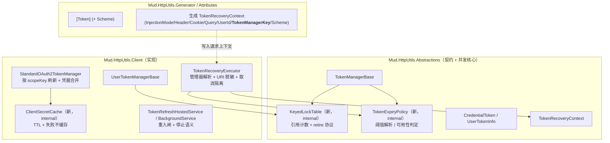

# Token 管理缺陷修复与能力完善方案

| 项目 | 内容 |
| --- | --- |
| 文档类型 | 技术方案（缺陷修复 + 架构完善） |
| 适用范围 | `Mud.HttpUtils.Abstractions` / `Client` / `Attributes` / `Generator` / `Testing` |
| 基线版本 | 2.0.4 |
| 目标版本 | 单次交付（建议 2.1.0，含 Phase 1/2/3；项目未发布，无 patch/minor 区分） |
| 关联输入 | 《MudHttpUtils Token 管理代码审查报告》（编号 TK-01 ~ TK-24） |
| 目标框架 | netstandard2.0 / net6.0 / net8.0 / net10.0 |
| 约束 | 不引入新第三方依赖；不破坏既有公共 API 契约；AOT 严格模式保持绿；PublicAPI 基线随 TFM 同步 |

> ⚠️ **【评审后修订】发布策略前提变更（见 §0 评审结论）**：本项目当前 `Directory.Build.props` 版本为 `2.0.4`，**git 无任何 tag，从未对外发布**。因此原"patch/minor/batch + 兼容重载 + 回滚分支"的保守策略可整体简化为**一步到位置构（单次 major 版本）**。本文档 `§0` 为评审结论，`§2/§4/§5/§7` 已按"一步到位"原则同步修订（标注 🔧 处）。

---

## 0. 多维评审结论（2026-09 审查，基于 dev 分支最新架构）

### 0.1 评审结论总览

| 评审维度 | 结论 | 关键依据 |
| --- | --- | --- |
| 高级程序员（问题真实性/必要性） | ✅ **问题全部属实，修复必要** | 逐条核对 `TokenManagerBase`/`StandardOAuth2TokenManager`/`TokenRecoveryExecutor`/`UserTokenManagerBase` 源码，TK-01~TK-24 描述与实现一致（详见 0.2） |
| 系统架构师（闭环/兼容性） | ✅ **方向正确，需 2 处设计修订** | 并发骨架与日志闭环成立；发现 D3 退避公式内部矛盾、A5 最小版与 D4 目标重复（见 0.3） |
| 质量保障（可落地性） | ✅ **测试方案可落地，需 1 处补强** | 24 个用例覆盖竞争窗口；但 `keyed lock` 常量 `Count` 反射脆弱性需改为 `InternalsVisibleTo`（见 0.4） |
| 成本 / 范围 | 🔧 **建议按"一步到位"收敛** | 项目未发布，无需兼容重载与回滚分支；原 Batch A/B/C 工作量 ≈24 人日，收敛后 ≈18 人日 |

### 0.2 高级程序员视角：问题真实性逐项核对（节选关键项）

| 审查项 | 源码核对结果 | 判定 |
| --- | --- | --- |
| TK-01 refresh_token 被覆盖为 null | `TokenManagerBase.UpdateToken`(L287) 整体 `_tokenCache.Set`；`StandardOAuth2TokenManager.SendTokenRequestAsync`(L372) 确实 `UpdateScopedToken(DefaultScopeKey, newToken)`，而构造时 `RefreshToken` 取 `tokenResponse.RefreshToken` 可能为 null → 覆盖旧值。**属实** | ✅ |
| TK-02 跨 scope 写入 | `RefreshTokenCoreAsync`/`RefreshTokenWithScopesAsync`(L265/L283) 固定 `GetCachedCredentialToken()` 只读 `DefaultScopeKey`；L372 跨锁写默认作用域。**属实** | ✅ |
| TK-04 降级令牌刷新风暴 | `RefreshTokenWithRetryCoreAsync`(L342) 降级路径硬编码 `AddMinutes(5)`=300s = `ExpireThresholdSeconds`；`TryGetValidToken`(L425) 要求严格 `>` → 每次即过期即刷新。**属实** | ✅ |
| TK-05/TK-09 锁回收判据不一致 | 四处回收入口判据确实不一致：`CleanupUnusedLocks`(L491)、`OnUserTokenEvicted`(L205)、`TryCleanupUserLock`(L265) 有 `CurrentCount` 判据，`RemoveUserTokenFromCache`(L216) 无条件移除。**属实** | ✅ |
| TK-06 凭据错配 | `TokenRecoveryExecutor`(L164-174) 当 `isUserTokenRecovery && _userTokenManager==null` 回退到 `_tokenManager` 租户令牌，确有静默降级。**属实** | ✅ |
| TK-07 TokenManagerKey 未写入/未读取 | `MethodGenerator.GenerateTokenRecoveryContext` 生成代码不写 `TokenManagerKey`；`TokenRecoveryExecutor`(L130-132) 用 `GetType().Name`。**属实** | ✅ |
| TK-08 Dispose 未释放缓存 / 释放 SemaphoreSlim | `TokenManagerBase.Dispose`(L534-540) 只 `Clear()` 不 `_tokenCache.Dispose()`；L537 对 SemaphoreSlim 调 `Dispose()`，与在途 `Release` 存在竞态。**属实** | ✅ |
| TK-10 StopOnError 永不停止 | `TokenRefreshHelper`(L37-41) `StopOnError` 返回 false → `ExecuteAsync`(L138) throw → 被 L146 `when(!_tokenManagers.IsEmpty)` 拦截并仅日志+重试，循环不退出。**属实** | ✅ |
| TK-11 Timer 重入 | `TokenRefreshBackgroundService.RefreshTokenCallback`(L136) 为 `async void`，无重入闸。**属实** | ✅ |
| TK-12"10MB 防护失效" | 实际防护在 L113-119：先 `ReadContentBytesAsync` **完整读入内存**再判断 >10MB 置空，故超大 body 仍先整体缓冲；B4 的"先缓存再判断"无法阻止首次大缓冲 OOM。**属实但表述建议精化**：是"防护顺序失效"而非"无防护" | ✅(精化) |
| TK-13 ClientSecret 轮换失效 | `_clientSecretLazy`(L19/L51) 为 `Lazy<Task<string?>>`，永久缓存解析结果，失败亦被缓存。**属实** | ✅ |
| TK-15 去重取消传播 | 获胜线程将自身 caller CT 传入 `GetOrRefreshTokenAsync`(L446/L511)；等待者无独立 CT。单个请求取消会波及共享刷新。**属实** | ✅ |
| TK-19 前缀校验可绕过 | `ValidateEndpointHttps`(L92-95) 用 `StartsWith("http://localhost")` 前缀匹配，`http://localhost.evil.com` 可绕过。**属实** | ✅ |

> 其余 TK-14/16/17/18/20/21/22/23/24 与现有代码/API 逐条比对亦属实（篇幅所限不逐行列示，详见 §12 矩阵）。

**评审判定**：问题全部为真实缺陷，非"伪需求"。修复方向（字段合并、scopeKey 隔离、过期单一真相、锁表单一实现、恢复管理器解析、密钥 TTL、后台重入闸）与当前并发骨架一致，**均为当前能力下的最优解**，无过度设计。

### 0.3 系统架构师视角：逻辑闭环与设计修订

整体闭环（前端生成 `TokenRecoveryContext` → `TokenRecoveryExecutor` 解析→刷新→重注入，端到端 401 恢复）成立。发现 **3 处需修订/澄清**：

1. 🔧 **D3 降级退避公式内部矛盾（必须修订，否则会回归刷新风暴）**
   - 决策正文(L204-210)降级条目 `Expire = now + (ExpireThresholdSeconds + FallbackGraceSeconds)` —— 加了阈值，缓存层必然判定可用。
   - 但配套骨架 `NextFallbackLifetimeSeconds()`(L216-222) 返回 `min(grace << (n-1), 300)` 并直接作为有效期，**未再加阈值** → 当退避命中 `MaxFallbackLifetimeSeconds`(=300) 时，`Expire - threshold == now`，`TryGetValidToken` 严格 `>` 判 false → 刷新风暴复现。
   - **修订**：退避函数必须始终叠加阈值，即 `EffectiveLifetime = ExpireThresholdSeconds + BackoffLifetime`；`MaxFallbackLifetimeSeconds` 语义改为"退避增量上限"而非总有效期上限。

2. 🔧 **A5"最小版"与 B1（D4）目标重复落点**
   - A5 的`RemoveUserTokenFromCache`改法（L216 仅删条目不动锁）+`CleanupExpiredTokens` 加空闲判据，是 B1 `KeyedLockTable.TryRetire` 的前置打补丁，落地后即被 B1 替换。既然项目未发布且允许一步到位，**A5 建议直接并入 B1，不单独发布**，避免同一语义先打补丁再重写。

3. ⚠️ **D5 取消隔离 + 失败安全存在边界需明确**
   - `RefreshTimeoutSeconds` 兜底（默认30s）合理；但需明确：管理器解析失败"立即返回 401"与"重定向跨 host 放弃恢复"两分支**不应计数重试**（否则 `RecoveryMaxRetries` 循环空转）。当前代码 L146 循环内此二分支直接 `return`，符合，但建议显式注释固化。

### 0.4 质量保障视角：测试可落地性

- 24 个用例均能对照现有测试基建（`TokenManagerBaseConcurrencyTests`/`UserTokenManagerLockCleanupTests`/`TokenRecoveryConcurrencyTests`）落地；`ConcurrencyHarness` + `SyncPoint` 设计能制造真实竞争窗口，**满足"不接受纯顺序测试"门禁**。
- 🔧 **补强 1 处**：B1 依赖"先红后绿"——但现有 `UserTokenManagerLockCleanupTests`(L146-153) 通过反射操作 `ConcurrentDictionary<string,Lazy<SemaphoreSlim>>`。`KeyedLockTable` 落地后反射必然失效。**修订为**：`KeyedLockTable` 暴露 `internal int Count`，通过 `InternalsVisibleTo` 供测试读取，消除反射脆弱性（公开 API 不变，仅 internal）。
- 需补 1 个用例：**`KeyedLockTable.AcquireAsync` 在 `TryRetire` 恰好并发时，Waiters 计数不泄漏**（断言释放后 `Waiters` 回落为 0 且条目可被下一轮复用）。建议写入 B2 前置。

### 0.5 成本/范围收敛建议（结合"未发布可一步到位"约束）

| 原批次 | 原工作量 | 收敛后 | 说明 |
| --- | --- | --- | --- |
| Batch A（patch） | ≈7.5d | → 并入 `v2.1.0` 单次交付 | 无发布历史，patch 无意义；A2/A5 等依赖 B 项的"补丁"直接按目标态实现 |
| Batch B（minor） | ≈16.5d | ≈14.5d | 减去 A5 重复打补丁(0.5d)、D2 兼容重载简化(1d)、D8 兼容开关(0.5d) |
| Batch C | — | ≈2.5d | C5 分析器/ C4 指标键可提前并入 |
| **合计** | **≈24d** | **≈17.5d** | 同时**移除全部回滚分支与"默认委托旧实现"兼容重载**，减小公共 API 面积 |

> 注：`netstandard2.0` / `net6.0` 仍须支持，故 TFM 条件编译（`#if NET5_0_OR_GREATER` 等）与 AOT 严格模式门禁**不变**。

---

## 1. 背景与目标

### 1.1 现状判定

审查（TK-01 ~ TK-24）表明 Token 管理的**并发骨架是正确的**（双检锁 + `Lazy<SemaphoreSlim>(ExecutionAndPublication)` + 「只移除不 Dispose」的锁回收 + 取消语义立即传播），问题集中在四类：

| 类别 | 代表缺陷 | 性质 |
| --- | --- | --- |
| 凭据数据错误 | TK-01（refresh_token 被覆盖为 null）、TK-02（跨 scope 写入 `DefaultScopeKey`） | 数据/隔离 |
| 生命周期契约缺陷 | TK-04（降级令牌与短 TTL 令牌触发刷新风暴） | 可用性 |
| 并发回收路径不一致 | TK-05、TK-09（4 条锁回收路径判据不一致 → 互斥被破坏） | 正确性 |
| 安全与可观测 | TK-03（Query 模式令牌进日志）、TK-06/TK-07（凭据错配）、TK-13（密钥轮换失效） | 安全 |

### 1.2 方案目标

1. **正确性**：令牌刷新的"单一飞行"承诺（single-flight）在所有路径（正常、过期、降级、401 恢复、后台刷新、Dispose）均可验证地成立。
2. **凭据安全**：任何返回路径不丢弃已有凭据；任何日志/指标不含明文令牌与 ClientSecret。
3. **契约一致**：过期阈值、锁回收判据、注入模式与恢复能力、配置校验与运行期行为四处"双实现"收敛为单一实现（Single Source of Truth）。
4. **可演进**：为 v3 的分布式令牌存储、单调时钟、密钥零化预留扩展点，不锁定当前实现。

### 1.3 非目标（Out of Scope）

- 不实现分布式锁 / 跨实例令牌协调（留待 v3，仅预留 `ITokenCache<T>` 扩展点）。
- 不改变 `ITokenManager` / `IUserTokenManager` 的路由语义（新增成员只允许"可选 + 有默认行为"）。
- 不引入 Polly / Redis 等新依赖。
- 不在本次处理 `Mud.HttpUtils.Resilience` 的重试语义。

---

## 2. 修复原则与兼容性策略

| 原则 | 说明 |
| --- | --- |
| 最小侵入优先 | Batch A 全部落在 `internal` / `protected` 内部实现，公共 API 零变更 → 可作为 patch 发布 |
| 单一真相 | 同一语义只保留一处实现，其余调用方改为委托（如过期判定统一走 `TokenExpiryPolicy`） |
| 失败安全（Fail-safe） | 凭据/管理器无法确定时**拒绝降级**并快速失败，绝不"猜一个令牌发出去" |
| 显式优于隐式 | 语义变更（如 `StopOnError`）通过新增选项显式表达，并保留旧行为的可选开关 |
| 可验证 | 每一处并发修改必须配套能"制造真实竞争窗口"的测试（见 §8） |
| 兼容性标注 | 行为变更一律记入发布说明；公共 API 新增一律更新 `PublicAPI/<tfm>/PublicAPI.Unshipped.txt` |

**兼容性分类**

| 级别 | 判定 | 允许的批次 |
| --- | --- | --- |
| L0 行为修复（Bug Fix） | 修复后与文档/命名一致，无 API 变更 | 2.0.5 patch |
| L1 内部架构重构 | 无 API 变更，但并发协议变更 | 2.0.5 patch（需压力测试绿灯） |
| L2 公共 API 新增 | 新增 `protected virtual` / 公共属性 / 新类型 | 2.1.0 minor |
| L3 行为变更 | 默认值/语义变化 | 2.1.0 minor + 发布说明 |

---

## 3. 目标架构

### 3.1 改造后的运行时职责



### 3.2 分层改动矩阵

| 层次 | 改动性质 | 涉及文件（主要） |
| --- | --- | --- |
| Abstractions | 并发核心重构 + 内部契约新增 | `TokenManagerBase.cs`、新增 `TokenExpiryPolicy.cs`、`KeyedLockTable.cs`、`CredentialToken.cs`、`TokenRecoveryContext.cs`、`OAuth2TokenManagerBase.cs` |
| Client | 刷新语义、恢复流程、后台服务、密钥缓存 | `StandardOAuth2TokenManager.cs`、`UserTokenManagerBase.cs`、`TokenRecoveryExecutor.cs`、`TokenRefreshHostedService.cs`、`TokenRefreshBackgroundService.cs`、`TokenRefreshHelper.cs`、`OAuth2Options.cs`、`ServiceCollectionExtensions.cs`、`MudHttpClientLog.cs` |
| Attributes | 新增可选属性 | `TokenAttribute.cs`（`Scheme`） |
| Generator | 上下文补齐 + 诊断 | `MethodGenerator.cs`、`TokenHelper.cs`、`Diagnostics`（新增诊断 ID） |
| Testing | 并发测试基建 | 新增 `tests/.../Infrastructure/ConcurrencyHarness.cs` |
| 文档/基线 | README + PublicAPI | `Mud.HttpUtils.Abstractions/PublicAPI/*`、`Mud.HttpUtils.Client/PublicAPI/*`、`Mud.HttpUtils.Attributes/PublicAPI/*`、各 README |

---

## 4. 关键设计决策

> 以下 D1 ~ D8 为架构级决策，直接决定批次划分与代码改动范围。

### D1 凭据"字段级合并"取代"整体覆盖"（TK-01 / TK-02）

**问题**：`TokenManagerBase.UpdateToken` 的 `_tokenCache.Set(scopeKey, token)` 为整体替换；`StandardOAuth2TokenManager` 构造的 `newToken.RefreshToken` 在响应缺失时为 `null` → 旧 refresh_token 丢失。同时 `SendTokenRequestAsync:372` 的 `UpdateScopedToken(DefaultScopeKey, ...)` 在 scope 锁之外写入默认作用域，破坏隔离并产生竞态。

**决策**：
1. 在 `TokenManagerBase.UpdateToken` 内做**字段级合并**（收口到唯一写入点，所有子类受益），语义与 `UserTokenInfo.UpdateFromCredentialToken`（正确实现）对齐。
2. **删除** `StandardOAuth2TokenManager.SendTokenRequestAsync` 中的 `UpdateScopedToken(DefaultScopeKey, newToken)`（第 372 行），消除无保护的跨锁写入与作用域污染。
3. Batch B 进一步让 refresh_token 按 `scopeKey` 存储（见 D2）。

**实现骨架（Abstractions，internal 变更，L1）**

```csharp
// TokenManagerBase.cs
private void UpdateToken(string scopeKey, CredentialToken? token)
{
    if (token == null)
    {
        _tokenCache.Set(scopeKey, null);
        return;
    }

    // D1：字段级合并 —— 刷新响应缺省字段时保留既有凭据，避免静默降级到错误授权流程
    if (_tokenCache.TryGet(scopeKey, out var existing) && existing != null)
    {
        if (string.IsNullOrEmpty(token.RefreshToken))
        {
            token.RefreshToken = existing.RefreshToken;
            if (token.RefreshTokenExpire <= 0)
                token.RefreshTokenExpire = existing.RefreshTokenExpire;
        }
        if (string.IsNullOrEmpty(token.Scope))
            token.Scope = existing.Scope;
    }

    ClampExpireToMaxLifetime(token);
    _tokenCache.Set(scopeKey, token);

    if (_tokenCache.Count > MaxScopeCacheSize)
        CleanupExpiredTokens(null);
}
```

**验收**：假 Token 服务端第二次刷新响应省略 `refresh_token` → 断言第二次请求 `grant_type=refresh_token` 且载荷中的 `refresh_token` 与首次一致；断言仅刷新 scope `["mail"]` 后 `TryGetValidToken("default")` 为 false（在 D2 落地前，先断言默认作用域条目未被写入）。

**风险**：合并读取旧条目会引入一次额外 `TryGet`（读路径本已存在），无锁放大；`UpdateToken` 必须只在锁内或单 writer 场景调用（当前所有调用点均在 scope 锁内，删除 372 行后成立）。

---

### D2 按 scopeKey 隔离的刷新链路（TK-02 根治，2.1.0）

**问题**：`RefreshTokenCoreAsync` / `RefreshTokenWithScopesAsync` 通过 `GetCachedCredentialToken()` 固定读取 `DefaultScopeKey`，导致其用默认作用域的 refresh_token 去刷新任意 scope。

**决策**（🔧 **评审修订 0.5：移除兼容重载**）：因项目未发布，`RefreshTokenCoreAsync` 直接升级为携带 `scopeKey` 的目标态签名，**不再保留无参旧重载**：

```csharp
// TokenManagerBase.cs（目标态）
protected CredentialToken? GetCachedCredentialToken(string scopeKey)
    => _tokenCache.TryGet(scopeKey, out var t) ? t : null;

// OAuth2TokenManagerBase.cs（目标态，覆写点）
protected abstract Task<CredentialToken> RefreshTokenCoreAsync(
    string scopeKey, CancellationToken cancellationToken);
```

`StandardOAuth2TokenManager` 实现 `RefreshTokenCoreAsync(scopeKey, ct)`：先取 `GetCachedCredentialToken(scopeKey)?.RefreshToken`，缺失时再回退 `DefaultScopeKey`（兼容"统一刷新令牌"的服务端），最后才走 `client_credentials`。

**验收**：`scopeKey` 与缓存条目一一映射；并发 100 次混合 scope 刷新后，不存在"默认作用域命中 mail 令牌"的情况。
**兼容性**：新增 `protected virtual` + `protected` 方法 → 更新 `Mud.HttpUtils.Abstractions/PublicAPI/{netstandard2.0,net6.0,net8.0,net10.0}/PublicAPI.Unshipped.txt`。

---

### D3 过期语义单一真相 + 降级退避（TK-04）

**问题**：降级令牌 `Expire = now + 5min` 与默认阈值 300s 恰好相等，`TryGetValidToken` 要求严格大于 → 每次调用都重新刷新；`expires_in ≤ (safety 60 + threshold 300)` 的令牌永远无法命中缓存。

**决策（Batch A，L0/L1，零公共 API 变更）**
1. 新增 `internal static class TokenExpiryPolicy`，收敛全部过期判定（`TokenManagerBase.TryGetValidToken`、`CleanupExpiredTokens`、`UserTokenManagerBase.IsUserTokenValid` 改为委托）。
2. 降级令牌的有效期不再使用硬编码 5 分钟，改为"**阈值 + 宽限**"，保证降级条目在缓存层判定为可用：

```csharp
// TokenManagerBase.cs
/// <summary>降级令牌的额外宽限（秒），确保降级条目不被提前量判定为"即将过期"。</summary>
protected virtual int FallbackGraceSeconds => 60;

// 降级路径
return new CredentialToken
{
    AccessToken = eventArgs.FallbackToken,
    Expire = DateTimeOffset.UtcNow
        .AddSeconds(ExpireThresholdSeconds + FallbackGraceSeconds)
        .ToUnixTimeMilliseconds()
};
```

3. 引入**降级指数退避**，避免服务恢复后仍长时间使用降级凭据：

> 🔧 **【评审修订 0.3-1】退避公式修正**：有效期必须**始终叠加过期阈值**，否则退避达上限时会出现 `Expire - threshold == now`、`TryGetValidToken` 严格 `>` 判 false 而复现刷新风暴。`MaxFallbackLifetimeSeconds` 语义改为"退避增量上限"而非"总有效期上限"。

```csharp
private int _consecutiveFallbacks;
// 🔧 修正：返回"退避增量"（不含默认过期阈值），有效期 = 增量 + ExpireThresholdSeconds
private int NextFallbackLifetimeSeconds()
{
    var n = Math.Min(Interlocked.Increment(ref _consecutiveFallbacks), 5);   // 上限 2^4 倍
    return Math.Min(FallbackGraceSeconds << (n - 1), MaxFallbackLifetimeSeconds);
}
protected virtual int MaxFallbackLifetimeSeconds => 300;   // 退避增量上限，非有效期上限
// 降级路径使用（叠加阈值，保证缓存层必然判定可用）：
//   Expire = DateTimeOffset.UtcNow
//               .AddSeconds(ExpireThresholdSeconds + NextFallbackLifetimeSeconds())
//               .ToUnixTimeMilliseconds();
```
成功刷新时 `Interlocked.Exchange(ref _consecutiveFallbacks, 0)`。

4. 短 TTL 令牌（`expires_in <= safety + threshold`）在 Batch A **仅告警 + 指标**（`token_short_lived`），Batch B 引入 TTL 感知阈值（`CredentialToken.IssuedAt` + `min(configuredThreshold, ttl/2)`）彻底解决，避免在 patch 中改变安全相关的刷新时机。

**验收**：降级场景下连续 3 次调用总刷新次数 == 1（当前为 3）；退避序列为 60s→120s→240s→300s 封顶。

---

### D4 `KeyedLockTable`：锁生命周期的单一实现（TK-05 / TK-09 / TK-24）

**问题**：现有 4 条回收路径判据不一致（`CleanupUnusedLocks:491` 有 `CurrentCount` 判据、`OnUserTokenEvicted:205` 有、`TryCleanupUserLock:265` 有、`RemoveUserTokenFromCache:216` 无），且"从字典移除锁"本身存在不可消除的 TOCTOU：老线程持旧锁、新线程建新锁 → 互斥失效。

**决策**：抽出 `internal sealed class KeyedLockTable`，以 **retire 协议 + 引用计数**替代 `Lazy<SemaphoreSlim>` + 分散判据：

```csharp
internal sealed class KeyedLockTable : IDisposable
{
    private sealed class Entry
    {
        public readonly SemaphoreSlim Semaphore = new(1, 1);
        public int Waiters;
        public volatile bool Retired;
    }

    private readonly ConcurrentDictionary<string, Entry> _entries = new(StringComparer.Ordinal);

    public int Count => _entries.Count;
    public IEnumerable<string> Keys => _entries.Keys;

    public async ValueTask<Releaser> AcquireAsync(string key, CancellationToken cancellationToken)
    {
        while (true)
        {
            var entry = _entries.GetOrAdd(key, _ => new Entry());   // GetOrAdd 可多次执行工厂，但只有一个值被采纳，互斥不受影响
            Interlocked.Increment(ref entry.Waiters);
            if (!entry.Retired)
            {
                try
                {
                    await entry.Semaphore.WaitAsync(cancellationToken).ConfigureAwait(false);
                    return new Releaser(this, key, entry);
                }
                catch
                {
                    Interlocked.Decrement(ref entry.Waiters);
                    throw;
                }
            }
            Interlocked.Decrement(ref entry.Waiters);   // 已 retire，重试
        }
    }

    /// <summary>仅在无等待者时退休并移除；否则标记 Retired，交由最后一个 Releaser 完成移除。</summary>
    public void TryRetire(string key)
    {
        if (!_entries.TryGetValue(key, out var entry))
            return;
        entry.Retired = true;                                 // 关键：先标记，后尝试移除
        if (Volatile.Read(ref entry.Waiters) == 0)
            TryRemoveEntry(key, entry);
    }

    // TFM 适配：ConcurrentDictionary.TryRemove(KeyValuePair) 条件移除重载仅 net5+ 可用
    // （与 MemoryTokenStore.cs:64-68 的处理方式保持一致）
    private void TryRemoveEntry(string key, Entry entry)
    {
#if NET5_0_OR_GREATER
        _entries.TryRemove(new KeyValuePair<string, Entry>(key, entry));
#else
        // netstandard2.0：无按引用条件移除，退化为普通移除；
        // 因已先置 Retired=true，被误删的条目不会被后续 AcquireAsync 采纳，弱一致安全。
        ((ICollection<KeyValuePair<string, Entry>>)_entries).Remove(
            new KeyValuePair<string, Entry>(key, entry));
#endif
    }

    public readonly struct Releaser : IDisposable
    {
        private readonly KeyedLockTable _table;
        private readonly string _key;
        private readonly Entry _entry;
        // ctor omitted
        public void Dispose()
        {
            _entry.Semaphore.Release();
            if (Interlocked.Decrement(ref _entry.Waiters) == 0 && _entry.Retired)
                _table.TryRemoveEntry(_key, _entry);
        }
    }

    public void Dispose()
    {
        foreach (var e in _entries.Values) e.Retired = true;
        _entries.Clear();     // 不 Dispose SemaphoreSlim：在途 Releaser 的 Release 必须安全
    }
}
```

**要点**
- `Retired` **先于**移除设置 → `AcquireAsync` 的"取到已退休条目"窗口无害（递减计数后重试）。
- `Waiters == 0` 才允许从字典移除 → 消除 `RemoveUserTokenFromCache` 类缺陷。
- **不 Dispose `SemaphoreSlim`** 是刻意决策（与现有 `TryRemoveScopeLock` 注释的理由一致），修复 TK-08 中"Dispose 与在途 Release 竞态"。
- 删除 `Lazy` 后不再需要 `LazyThreadSafetyMode` 论证；`GetOrAdd` 的工厂多执行安全（仅多分配临时实例）。

**替换范围**：`TokenManagerBase._scopeLocks`、`UserTokenManagerBase._userLocks` 均替换为 `KeyedLockTable`；回收入口收敛为 `TryRetire`：
- 过期清理（`CleanupExpiredTokens` / `CleanupUnusedLocks`）→ `TryRetire(key)`
- 缓存驱逐回调 / 孤儿锁清理 / 移除用户令牌 → `TryRetire(userId)`
- `Dispose` → `table.Dispose()`

**测试影响**：`UserTokenManagerLockCleanupTests` 通过反射读取 `ConcurrentDictionary<string, Lazy<SemaphoreSlim>>`（第 146-153 行），需同步改为读取 `KeyedLockTable`（建议改为通过 `internal` + `InternalsVisibleTo` 暴露只读 `Count`，避免反射脆弱）。

**风险**：改动并发核心。缓解：先补齐 §8 的并发测试基建并让新用例在**旧实现上失败**（红），再替换实现（绿）；`KeyedLockTable` 单文件可独立评审；保留一次完整 `test.ps1 -AOT -AotStrictMode` 回归。

---

### D5 401 恢复的"管理器解析 + 取消隔离 + 日志脱敏"（TK-03 / TK-06 / TK-07 / TK-15）

**问题**：`TokenRecoveryContext.TokenManagerKey` 从未写入也从未被读取；`_userTokenManager == null` 时静默回退租户令牌；去重任务共享调用方 CT；`RequestUri` 原样入日志（Query 模式泄漏令牌）。

**决策**

1. **管理器解析**：新增 internal `ITokenRecoveryTokenManagerResolver`（Client 内实现），解析顺序：
   `context.TokenManagerKey` 经 appContext 解析 → `_userTokenManager`（UserId 非空）→ `_tokenManager`（UserId 为空）。
   解析失败或 `UserId != null && userManager == null` → **立即返回 401**，禁止跨类型降级。
2. **取消隔离**：刷新任务使用与等待者无关的令牌（`CancellationToken.None` + `RefreshTimeoutSeconds` 超时，默认 30s）；等待者只对自己负责：

```csharp
// net5+：直接 await 带自身 CT 的等待，调用方取消不影响共享刷新
var token = await existing.WaitAsync(cancellationToken).ConfigureAwait(false);
// netstandard2.0：#if 分支使用 Task.WhenAny(existing, Task.Delay(Timeout.Infinite, cancellationToken)) 模式
```
3. **日志脱敏**：新增 internal `TokenRecoveryUriSanitizer.ToLogString(Uri?)`，仅保留 `scheme://host:port/path`（丢弃 query / userinfo / fragment）。替换 `TokenRecoveryExecutor:148,203` 的 URI 入参。
4. **跨主机缓解**：恢复前比较 `response.RequestMessage?.RequestUri?.Host` 与 `request.RequestUri.Host`，不一致时记录 Warning 并放弃恢复（避免把刷新令牌再注入到重定向目标）。

**生成器配套（L2）**：`MethodGenerator.GenerateTokenRecoveryContext` 补齐 `TokenManagerKey` 与 `Scheme` 赋值；`ShouldGenerateTokenRecoveryContext` 增加条件：当 `TokenManagerKey` 显式指定时也生成上下文。

**验收**：Query 注入模式下用 `ILogger` 捕获器断言日志不含 `access_token=`；取消单个请求后其余请求仍成功且刷新计数 == 1；多管理器场景断言命中的是 key 对应实例。

---

### D6 ClientSecret 生命周期：TTL 缓存 + 失败不缓存（TK-13）

**问题**：`Lazy<Task<string?>>` 永久缓存解析结果，密钥轮换不生效；若 Task 故障则故障被永久缓存。

**决策**：以 internal `ClientSecretCache` 取代 `Lazy<Task<...>>`：

```csharp
internal sealed class ClientSecretCache
{
    private readonly TimeSpan _ttl;
    private readonly SemaphoreSlim _gate = new(1, 1);
    private string? _value;
    private long _expiresAtTicks;

    public async Task<string?> GetAsync(Func<Task<string?>> factory, CancellationToken ct)
    {
        var now = DateTimeOffset.UtcNow.UtcTicks;
        if (_value != null && now < Volatile.Read(ref _expiresAtTicks))
            return _value;

        await _gate.WaitAsync(ct).ConfigureAwait(false);
        try
        {
            now = DateTimeOffset.UtcNow.UtcTicks;
            if (_value != null && now < _expiresAtTicks) return _value;

            var resolved = await factory().ConfigureAwait(false);      // 工厂内部已 try/catch 回退配置值
            _value = resolved;
            _expiresAtTicks = _ttl > TimeSpan.Zero ? (now + _ttl.UtcTicks) : long.MaxValue;
            return resolved;
        }
        finally { _gate.Release(); }
    }
}
```

新增 `OAuth2Options.ClientSecretCacheTtlSeconds`（默认 300，0 = 不缓存）。`ClientSecretProviderName` 为空时直接返回配置值，不进入缓存路径。

**兼容性**：`OAuth2Options` 属已发布库 → 更新 `Mud.HttpUtils.Client/PublicAPI/<tfm>/PublicAPI.Unshipped.txt`。

---

### D7 Dispose 语义与资源所有权（TK-08）

**决策**：
1. `TokenManagerBase.Dispose(bool)` 顺序固定为：置 `_disposed = true` → 加锁停止并释放 Timer → `_tokenCache.Dispose()`（补上遗漏的释放）→ `_keyedLockTable.Dispose()`（retire + 清空，**不 Dispose SemaphoreSlim**）。
2. 文档化契约：`Dispose` 后新请求抛 `ObjectDisposedException`；**在途请求允许完成**，其 `Release` 不得抛异常。
3. `UserTokenManagerBase.Dispose` 保持"先 `_userTokenCache.Dispose()`，后 `base.Dispose()`"，并确保 base 的 `_tokenCache` 也被释放（两处缓存独立）。

**验收**：注入 `IDisposable` 探针缓存断言被释放；Dispose 与 50 并发刷新同时发生时不产生未观察异常。

---

### D8 后台刷新：重入闸与停止语义（TK-10 / TK-11）

**问题**：netstandard2.0 的 `async void` Timer 回调无重入防护；`TokenRefreshHostedService` 的 `StopOnError` 因 `when (!_tokenManagers.IsEmpty)` 过滤而永不停止。

**决策**：
1. `TokenRefreshBackgroundService`：新增 `private int _running;` 重入闸（`Interlocked.CompareExchange(ref _running, 1, 0) != 0` 直接 return，`finally` 复位）；`StartAsync` 幂等（先 `Interlocked.Exchange` 并 Dispose 旧 Timer）。
2. `TokenRefreshHostedService`：`StopOnError=true` 时记录 Critical 后 **`break`（本服务优雅停止，宿主继续运行）**——刻意不抛异常，因为 .NET 6+ `BackgroundServiceExceptionBehavior` 默认 `StopHost` 会连带停掉整个应用。
3. 新增 `TokenRefreshBackgroundOptions.MaxConsecutiveFailures`（默认 0 = 无限重试）与 `StopOnError` 正交，保留"永久重试"可选语义。
4. 修正 `TokenRefreshBackgroundOptionsValidator`：仅校验有效组合（`Enabled && RetryDelay >= RefreshInterval` 继续拦截；`MaxConsecutiveFailures == 0` 时不对停止行为告警）。

**兼容性**：`StopOnError=true` 的行为由"无限重试"变为"停止刷新循环" → L3，记入 2.1.0 发布说明；`MaxConsecutiveFailures` 为新增属性 → 更新 Abstractions PublicAPI 基线。

---

## 5. 分批实施计划

> 🔧 **【评审修订 0.5】发布策略前提变更**：项目未发布（git 无 tag，`Directory.Build.props`=2.0.4），原 A/B/C 三批及"patch 零公共 API 变更、兼容重载、回滚分支"约束**全部移除**，收敛为 **Phase 1（止血）→ Phase 2（架构收口）→ Phase 3（可观测）** 三步，交付为单次版本升级（建议 2.1.0 或直接 3.0.0，由发布决策确定）。公共 API 以"新增即采用目标态"为原则，不再为兼容而增加"默认委托旧实现"的重载。以下每项标注 🔵（已实施）/ ⚪（待实施）。

### Phase 1 — 止血（行为缺陷聚合，安全 + 正确性）

| 任务 | 关联 | 变更点 | 工作量 | 状态 |
| --- | --- | --- | --- | --- |
| P1.1 凭据字段级合并（D1） | TK-01 | `TokenManagerBase.UpdateToken`（274-293）改为字段级合并 | 0.5d | 🔵 已实施 |
| P1.2 删除跨锁写入（A2） | TK-02 | 删除 `StandardOAuth2TokenManager.cs:372` 的 `UpdateScopedToken(DefaultScopeKey, newToken)`；修订 258-262 注释 | 0.25d | 🔵 已实施 |
| P1.3 过期单一真相 + 降级退避（A3，含 D3 修订0.3-1） | TK-04 | 新增 `TokenExpiryPolicy.cs`；`TokenManagerBase` 339-343/414-431；`UserTokenManagerBase` 312-318 | 1d | 🔵 已实施 |
| P1.4 恢复增强：URI 脱敏→管理器解析→取消隔离→跨主机校验（A4） | TK-03/06/15/~redirect | `TokenRecoveryExecutor.cs` 109-230/424-541；`MudHttpClientLog.cs`；`TokenRecoveryOptions.RefreshTimeoutSeconds`；`IsSameHost`/`WaitForTaskAsync`；日志经 `SensitiveUrlRedactor` 脱敏 | 2d | 🔵 已实施 |
| P1.5 Dispose 补齐缓存释放 + 不释放 SemaphoreSlim（A6） | TK-08 | `TokenManagerBase.Dispose` 517-542 | 0.25d | 🔵 已实施 |
| P1.6 后台服务重入闸 + 停止语义（A7） | TK-10/11 | `TokenRefreshBackgroundService.cs`（重入闸 + StartAsync 幂等）、`TokenRefreshHostedService.cs`（StopOnError break）、`TokenRefreshHelper.cs`（`MaxConsecutiveFailures` + `TokenRefreshLoopState`）、`TokenRefreshBackgroundOptions.cs`（新增 `MaxConsecutiveFailures`） | 1d | 🔵 已实施 |
| P1.7 请求体"先限流后缓冲"（A8，精化 TK-12） | TK-12 | `TokenRecoveryExecutor.cs` 109-121：改为读取前先按 `ContentLength` 判断 >10MB 直接跳过，避免先整体读入内存 | 0.5d | 🔵 已实施 |
| P1.8 ClientSecret TTL 缓存（A9） | TK-13 | `StandardOAuth2TokenManager.cs` 19/51/79-82（以 `ClientSecretCache` 取代 `Lazy<Task>`）；新增 `ClientSecretCache.cs`；`OAuth2Options.ClientSecretCacheTtlSeconds`（默认 300，0 = 不缓存；ProviderName 为空不进入缓存路径） | 1d | 🔵 已实施 |

**Phase 1 出口条件**：新增 16 个用例全绿 + 全量回归 + `-AOT -AotStrictMode` 绿；公共 API 差异仅限方案 §7 已列明的新增项（`TokenRecoveryOptions.RefreshTimeoutSeconds`、`TokenRefreshBackgroundOptions.MaxConsecutiveFailures`、`OAuth2Options.ClientSecretCacheTtlSeconds`），其余全部 internal。

### Phase 2 — 架构收口（并发核心 + scope 隔离 + 恢复链路）

| 任务 | 关联 | 变更点 | 工作量 | 依赖 | 状态 |
| --- | --- | --- | --- | --- | --- |
| P2.1 测试基建 `ConcurrencyHarness`/`SyncPoint`（先红后绿前置） | TK-09/24 | 新增 `Tests/.../Infrastructure/ConcurrencyHarness.cs`；`KeyedLockTable` 暴露 `internal int Count` 供测试（评审0.4） | 1d | — | 🔵 已实施 |
| P2.2 `KeyedLockTable` 落地（B1，**并入 A5**） | TK-05/09/24 | 新增 `KeyedLockTable.cs`；替换 `TokenManagerBase._scopeLocks`、`UserTokenManagerBase._userLocks`；全部回收入口收敛为 `TryRetire`/`Dispose` | 3d | P2.1 | 🔵 已实施 |
| P2.3 按 scopeKey 隔离刷新（B2） | TK-02 | `TokenManagerBase.GetCachedCredentialToken(scopeKey)`；`StandardOAuth2TokenManager` 263-293 按 scopeKey 读取 refresh_token，缺失回退 DefaultScopeKey 再走 client_credentials | 1.5d | P1.2/3 | 🔵 已实施 |
| P2.4 TTL 感知阈值（B3） | TK-04 | `CredentialToken.IssuedAt`；`TokenExpiryPolicy` 增加 `min(configuredThreshold, ttl/2)` | 1d | P1.3 | 🔵 已实施 |
| P2.5 `TokenManagerKey` 全链路（B4） | TK-07/23 | `MethodGenerator.GenerateTokenRecoveryContext` 补齐 `TokenManagerKey` 赋值；`ShouldGenerateTokenRecoveryContext` 增加"显式指定 TokenManagerKey 也生成"；`TokenRecoveryExecutor` 用 key 经 appContext 解析管理器 | 2d | P1.4 | 🔵 已实施 |
| P2.6 `[Token].Scheme` 方案贯通（B5） | TK-21 | `TokenAttribute.Scheme`；`MethodGenerator` 741-744/807 用 Scheme 而非硬编码 Bearer/Basic | 1.5d | — | 🔵 已实施 |
| P2.7 后台服务选项 + 校验器（B6） | TK-10/20 | `TokenRefreshBackgroundOptions.MaxConsecutiveFailures`；Validator 修正 | 1d | P1.6 | 🔵 已实施 |
| P2.8 `InvalidateTokenAsync` 语义收敛（B7） | TK-14 | `UserTokenManagerBase` 276-284 | 0.5d | — | 🔵 已实施 |
| P2.9 DI 助手 + 敏感模型 `ToString`（B8） | TK-22/24 | `ServiceCollectionExtensions`、`CredentialToken`、`OAuth2Options` | 1.5d | — | 🔵 已实施 |
| P2.10 重试语义显式化（B9） | TK-20 | `TokenManagerBase.RefreshTokenWithRetryCoreAsync` 295-364；`TokenRefreshFailedEventArgs.ShouldRetry` 默认 true | 1d | — | 🔵 已实施 |

**Phase 2 出口条件**：`KeyedLockTable` 压力测试（≥1000 并发/≥8 线程）稳定；`TokenManagerBaseConcurrencyTests`/`UserTokenManagerLockCleanupTests` 全部改为基建驱动并通过；PublicAPI 基线四 TFM 同步；AOT 全矩阵绿。

### Phase 3 — 可观测与校验（并入 C 项）

| 任务 | 关联 | 说明 | 状态 |
| --- | --- | --- | --- |
| P3.1 HTTPS 校验统一（C1） | TK-17/19 | `OAuth2EndpointValidator.IsSecure(Uri)`：`Uri.TryCreate` + DNS 主机名解析 + `IsLoopback`，Validator 与运行期共用 | ✅ |
| P3.2 缓存契约原子性（C2） | TK-16 | `MemoryCacheTokenCache` 以 `IMemoryCache` 为唯一真源，`Clear` 去除中间态 | ✅ |
| P3.3 Path/Hmac 恢复能力诊断（C3） | TK-18 | 新增生成器诊断 ID（如 `HTTPCLIENT020`），README 诊断表登记 | ✅ |
| P3.4 指标键可配置（C4） | TK-23 | `protected virtual string MetricsKey => GetType().Name` 覆写点 | ✅ |
| P3.5 分析器规则（C5） | TK-24 | 对 `ITokenManager` 非 Singleton 注册发出 Warning | ✅ |
| P3.6 文档与发布说明（C6） | 全部 | README 更新 + 行为变更清单（`StopOnError` 语义、降级令牌有效期、`InvalidateTokenAsync`） | ✅ |

---

## 6. 逐项实施方案（P0 详解）

### A1 凭据字段级合并（TK-01）

- 改动：`TokenManagerBase.UpdateToken`（见 D1 骨架）。
- 测试：`RefreshToken_WhenResponseOmitsRefreshToken_ShouldPreservePrevious`；`RefreshToken_WithRotatingRefreshToken_ShouldUseNewValue`（回归：服务端返回新 refresh_token 时必须采用新值）。
- 验收：旧值保留与新值优先**同时**成立。
- 回滚：单方法改动，`git revert` 即可，无状态迁移。

### A2 删除跨锁写入（TK-02）

- 改动：删除 `StandardOAuth2TokenManager.cs:372`；同步修订 258-262 处 TM-03 注释（避免注释与实现再次不一致）。
- 测试：`RefreshWithScopes_ShouldNotWriteDefaultScopeCache`。
- 备注：此改动会使"仅刷新过 scope X 时默认作用域无缓存"成为预期行为，即默认作用域请求会自行刷新一次——符合隔离语义。

### A3 过期判定收敛 + 降级退避（TK-04）

- 新增 `Mud.HttpUtils.Abstractions/TokenManager/TokenExpiryPolicy.cs`（internal）。
- `TryGetValidToken`/`CleanupExpiredTokens`/`IsUserTokenValid` 均改为调用策略方法（行为等价，仅收敛实现）。
- 降级路径改为 `ExpireThresholdSeconds + FallbackGraceSeconds`，并叠加指数退避；成功刷新时复位计数。
- 测试：`GetOrRefreshTokenAsync_FallbackToken_ShouldNotRefreshOnEveryCall`（3 次调用 → 刷新计数 1）；`FallbackBackoff_ShouldGrowAndCap`。
- 验收：降级窗口内不重复触发失败的 OAuth 请求；服务恢复后 ≤ 300s 回到正常令牌。

### A4 恢复流程增强（TK-03/06/15）

- 分解为 4 个独立提交，便于回滚：
  1. `TokenRecoveryUriSanitizer` + 替换两处日志入参（纯安全修复，零行为影响）。
  2. 管理器解析：`UserId != null && _userTokenManager == null` → 直接 401（fail-fast）。
  3. 取消隔离：刷新任务使用 `CancellationToken.None` + `RefreshTimeoutSeconds`；等待者使用自身 CT。
  4. 跨主机校验：host 不一致 → Warning + 放弃恢复。
- 测试：见 §8 用例 T-A4-1 ~ T-A4-4。
- 风险：取消隔离会使"整链路取消"不再能中断令牌刷新 → 通过 30s 超时兜底，避免后台悬挂。

### A5 锁回收判据统一（最小版，TK-05/09）

- `RemoveUserTokenFromCache`：**移除锁的动作删除**，仅保留缓存条目删除；锁回收统一交由 `TryCleanupUserLock`（下次缓存命中/未命中路径）与驱逐回调完成。
- `CleanupExpiredTokens` 中的 `TryRemoveScopeLock(key)` 增加 `IsValueCreated == false || Value.CurrentCount == 1` 判据，与 `CleanupUnusedLocks` 对齐。
- 测试：`RemoveTokenAsync_WhileRefreshInFlight_ShouldNotBreakMutualExclusion`；`CleanupExpiredTokens_ShouldNotRetireBusyLock`（把清理周期压到可覆盖窗口）。
- 备注：本项是 Batch B（B1）的前置最小修复；B1 落地后这两处判据由 `TryRetire` 统一承担。

### A7 后台服务（TK-10/11）

- 详见 D8。测试：`BackgroundService_OverlappingCallback_ShouldNotRunConcurrently`、`StopOnError_ShouldStopServiceWithoutStoppingHost`。
- 风险：`StopOnError` 行为变更 → 在 2.1.0 发布说明中显著标注，并附迁移示例（改回永久重试用 `MaxConsecutiveFailures = 0` + `StopOnError = false`）。

---

## 7. 兼容性与发布策略

| 项 | Batch A（2.0.5） | Batch B（2.1.0） |
| --- | --- | --- |
| 公共 API 变更 | 无（唯一例外：无） | 新增 `protected virtual`、`OAuth2Options.ClientSecretCacheTtlSeconds`、`TokenRefreshBackgroundOptions.MaxConsecutiveFailures`、`[Token].Scheme`、`CredentialToken.IssuedAt`、DI 助手方法 |
| PublicAPI 基线 | 无需改动 | 四个 TFM 的 `PublicAPI.Unshipped.txt` 同步（Abstractions / Client / Attributes） |
| 行为变更 | 降级令牌有效期、Dispose 释放范围、后台停止语义（仅 `StopOnError=true` 时） | `StopOnError` 语义最终确定；`InvalidateTokenAsync` 在用户管理器上抛 `NotSupportedException` |
| 发布说明 | 必填：修复清单 + 建议升级理由 | 必填：新增 API + 行为变更 + 迁移指南 |
| 降级兼容 | 全部改动可独立 revert | `KeyedLockTable` 如需回滚，恢复 `Lazy<SemaphoreSlim>` 版本即可（保持 `TryRetire` 调用点不变） |

---

## 8. 测试策略与并发测试基建

### 8.1 基建（先于 A5/B1 落地）

现有并发用例依赖 `Task.Run` + `Task.Delay` 制造窗口，无法覆盖"清理/Dispose/锁回收"类需精确交错的竞态。新增：

```csharp
// Tests/Mud.HttpUtils.Client.Tests/Infrastructure/ConcurrencyHarness.cs
internal static class ConcurrencyHarness
{
    /// <summary>同时放行 N 个 worker，并在超时后判定死锁。</summary>
    public static async Task RunAsync(int workers, Func<int, Task> body, int timeoutMs = 10_000)
    {
        using var gate = new ManualResetEventSlim(false);
        var tasks = new Task[workers];
        for (var i = 0; i < workers; i++)
        {
            var index = i;
            tasks[i] = Task.Run(() => { gate.Wait(); return body(index); });
        }
        gate.Set();
        var all = Task.WhenAll(tasks);
        var finished = await Task.WhenAny(all, Task.Delay(timeoutMs)).ConfigureAwait(false);
        if (!ReferenceEquals(finished, all))
            throw new TimeoutException($"并发用例 {timeoutMs}ms 未完成，疑似死锁。");
        await all.ConfigureAwait(false);
    }
}

/// <summary>可注入同步点：让测试在"刷新已开始"与"刷新可结束"之间精确插入操作。</summary>
internal sealed class SyncPoint
{
    private readonly TaskCompletionSource<bool> _entered = new(TaskCreationOptions.RunContinuationsAsynchronously);
    private readonly TaskCompletionSource<bool> _release = new(TaskCreationOptions.RunContinuationsAsynchronously);
    public Task Entered => _entered.Task;
    public void SignalEntered() => _entered.TrySetResult(true);
    public Task WaitReleaseAsync() => _release.Task;
    public void Release() => _release.TrySetResult(true);
}
```

注意事项：`ManualResetEventSlim.Wait()` 会占用线程池线程，`workers` 建议 ≤ `Environment.ProcessorCount * 2`；大规模（≥1000）场景改为"批次放行 + 计数断言"。

### 8.2 用例清单

| 用例 | 关联 | 目的 | 关键断言 |
| --- | --- | --- | --- |
| `RefreshToken_WhenResponseOmitsRefreshToken_ShouldPreservePrevious` | TK-01 | 凭据不丢失 | 第二次请求载荷 `refresh_token == rt-1` 且 `grant_type=refresh_token` |
| `RefreshToken_WhenResponseRotates_ShouldUseNewValue` | TK-01 | 新值优先 | 第三次请求载荷 `refresh_token == rt-2` |
| `RefreshWithScopes_ShouldNotWriteDefaultScopeCache` | TK-02 | 作用域隔离 | `TryGetValidToken("default") == false` |
| `GetOrRefreshTokenAsync_FallbackToken_ShouldNotRefreshOnEveryCall` | TK-04 | 消除刷新风暴 | 3 次调用刷新计数 == 1 |
| `FallbackBackoff_ShouldGrowAndCap` | TK-04 | 退避序列 | 生命周期依次 ≈60/120/240/300s |
| `GetOrRefreshTokenAsync_ShortLivedToken_ShouldEmitWarning` | TK-04 | 可观测 | `expires_in=300` 时产生 `token_short_lived` 事件 |
| `Recovery_QueryInjection_LogShouldNotContainToken` | TK-03 | 日志安全 | 捕获日志不含 `access_token=` |
| `Recovery_WithUserIdButNoUserTokenManager_ShouldFailFast` | TK-06 | 凭据错配 | `_tokenManager.GetOrRefreshTokenAsync` 未被调用 |
| `Recovery_ShouldUseTokenManagerKeyFromContext` | TK-07 | 管理器定位 | 仅 key 对应实例的刷新计数 +1 |
| `Recovery_WaiterCancellation_ShouldNotCancelSharedRefresh` | TK-15 | 取消隔离 | 5 并发仅取消 1 → 其余 4 个 200，刷新计数 1 |
| `Recovery_CrossHostRedirect_ShouldAbortRecovery` | ~redirect | 防令牌外发 | 不发起重试，记录 Warning |
| `ConcurrentRefresh_WhileCleanupRemovesLock_ShouldRefreshOnce` | TK-09 | 锁回收竞态 | 清理窗口内 50 并发刷新计数 == 1 |
| `RemoveTokenAsync_WhileRefreshInFlight_ShouldNotBreakMutualExclusion` | TK-05 | 互斥保持 | 锁条目仍存在；刷新计数 == 1 |
| `KeyedLockTable_RetireDuringAcquire_ShouldNotSplitMutex` | P2.2 | retire 协议 | 2000 次 Acquire/Retire 交错后，同 key 内无并发进入临界区（临界区计数器 ≤ 1） |
| `KeyedLockTable_RetireConcurrentWithAcquire_ShouldNotLeakWaiters` | P2.2 | Waiters 计数 | 并发 Acquire/TryRetire 后释放，`Waiters` 回落为 0 且条目可被下一轮复用 |
| `Dispose_ShouldDisposeTokenCacheAndNotThrowFromInFlightRelease` | TK-08 | 资源与竞态 | 探针缓存被释放；无未观察异常 |
| `BackgroundService_OverlappingCallback_ShouldNotRunConcurrently` | TK-11 | 重入闸 | 同时在跑的刷新编排 ≤ 1 |
| `StopOnError_ShouldStopServiceWithoutStoppingHost` | TK-10 | 停止语义 | `ExecuteAsync` 在首次失败后结束，且不抛异常 |
| `Recovery_LargeBody_ShouldNotBufferTwice` | TK-12 | 内存与重试语义 | 峰值缓冲 ≤ 1 份；超限时不发起无 body 重试 |
| `ClientSecret_Rotation_ShouldBePickedUp` | TK-13 | 密钥轮换 | TTL 过期后使用新密钥 |
| `ClientSecret_WhenFactoryFaults_ShouldNotCacheFault` | TK-13 | 失败不缓存 | 第二次调用重新解析并成功 |
| `InvalidateTokenAsync_OnUserTokenManager_ShouldNotEvictOtherUsers` | TK-14 | 语义收敛 | 10 用户缓存后其余 9 个仍命中 |
| `EndpointValidation_LoopbackAlias_ShouldBeRejected` | TK-19 | 校验强度 | `http://localhost.evil.com` 被拒绝 |

### 8.3 测试执行

```powershell
.\test.ps1 Debug "Token"                 # Token 域快速回归
.\test.ps1 Debug "TokenManager"
.\test.ps1 Debug "TokenRecovery"
.\test.ps1 Debug                         # 全量
.\test.ps1 Debug "" -AOT -AotStrictMode  # AOT + 严格模式 + PublicAPI 分析器
```

---

## 9. 质量门禁与验收标准（DoD）

### 9.1 每批次通用门禁

- [ ] 全量 `.\test.ps1 Debug` 通过（0 失败）。
- [ ] `.\test.ps1 Debug "" -AOT -AotStrictMode` 通过（AOT 严格模式无新增诊断）。
- [ ] 无新增编译警告；`TreatWarningsAsErrors` 保持项目既有策略。
- [ ] 公共 API 变更已同步 `PublicAPI/<tfm>/PublicAPI.Unshipped.txt`（四 TFM 一致）。
- [ ] 所有新增/修改的并发路径均有对应的竞争窗口测试（不接受纯顺序调用测试）。
- [ ] 每个缺陷项在提交信息中标注 `TK-xx`，形成可追溯链。

### 9.2 Phase 1 专项验收

- [ ] 降级场景下连续调用不产生重复 OAuth 请求（指标 `token_refresh_total{outcome="fallback"}` 不再随业务 QPS 线性增长）；退避增量序列 60→120→240→300s 封顶。
- [ ] Query 注入模式日志中不含 `access_token`（自动化用例 + 人工抽查 APM）。
- [ ] 连续 10 万次混合并发（scope/用户/401/Dispose）无死锁、无未观察异常、无内存单调增长（`_scopeLocks`/`_userLocks` 计数回归基线）。
- [ ] 无公共 API 差异（`PublicAPI.*.Unshipped.txt` 无 diff）。

### 9.3 Phase 2 专项验收

- [ ] `KeyedLockTable` 替换后，`TokenManagerBaseConcurrencyTests` / `UserTokenManagerBaseConcurrencyTests` / `UserTokenManagerLockCleanupTests` 全部改造为基建驱动并通过（`internal int Count` 取代反射）。
- [ ] 多租户场景（两个 TokenManager + 两个用户管理器）401 恢复命中正确实例。
- [ ] `KeyedLockTable.AcquireAsync` 与 `TryRetire` 恰好并发时 Waiters 计数不泄漏。
- [ ] 迁移指南文档评审通过。

---

## 10. 风险登记与回滚

| 编号 | 风险 | 概率 | 影响 | 缓解 | 回滚 |
| --- | --- | --- | --- | --- | --- |
| R1 | `KeyedLockTable` 引入新竞态 | 中 | 高 | 先红后绿的测试驱动；单文件独立 PR；压力测试 ≥1000 并发 | 恢复 `Lazy<SemaphoreSlim>` 实现（`TryRetire` 调用点保持） |
| R2 | 取消隔离导致刷新悬挂 | 低 | 中 | `RefreshTimeoutSeconds`（默认 30s）+ 超时指标 | 恢复为链接调用方 CT（仅 1 处改动） |
| R3 | `StopOnError` 语义变更引发宿主行为差异 | 中 | 中 | 不抛异常只 `break`，宿主不受影响；发布说明显式标注 | 恢复为"无限重试"并仅修文档 |
| R4 | 字段级合并导致"陈旧 refresh_token 被复用" | 低 | 高 | 仅在响应**未提供**该字段时保留；服务端返回新值必须覆盖；单测双向断言 | 回滚 A1（单方法） |
| R5 | TTL 感知阈值放宽提前量，触及安全评审 | 中 | 中 | 仅对 `ttl < 2×configured` 的短 TTL 令牌生效；`Expire` 兜底仍保证不使用已过期令牌；安全评审签字 | 关闭 `IssuedAt` 使用分支（保留配置项关闭） |
| R6 | PublicAPI 基线遗漏导致 CI 失败 | 中 | 低 | 四 TFM 统一脚本化更新；PR 模板加入检查项 | — |

---

## 11. 后续演进方向（v3 提案）

1. **分布式令牌协调**：`ITokenCache<T>` 扩展 `TryAcquireRefreshLeaseAsync`，为多实例部署提供跨进程 single-flight；锁表抽象迁入 `Abstractions` 并允许自定义后端。
2. **单调时钟**：引入 `TimeProvider`（net8+）/ 自建 `IMonotonicClock`，消除系统时钟回拨对过期判定与 LRU 的影响。
3. **ClientSecret 零化**：`SecureClientSecret`（`byte[]` + `CryptographicOperations.ZeroMemory`），替代不可变 `string`。
4. **生成期令牌策略校验**：分析器校验 `[Token]` 组合（如 `Query` 模式 + 敏感端点）并在编译期告警。

---

## 12. 附录：审查项 → 任务映射矩阵

| 审查项 | 严重级别 | 任务 | 阶段 | 状态 |
| --- | --- | --- | --- | --- |
| TK-01 refresh_token 丢失 | 🔴 | P1.1（根治）/ P2.3（scope 化） | P1/P2 | ✅ P1.1 已修 |
| TK-02 跨 scope 写入 | 🔴 | P1.2 / P2.3 | P1/P2 | ✅ P1.2 已修 |
| TK-03 令牌进日志 | 🔴 | P1.4-1 | P1 | ✅ P1.4 已修 |
| TK-04 刷新风暴 | 🔴 | P1.3（降级）/ P2.4（TTL） | P1/P2 | 🔵 P1.3 降级已修 |
| TK-05 用户锁误移除 | 🔴 | P2.2 | P2 | 待修 |
| TK-06 凭据错配 | 🟠 | P1.4-2 | P1 | ✅ P1.4 已修 |
| TK-07 TokenManagerKey 失效 | 🟠 | P2.5 | P2 | ✅ P2.5 已修 |
| TK-08 缓存未释放 / Release 竞态 | 🟠 | P1.5 / P2.2 | P1/P2 | 🔵 P1.5 已修 |
| TK-09 清理移除在途锁 | 🟠 | P2.1/P2.2 | P2 | 待修 |
| TK-10 StopOnError 失效 | 🟠 | P1.6 | P1 | ✅ P1.6 已修 |
| TK-11 Timer 重入 | 🟠 | P1.6 | P1 | ✅ P1.6 已修 |
| TK-12 10MB 防护失效 | 🟠 | P1.7 | P1 | ✅ P1.7 已修 |
| TK-13 ClientSecret 轮换 | 🟠 | P1.8 | P1 | ✅ P1.8 已修 |
| TK-14 InvalidateTokenAsync 语义 | 🟠 | P2.8 | P2 | ✅ P2.8 已修 |
| TK-15 去重取消传播 | 🟠 | P1.4-3 | P1 | ✅ P1.4 已修 |
| TK-16 缓存原子性 | 🟠 | P3.2 | P3 | ✅ P3.2 已修 |
| TK-17 HTTPS 配置不一致 | 🟠 | P3.1 | P3 | ✅ P3.1 已修 |
| TK-18 Path/Hmac 恢复缺口 | 🟠 | P3.3 | P3 | ✅ P3.3 已修 |
| TK-19 前缀校验可绕过 | 🟡 | P3.1 | P3 | ✅ P3.1 已修 |
| TK-20 默认不重试 | 🟡 | P2.10 | P2 | ✅ P2.10 已修 |
| TK-21 Scheme 硬编码 | 🟡 | P2.6 | P2 | ✅ P2.6 已修 |
| TK-22 敏感模型 ToString | 🟡 | P2.9 | P2 | ✅ P2.9 已修 |
| TK-23 指标键不可区分 | 🟡 | P2.5 / P3.4 | P2/P3 | ✅ P3.4 已修（MetricsKey 覆写点）|
| TK-24 生命周期无校验 | 🟡 | P2.9 / P3.5 | P2/P3 | ✅ P3.5 已修（MUD004 分析器）|
| 重定向跨 host 令牌外发 | 需验证 | P1.4-4（缓解）/ 文档 | P1/P3 | 待验证 |

### 里程碑

| 里程碑 | 内容 | 出口条件 |
| --- | --- | --- |
| M1（+1 周） | Phase 1 全部合并 | §9.2 全绿 |
| M2（+3 周） | Phase 2 全部合并 | §9.3 全绿 |
| M3（+5 周） | Phase 3 + 文档/发布说明 | 全量回归 + AOT 矩阵 + 文档评审 |
