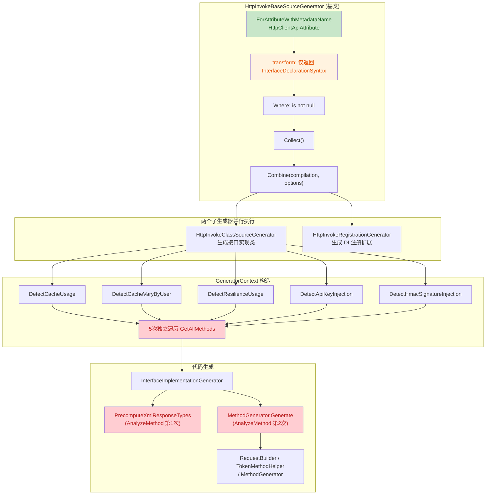

# Mud.HttpUtils.Generator 源代码生成器代码审查报告

**审查日期**：2026-07-07
**审查范围**：`Mud.HttpUtils.Generator` 项目全部代码（约 35 个源文件）
**审查方法**：基于 TRAE-code-review 技能的三维度并行审查（架构层 / 分析器与方法生成层 / 辅助工具与绑定器层）+ 关键问题人工交叉验证
**审查依据**：Roslyn Source Generator 最佳实践、netstandard2.0 兼容性约束、线程安全规范

---

## 一、执行摘要

### 总体评价

| 维度 | 评分 | 说明 |
|------|:----:|------|
| 架构设计 | 8/10 | 增量管道组合规范，`SemanticModelCache` 双层缓存设计正确 |
| 功能正确性 | 6/10 | 存在 3 个 Critical 级缺陷（解密顺序、属性继承、重复分析） |
| 线程安全 | 9/10 | `ConcurrentDictionary` + `ConditionalWeakTable` 使用正确，无实例状态残留 |
| 注入防护 | 5/10 | 多处用户输入未转义，存在编译失败/代码注入风险 |
| netstandard2.0 兼容性 | 6/10 | 生成代码使用了 C# 9+ 语法与 `System.Web` 依赖 |
| 可维护性 | 7/10 | 模块化清晰，但存在字符串硬编码枚举、空 catch 块等问题 |

### 问题统计

| 严重程度 | 数量 | 说明 |
|----------|:----:|------|
| 🔴 Critical | 3 | 功能失效/性能严重退化 |
| 🟠 Major | 22 | 功能缺陷/安全风险/兼容性问题 |
| 🟡 Minor | 33 | 代码质量/小优化 |
| ℹ️ Info | 13 | 建议性改进 |
| **合计** | **71** | |

---

## 二、架构与数据流概览

### 增量生成管道架构



### 关键风险点（红色标注）

1. **transform 未携带语义信息**（橙色）：导致下游重复调用 `GetDeclaredSymbol`
2. **5 次重复遍历方法树**（红色）：`GeneratorContext` 构造函数性能问题
3. **AnalyzeMethod 被调用两次**（红色）：`PrecomputeXmlResponseTypes` 与 `MethodGenerator.Generate` 重复分析

---

## 三、Critical 级别问题

### C1. ResponseEnableDecrypt 解密逻辑对非字符串类型完全失效

- **文件**：[RequestBuilder.cs](file:///d:/Repos/MudHttpUtils/Mud.HttpUtils.Generator/Generators/Implementation/RequestBuilder.cs#L654-L697)
- **行号**：654-697（ResponseExecution），767-802（AllowAnyStatusCodeExecution），893-929（GenerateStandardExecution）
- **已验证**：✅ 人工确认

**问题描述**：

对于非字符串返回类型，当 `ResponseEnableDecrypt = true` 时，生成代码的执行顺序错误：

1. **先反序列化密文**（行 666）：`JsonSerializer.Deserialize<T>(__rawContent)` —— 此时 `__rawContent` 是密文，反序列化**必然失败**
2. **失败后进入 catch 返回错误响应**（行 679-682）
3. **解密代码永远不会被执行**（行 688-693）：因为反序列化已失败返回，解密逻辑不可达

正确流程应为：**先解密 `__rawContent`，再反序列化**。

**代码证据**：

```csharp
// 行 666：先反序列化密文（必失败）
codeBuilder.AppendLine($"                    __content = System.Text.Json.JsonSerializer.Deserialize<{innerType}>(__rawContent, _jsonSerializerOptions);");

// 行 688-693：永远不可达的解密代码
codeBuilder.AppendLine($"                if (__content != null)");
codeBuilder.AppendLine($"                {{");
codeBuilder.AppendLine($"                    var __rawJson = JsonSerializer.Serialize(__content, _jsonSerializerOptions);");
codeBuilder.AppendLine($"                    var __decryptedJson = {httpClient}.DecryptContent(__rawJson);");
codeBuilder.AppendLine($"                    __content = JsonSerializer.Deserialize<{innerType}>(__decryptedJson, _jsonSerializerOptions);");
codeBuilder.AppendLine($"                }}");
```

**改进建议**：在 `try` 块内、反序列化之前插入 `__rawContent = {httpClient}.DecryptContent(__rawContent);`，删除 catch 后的"再序列化-解密-再反序列化"块。

---

### C2. 同一方法被 AnalyzeMethod 重复分析两次（性能）

- **文件**：[InterfaceImplementationGenerator.cs](file:///d:/Repos/MudHttpUtils/Mud.HttpUtils.Generator/Generators/Implementation/InterfaceImplementationGenerator.cs#L562-L603) + [MethodGenerator.cs](file:///d:/Repos/MudHttpUtils/Mud.HttpUtils.Generator/Generators/Implementation/MethodGenerator.cs#L39-L45)
- **已验证**：✅ 代码确认

**问题描述**：

`PrecomputeXmlResponseTypes` 对每个 HTTP 方法调用 `MethodAnalyzer.AnalyzeMethod`（行 571-575）。随后 `MethodGenerator.Generate` 又对相同方法再次调用 `AnalyzeMethod`（行 39-43）。`AnalyzeMethod` 内部涉及多次 `GetAttributes()`、`FindMethodSyntax`（含 `GetDeclaredSymbol`）、`AnalyzeInterfaceAttributes` 等高开销操作，对每个方法执行两次会显著拖慢大型接口的生成速度。

**改进建议**：在 `PrecomputeXmlResponseTypes` 中缓存 `MethodAnalysisResult` 到 `GeneratorContext`（例如 `Dictionary<IMethodSymbol, MethodAnalysisResult>` 使用 `SymbolEqualityComparer.Default`），`MethodGenerator` 复用缓存。

---

### C3. AnalyzeInterfaceProperties 忽略基接口的属性

- **文件**：[MethodAnalyzer.cs](file:///d:/Repos/MudHttpUtils/Mud.HttpUtils.Generator/Analyzers/MethodAnalyzer.cs#L562-L597)
- **已验证**：✅ 代码确认

**问题描述**：

`AnalyzeInterfaceProperties` 使用 `interfaceDecl.Members.OfType<PropertyDeclarationSyntax>()` 仅扫描当前接口语法节点的直接成员，符号侧使用 `interfaceSymbol.GetMembers().OfType<IPropertySymbol>()` 同样只获取当前接口直接成员。当 `[Query]`/`[Path]` 标注的属性定义在基接口中时，这些属性不会被识别，导致：

- URL 模板中的占位符无法被基接口属性替换
- 生成的查询参数缺失

**改进建议**：符号侧改为遍历 `interfaceSymbol.AllInterfaces` 联合当前接口的 `GetMembers()`；语法侧通过 `GetAllBaseInterfaceSyntaxNodes` 收集所有接口语法节点。

---

## 四、Major 级别问题

### 架构层

#### M1. transform 未返回语义信息，导致下游重复调用 GetDeclaredSymbol

- **文件**：[HttpInvokeBaseSourceGenerator.cs](file:///d:/Repos/MudHttpUtils/Mud.HttpUtils.Generator/Generators/HttpInvokeBaseSourceGenerator.cs#L55-L62)
- **问题**：`ForAttributeWithMetadataName` 的 transform 仅返回 `InterfaceDeclarationSyntax`，未携带 `GeneratorAttributeSyntaxContext` 中已计算好的 `TargetSymbol`、`Attribute`。导致下游重新调用 `GetOrCreateSemanticModel` + `GetDeclaredSymbol`。
- **建议**：transform 改为返回 `GeneratorAttributeSyntaxContext` 或自定义轻量结构体。

#### M2. FormContentGenerator 的 AddSource 文件名仅用类名，跨命名空间冲突

- **文件**：[FormContentGenerator.cs](file:///d:/Repos/MudHttpUtils/Mud.HttpUtils.Generator/Generators/FormContentGenerator.cs#L105)
- **问题**：`var fileName = $"{classSymbol.Name}.g.cs";` 跨命名空间同名类会因文件名重复抛 `ArgumentException`。
- **建议**：参考 `EventHandlerSourceGenerator.GenerateUniqueFileName`，将命名空间编入文件名。

#### M3. EventHandlerSourceGenerator 用 Split(',') 解析构造函数参数，无法处理泛型逗号

- **文件**：[EventHandlerSourceGenerator.cs](file:///d:/Repos/MudHttpUtils/Mud.HttpUtils.Generator/EventHandler/EventHandlerSourceGenerator.cs#L207-L220)
- **问题**：`Dictionary<string, int> dict` 等泛型参数的逗号会被误判为参数分隔符。
- **建议**：实现基于括号/尖括号深度计数的分词器。

#### M4. GeneratorContext 构造函数 5 次重复遍历接口方法树

- **文件**：[GeneratorContext.cs](file:///d:/Repos/MudHttpUtils/Mud.HttpUtils.Generator/Generators/Context/GeneratorContext.cs#L109-L114)
- **问题**：`DetectCacheUsage`、`DetectCacheVaryByUser`、`DetectResilienceUsage`、`DetectApiKeyInjection`、`DetectHmacSignatureInjection` 各自独立调用 `GetAllMethods`，5 倍重复遍历。
- **建议**：构造函数中一次性调用 `GetAllMethods` 缓存，传入各 Detect 方法复用。

#### M5. TransitiveCodeGenerator.ReportErrorDiagnostic 固定 Location.None，丢失错误定位

- **文件**：[TransitiveCodeGenerator.cs](file:///d:/Repos/MudHttpUtils/Mud.HttpUtils.Generator/TransitiveCodeGenerator.cs#L85-L92)
- **问题**：所有诊断使用 `Location.None`，IDE 无法跳转到错误位置。
- **建议**：增加 `Location` 参数，由调用方传入精确位置。

#### M6. EventHandlerSourceGenerator 重复获取特性，未利用 GeneratorAttributeSyntaxContext

- **文件**：[EventHandlerSourceGenerator.cs](file:///d:/Repos/MudHttpUtils/Mud.HttpUtils.Generator/EventHandler/EventHandlerSourceGenerator.cs#L86-L89)
- **问题**：`ForAttributeWithMetadataName` 已提供 `AttributeData`，但代码又重新遍历符号特性集合，存在名称匹配不一致风险。
- **建议**：直接使用 `attrCtx.Attribute`。

### 分析器与方法生成层

#### M7. 方法级 [Token(InjectionMode=...)] 被完全忽略

- **文件**：[MethodAnalyzer.cs](file:///d:/Repos/MudHttpUtils/Mud.HttpUtils.Generator/Analyzers/MethodAnalyzer.cs#L911-L927)
- **问题**：`AnalyzeMethodTokenExtended` 只提取 `TokenManagerKey` 和 `RequiresUserId`，未提取 `InjectionMode`。方法级 `[Token(InjectionMode = Cookie)]` 完全不生效。
- **建议**：在 `MethodAnalysisResult` 增加 `MethodTokenInjectionMode` 字段，所有 `IsToken*Mode` 优先使用方法级。

#### M8. FindMethodSyntax 回退到 candidates[0] 导致重载误判

- **文件**：[MethodAnalyzer.cs](file:///d:/Repos/MudHttpUtils/Mud.HttpUtils.Generator/Analyzers/MethodAnalyzer.cs#L426-L427)
- **问题**：语义分析未精确匹配时直接返回第一个候选，重载场景（如 `Get(int)` vs `Get(string)`）会误判。
- **建议**：用参数类型符号逐一比对，或返回 null 由调用方降级处理。

#### M9. 多处用户输入未转义导致字符串注入（安全/编译失败）

- **文件**：多处
  - [TokenMethodHelper.cs:40](file:///d:/Repos/MudHttpUtils/Mud.HttpUtils.Generator/Generators/Implementation/TokenMethodHelper.cs#L40) - `tokenManagerKey` 未转义
  - [AccessTokenGenerator.cs:96](file:///d:/Repos/MudHttpUtils/Mud.HttpUtils.Generator/Generators/Implementation/AccessTokenGenerator.cs#L96) - `tokenManagerKey` 未转义
  - [ConstructorGenerator.cs:127](file:///d:/Repos/MudHttpUtils/Mud.HttpUtils.Generator/Generators/Implementation/ConstructorGenerator.cs#L127) - `_defaultContentType` 未转义
  - [RequestBuilder.cs:454-498](file:///d:/Repos/MudHttpUtils/Mud.HttpUtils.Generator/Generators/Implementation/RequestBuilder.cs#L454-L498) - `fieldName`/`fileName`/`contentType` 未转义
  - [RequestBuilder.cs:179-186](file:///d:/Repos/MudHttpUtils/Mud.HttpUtils.Generator/Generators/Implementation/RequestBuilder.cs#L179-L186) - `tokenQueryName`/`interfaceQuery.Value` 未转义
  - [RequestBuilder.cs:320](file:///d:/Repos/MudHttpUtils/Mud.HttpUtils.Generator/Generators/Implementation/RequestBuilder.cs#L320) - `BodyEncryptPropertyName` 未转义
  - [HeaderParameterBinder.cs:49-83](file:///d:/Repos/MudHttpUtils/Mud.HttpUtils.Generator/Generators/Implementation/Binders/HeaderParameterBinder.cs#L49-L83) - `headerName` 未转义
  - [QueryParameterBinder.cs:72-210](file:///d:/Repos/MudHttpUtils/Mud.HttpUtils.Generator/Generators/Implementation/Binders/QueryParameterBinder.cs#L72-L210) - `paramName`/`separator` 未转义
- **问题**：来自用户特性参数的字符串直接拼入生成的 C# 字符串字面量，若含 `"` 或 `\` 会导致编译失败或代码注入。
- **建议**：统一使用 `StringEscapeHelper.EscapeString` 转义；封装 `AppendStringLiteral(StringBuilder, string)` 辅助方法。

#### M10. Authorization 头检测不一致导致 Token 注入冲突

- **文件**：[MethodAnalyzer.cs:791](file:///d:/Repos/MudHttpUtils/Mud.HttpUtils.Generator/Analyzers/MethodAnalyzer.cs#L791) + [TypeSymbolHelper.cs:264-276](file:///d:/Repos/MudHttpUtils/Mud.HttpUtils.Generator/Helper/TypeSymbolHelper.cs#L264-L276)
- **问题**：`GetHeaderName` 支持 `AliasAs`+`Name` 双命名参数，但 `HasPropertyAttribute` 只检查 `ConstructorArguments[0]`。`[Header(AliasAs = "Authorization")]` 会被识别为 Header 但 `HasPropertyAttribute` 返回 false，导致 Token 注入与接口 Header 同时发生冲突。
- **建议**：统一使用 `GetHeaderName` 的提取逻辑。

#### M11. netstandard2.0 目标项目生成代码使用 C# 9+ 语法

- **文件**：[AccessTokenGenerator.cs:110](file:///d:/Repos/MudHttpUtils/Mud.HttpUtils.Generator/Generators/Implementation/AccessTokenGenerator.cs#L110) + [RequestBuilder.cs:673,775,902](file:///d:/Repos/MudHttpUtils/Mud.HttpUtils.Generator/Generators/Implementation/RequestBuilder.cs#L673)
- **问题**：生成代码含 `is not null`（C# 9）和 `ex is A or B`（C# 9）。用户项目若 `<LangVersion>` 为 7.3（netstandard2.0 默认）会编译失败。
- **建议**：改为 `!= null` 与 `ex is A || ex is B`。

#### M12. HttpUtility.ParseQueryString 在部分目标框架下不可用

- **文件**：[RequestBuilder.cs:163](file:///d:/Repos/MudHttpUtils/Mud.HttpUtils.Generator/Generators/Implementation/RequestBuilder.cs#L163) + [ClassStructureGenerator.cs:27](file:///d:/Repos/MudHttpUtils/Mud.HttpUtils.Generator/Generators/Implementation/ClassStructureGenerator.cs#L27)
- **问题**：`System.Web.HttpUtility.ParseQueryString` 在 .NET Core/5+ 需要额外引用包。
- **建议**：改用 `System.Collections.Specialized.NameValueCollection` 手动构造，或根据目标框架条件编译。

#### M13. GenerateInterfaceHeaders 对已存在的 Header 调用 Add 会抛异常

- **文件**：[MethodGenerator.cs:437-440](file:///d:/Repos/MudHttpUtils/Mud.HttpUtils.Generator/Generators/Implementation/MethodGenerator.cs#L437-L440)
- **问题**：非 Replace 模式直接调用 `Headers.Add(...)`，对不允许重复的 Header 名（如 `Authorization`）会抛 `ArgumentException`。
- **建议**：先用 `Headers.Contains` 判断，或使用 `TryAddWithoutValidation`。

#### M14. GetReturnExpression 对自定义结构体/枚举值类型处理错误

- **文件**：[RequestBuilder.cs:817-848](file:///d:/Repos/MudHttpUtils/Mud.HttpUtils.Generator/Generators/Implementation/RequestBuilder.cs#L817-L848)
- **问题**：`valueTypes` 硬编码集合缺少自定义 struct/enum，对自定义值类型使用 `!` 操作符无效，导致编译失败。
- **建议**：在分析阶段记录是否为值类型，用 `.GetValueOrDefault()` 处理。

#### M15. 缓存包装下 Token 提前获取造成性能浪费

- **文件**：[MethodGenerator.cs:161-220](file:///d:/Repos/MudHttpUtils/Mud.HttpUtils.Generator/Generators/Implementation/MethodGenerator.cs#L161-L220)
- **问题**：Token 获取在 `GenerateCacheWrappedMethod` 之前执行。若缓存命中，Token 完全用不到但仍调用了 `GetTokenAsync`。
- **建议**：将 Token 获取移到缓存/弹性包装的内部回调中。

### 辅助工具层

#### M16. CSharpCodeValidator.CSharpKeywords 使用 OrdinalIgnoreCase 错误拒绝合法标识符

- **文件**：[CSharpCodeValidator.cs:15](file:///d:/Repos/MudHttpUtils/Mud.HttpUtils.Generator/Helper/CSharpCodeValidator.cs#L15)
- **问题**：C# 关键字大小写敏感，`If`/`For` 是合法标识符，但 `OrdinalIgnoreCase` 会错误拒绝。
- **建议**：改为 `StringComparer.Ordinal`。

#### M17. TypeSymbolHelper.IsBasicType 将 System.Array 和 object[] 错误分类

- **文件**：[TypeSymbolHelper.cs:478,493](file:///d:/Repos/MudHttpUtils/Mud.HttpUtils.Generator/Helper/TypeSymbolHelper.cs#L478)
- **问题**：`SpecialType.System_Array => true` 将抽象类 `System.Array` 视为基本类型；`object[]` 也被误判，可能导致 Body 参数跳过复杂对象序列化。
- **建议**：移除 `System_Array` 分支，`object[]` 不应视为基本类型。

#### M18. TypeDetectionHelper.IsAsyncEnumerableType 正则无法匹配可空形式

- **文件**：[TypeDetectionHelper.cs:125-137](file:///d:/Repos/MudHttpUtils/Mud.HttpUtils.Generator/Helper/TypeDetectionHelper.cs#L125-L137)
- **问题**：`^IAsyncEnumerable<(.+)>$` 不匹配 `IAsyncEnumerable<int>?`。
- **建议**：调整为 `^IAsyncEnumerable<(.+)>?\??$`。

#### M19. GeneratorDebugLogger.LogError 在 Release 构建中静默吞噬异常

- **文件**：[GeneratorDebugLogger.cs:36-40](file:///d:/Repos/MudHttpUtils/Mud.HttpUtils.Generator/Helper/GeneratorDebugLogger.cs#L36-L40)
- **问题**：`[Conditional("DEBUG")]` 在 Release 中移除调用，但 catch 块仍捕获异常，异常被静默吞噬。
- **建议**：移除 `[Conditional("DEBUG")]`，或改为基于 `TraceListener` 的实现。

#### M20. NormalizeEventType 双重转义已合法的字符串字面量

- **文件**：[StringEscapeHelper.cs:71-86](file:///d:/Repos/MudHttpUtils/Mud.HttpUtils.Generator/Helper/StringEscapeHelper.cs#L71-L86)
- **问题**：对已是合法字符串字面量的输入，`innerContent.Contains(quote)` 会误判为不合法，导致 `\"` 被二次转义为 `\\\"`。
- **建议**：检测未转义引号，或用 `SyntaxFactory.ParseLiteralExpression` 验证。

#### M21. TokenHelper.GetRequiresUserIdFromAttribute 不安全类型转换

- **文件**：[TokenHelper.cs:136-137](file:///d:/Repos/MudHttpUtils/Mud.HttpUtils.Generator/Helper/TokenHelper.cs#L136-L137)
- **问题**：`(bool)namedArg` 直接拆箱，非 bool 值会抛 `InvalidCastException`。
- **建议**：用 `namedArg is bool b ? b : (bool?)null` 模式。

#### M22. TypeDetectionHelper.IsValueType / IsStringType 字符串版与符号版不一致

- **文件**：[TypeDetectionHelper.cs:59-103](file:///d:/Repos/MudHttpUtils/Mud.HttpUtils.Generator/Helper/TypeDetectionHelper.cs#L59-L103)
- **问题**：字符串版不识别 `Nullable<int>` 全名形式；`IsStringType` 不识别 `System.String`。两套实现不一致。
- **建议**：统一改为基于 `ITypeSymbol` 的检测，或补全字符串版判断。

---

## 五、Minor 级别问题

### 架构层

| 编号 | 问题 | 文件 | 建议 |
|------|------|------|------|
| m1 | `.Where(static s => s is not null)` 死代码 | HttpInvokeBaseSourceGenerator.cs:60 | 移除 |
| m2 | `completeData` 未使用 `WithComparer`，缓存粒度过粗 | HttpInvokeBaseSourceGenerator.cs:67 | 添加 `WithComparer` |
| m3 | `HttpInvokeRegistrationGenerator` 收到 `configOptionsProvider` 但未使用 | HttpInvokeRegistrationGenerator.cs:22-37 | 基类支持子类声明是否需要 |
| m4 | `GeneratorContext` 大量可变属性 + 构造函数副作用 | GeneratorContext.cs:39-72 | 收敛到 `Build` 方法，改为 `init` |
| m5 | `DetectXxx` 用 `catch { return false; }` 吞掉所有异常 | GeneratorContext.cs:116-216 | 至少记录日志 |
| m6 | `HttpInvokeClassSourceGenerator` 标记 `partial` 但无其他定义 | HttpInvokeClassSourceGenerator.cs:18 | 移除 `partial` |
| m7 | `timeoutSeconds * 1000` 存在整型溢出风险 | HttpInvokeRegistrationGenerator.cs:331-332 | 校验范围或用 `FromSeconds` |
| m8 | `EventHandler` 业务默认值硬编码（飞书类型） | EventHandlerSourceGenerator.cs:133-135 | 移到配置注入 |
| m9 | 长循环未检查 `CancellationToken` | 多处 | 循环开头检查 `IsCancellationRequested` |
| m10 | `GeneratedCodeAttribute` 应为 `static` | TransitiveCodeGenerator.cs:21 | 改为 `static` |

### 分析器与方法生成层

| 编号 | 问题 | 文件 | 建议 |
|------|------|------|------|
| m11 | `GetEnumNameFromTypedConstant` 硬编码 SerializeType 序号 | MethodAnalyzer.cs:268-291 | 增加单元测试断言一致性 |
| m12 | `AnalyzeMethod` 内多次独立遍历 `GetAttributes()` | MethodAnalyzer.cs 多处 | 一次性查找 `httpMethodAttributeData` 传递复用 |
| m13 | `ExtractConfigurationFromAttributes` 重复获取 Token 特性 5 次 | InterfaceImplementationGenerator.cs:386-489 | 获取一次 `tokenAttribute` 传给各 helper |
| m14 | `(bool)` 直接强转未做类型校验 | MethodAnalyzer.cs:924 | 用 `is bool` 模式 |
| m15 | Cookie 模式下 access_token 未做安全编码 | MethodGenerator.cs:511 | URL 编码或 Base64 包装 |
| m16 | `GetAttributeArgumentValueFromAttributeData` 对字符串值 `Trim('"')` 不必要 | MethodAnalyzer.cs:41,719 | 去掉 `Trim('"')` |
| m17 | `ResolveType` 递归扫描所有命名空间 | InterfaceImplementationGenerator.cs:270-314 | 缓存或限制搜索范围 |
| m18 | 不必要的 `$"..."` 插值字符串 | AccessTokenGenerator.cs 多处 | 移除 `$` |
| m19 | `ValidatePathParameters` 重复提取 URL 模板 | MethodGenerator.cs:715-719 | 直接使用 `methodInfo.UrlTemplate` |
| m20 | SkipResilience 字符串硬编码无编译期校验 | MethodGenerator.cs:284-291 | Abstractions 定义常量并测试同步 |
| m21 | `ConditionalWeakTable` 内层字典潜在键泄漏 | MethodAnalyzer.cs:465 | 可接受，文档说明 |

### 辅助工具层

| 编号 | 问题 | 文件 | 建议 |
|------|------|------|------|
| m22 | `SyntaxHelper.GetNamespaceName` 未正确处理嵌套命名空间 | SyntaxHelper.cs:44-64 | 从内向外累加层级 |
| m23 | `GetArrayTypeDisplayString` 冗余 if-else | TypeSymbolHelper.cs:367-382 | 删除 if-else |
| m24 | `HandleArrayCreation` 与 `HandleImplicitArrayCreation` 完全重复 | AttributeSyntaxHelper.cs:315-343 | 提取公共方法 |
| m25 | `ParameterAttributeInfo.NamedArguments` 默认使用可变 Dictionary | ParameterAttributeInfo.cs:31 | 用 `ReadOnlyDictionary` |
| m26 | `MethodAnalysisResult.Invalid` 每次创建新实例 | MethodAnalysisResult.cs:234 | 改为 `static readonly` |
| m27 | `BaseClassValidator.IsGeneratedClass` 使用过于宽泛的 `Contains("Wrap")` | BaseClassValidator.cs:22 | 用 `EndsWith("Wrap")` |
| m28 | `BaseClassValidator.ValidateBaseClass` 构造函数参数匹配过于宽泛 | BaseClassValidator.cs:153-176 | 用精确类型比较 |
| m29 | `IsAsyncType` 仅按 Name 匹配，不校验命名空间 | TypeSymbolHelper.cs:639-647 | 校验命名空间 |
| m30 | `IsNullableType` 含无效的 `?<` 检查 | TypeDetectionHelper.cs:80 | 删除 |
| m31 | `IsArrayType` 不识别多维数组 | TypeDetectionHelper.cs:68-72 | 增加 `[,]` 模式 |
| m32 | `IsValueType` 缺少 IntPtr/UIntPtr/Half/nint/nuint | TypeDetectionHelper.cs:87-103 | 补全 |
| m33 | `IsXmlContentType` 匹配过于宽松 | ContentTypeHelper.cs:25 | 精确匹配 `application/xml`/`+xml` |

---

## 六、Info 级别问题

| 编号 | 问题 | 文件 | 建议 |
|------|------|------|------|
| i1 | 生成命名空间策略偏离 .NET 生态约定 | HttpInvokeRegistrationGenerator.cs:164-167 | 文档说明或提供选项 |
| i2 | 诊断描述符缺少 `helpLinkUri` 与 `customTags` | Diagnostics.cs 全文件 | 补充文档链接 |
| i3 | `.csproj` 未显式声明 `<LangVersion>` | Mud.HttpUtils.Generator.csproj | 声明 `<LangVersion>latest</LangVersion>` |
| i4 | `ApiWrapAttributeNames()` 似乎是死代码 | HttpInvokeBaseSourceGenerator.cs:41 | 确认后移除 |
| i5 | 两个子生成器对同一特性重复 `ForAttributeWithMetadataName` | HttpInvokeBaseSourceGenerator.cs:53-75 | 可合并为单一生成器 |
| i6 | 生成文件名仅用 ClassName，相同简单名接口会互相覆盖 | InterfaceImplementationGenerator.cs:101 | 命名空间加入文件名 |
| i7 | `HttpClientTypeSupportsInterface` 硬编码类型判断 | MethodGenerator.cs:660-681 | 统一通过 `AllInterfaces` 检查 |
| i8 | `CancellationToken` 类型判断使用字符串比较 | TypeConverter.cs:22-24 | 用 `SpecialType` 或符号匹配 |
| i9 | `FindInterfaceDeclarationSyntax` 回退扫描所有语法树 | MethodAnalyzer.cs:496-519 | 跨程序集改为基于符号提取 |
| i10 | TokenInjectionMode 序号缺少自动同步机制 | MethodAnalyzer.cs + GeneratorContext.cs | 增加构建期校验测试 |
| i11 | `ParameterBinderFactory.RegisterBinder` 非线程安全 | ParameterBinderFactory.cs:34-37 | 改用 `ImmutableArray` |
| i12 | `ParameterBinderFactory.GetBinder` 依赖顺序 | ParameterBinderFactory.cs:20-23 | 文档或断言明确 |
| i13 | `MethodAnalysisResult` 属性分组不清 | MethodAnalysisResult.cs | 拆分为嵌套类 |

---

## 七、TOCTOU 与线程安全专项结论

| 检查项 | 结论 | 证据 |
|--------|:----:|------|
| `SemanticModelCache` TOCTOU | ✅ 安全 | `ConcurrentDictionary.GetOrAdd` 原子操作 |
| 跨 Compilation 串用 | ✅ 安全 | `ConditionalWeakTable<Compilation, ...>` 自动随 Compilation GC 失效 |
| 生成器实例状态 | ✅ 无风险 | 所有生成器无状态，`MethodGenerator._context` 已在 S5 重构中移除 |
| `SymbolEqualityComparer.Default` | ✅ 规范 | 所有符号比较均正确使用 |
| 静态字段可变性 | ⚠️ 注意 | `HttpClientApiAttributeNames` 是 `public static string[]`，外部可修改元素；建议改为 `ImmutableArray<string>` |

---

## 八、跨层重复问题汇总

以下问题在多个层面被独立发现，反映其广泛影响：

### 字符串注入防护不完整（M9 + 辅助工具层 M1）

- **影响范围**：8+ 处用户输入未转义
- **涉及文件**：TokenMethodHelper / AccessTokenGenerator / ConstructorGenerator / RequestBuilder / HeaderParameterBinder / QueryParameterBinder
- **统一建议**：封装 `AppendStringLiteral(StringBuilder, string)` 辅助方法，所有用户输入字符串字面量统一走此方法

### netstandard2.0 兼容性（M11 + M12）

- **影响范围**：生成代码使用 C# 9+ 语法 + 依赖 `System.Web`
- **涉及文件**：AccessTokenGenerator / RequestBuilder / ClassStructureGenerator
- **统一建议**：建立生成代码兼容性规范，明确目标 LangVersion 为 7.3

### 异常吞噬（m5 + M19）

- **影响范围**：`GeneratorContext.DetectXxx` + 多处 `catch (Exception ex)` 后调用 `LogError`（Release 中被移除）
- **统一建议**：`LogError` 移除 `[Conditional("DEBUG")]`，或改为基于 `TraceListener` 的实现

### 类型检测不一致（M17 + M22 + M18）

- **影响范围**：`TypeSymbolHelper.IsBasicType` 与 `TypeDetectionHelper.IsBasicType` 实现不一致
- **统一建议**：统一基于 `ITypeSymbol` 的检测，字符串版补全判断

---

## 九、优先级修复建议

| 优先级 | 编号 | 类别 | 建议 | 预期收益 |
|:------:|:----:|------|------|----------|
| **P0** | C1 | 功能正确性 | 修正非字符串类型的解密顺序 | 修复功能失效 |
| **P0** | C3 | 功能正确性 | AnalyzeInterfaceProperties 支持基接口 | 修复继承接口属性丢失 |
| **P0** | C2 | 性能 | 缓存 MethodAnalysisResult 复用 | 大型接口生成速度提升 |
| **P0** | M7 | 功能 | 支持方法级 Token InjectionMode | 修复被静默忽略的特性 |
| **P0** | M8 | 正确性 | 移除 FindMethodSyntax 错误回退 | 避免重载误判 |
| **P1** | M9 | 安全 | 8+ 处字符串注入统一转义 | 防止编译失败/代码注入 |
| **P1** | M11 | 兼容性 | 移除生成代码中的 C# 9+ 语法 | 兼容旧 LangVersion |
| **P1** | M12 | 兼容性 | 替换 HttpUtility.ParseQueryString | 跨框架可用 |
| **P1** | M13 | 健壮性 | Header Add 前判重 | 避免运行时异常 |
| **P1** | M14 | 正确性 | GetReturnExpression 支持自定义值类型 | 避免编译失败 |
| **P1** | M10 | 正确性 | 统一 Authorization 头检测 | 避免 Token 冲突 |
| **P1** | M19 | 可观测性 | LogError 移除 Conditional | Release 中异常可观测 |
| **P1** | M2 | 稳定性 | FormContentGenerator 文件名加命名空间 | 避免跨命名空间崩溃 |
| **P1** | M5 | 体验 | ReportErrorDiagnostic 增加 Location | IDE 错误可跳转 |
| **P2** | M4 | 性能 | GeneratorContext 一次遍历复用 | 减少 5x 重复遍历 |
| **P2** | M1 | 性能 | transform 返回语义上下文 | 消除下游重复 GetDeclaredSymbol |
| **P2** | M15 | 性能 | 缓存场景延迟获取 Token | 减少不必要的 Token 请求 |
| **P2** | M6 | 冗余 | EventHandler 直接使用 attrCtx.Attribute | 消除名称匹配不一致风险 |
| **P2** | M3 | 健壮性 | EventHandler 构造函数参数深度感知分词 | 支持泛型参数 |
| **P2** | M16-M18, M20-M22 | 代码质量 | 各项类型检测修正 | 提升准确性 |
| **P3** | m1-m33 | 优化 | 各项小优化 | 代码质量提升 |
| **P3** | i1-i13 | 建议 | 建议性改进 | 可维护性提升 |

---

## 十、正向评价

1. **SemanticModelCache 设计良好**：`ConditionalWeakTable` + `ConcurrentDictionary` 双层结构正确处理增量编译场景，`GetOrAdd` 消除 TOCTOU。
2. **SymbolEqualityComparer.Default 使用规范**：所有符号比较均正确使用，避免基于 `object.Equals` 的哈希异常。
3. **增量管道组合标准**：`ForAttributeWithMetadataName` + `Collect()` + `Combine` 是 Roslyn 推荐模式。
4. **MethodGenerator._context 参数化**：已在近期重构中移除实例状态风险，所有方法显式接收 `GeneratorContext` 参数。
5. **StringEscapeHelper 已存在**：部分注入点（Header 名、Cookie 名、Token Scheme）已正确转义，仅需扩展到全部用户输入。
6. **netstandard2.0 条件编译**：`#if NETSTANDARD2_0`/`#if NET6_0_OR_GREATER` 在 Properties/Options 等处使用正确。
7. **ValidationResult 不可变设计**：构造函数私有 + 静态工厂方法。
8. **HttpClientApiInfoBase 继承结构合理**：构造函数参数 null 校验到位。

---

**审查人**：Trae 自动评审（基于 TRAE-code-review 技能 + 三维度并行子代理）
**审查依据**：Roslyn Source Generator 最佳实践 + netstandard2.0 兼容性约束 + 项目源代码（截至 2026-07-07）
