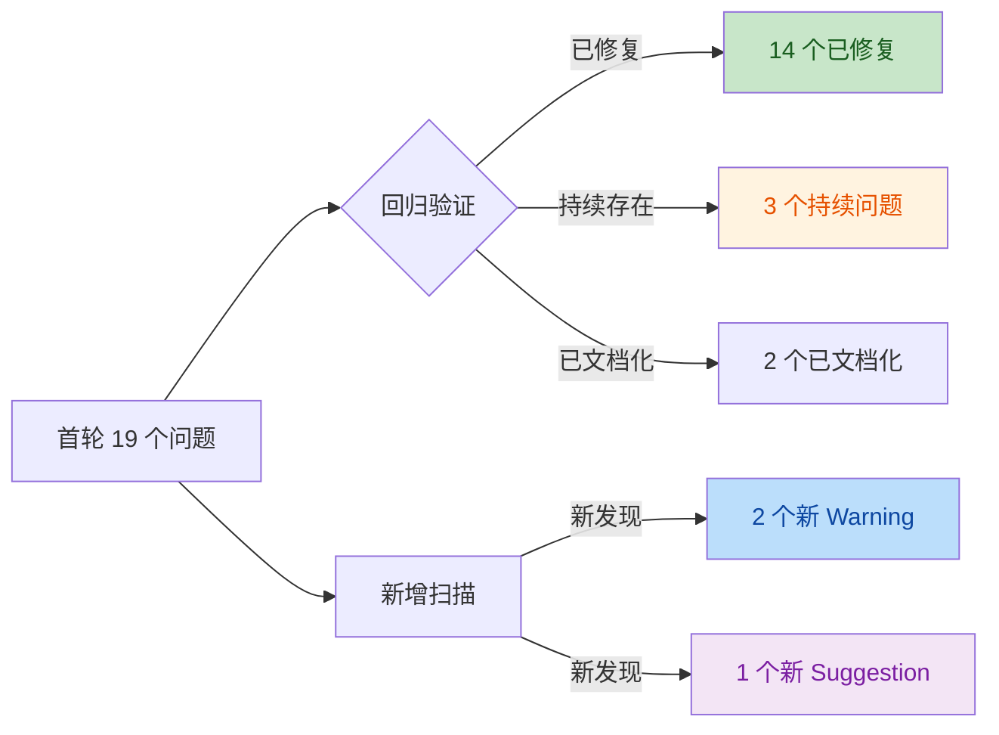
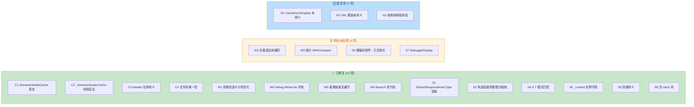

# Mud.HttpUtils.Generator 源代码生成器审查报告（第二轮）

> 审查工具：TRAE-code-review Skill
> 审查对象：Mud.HttpUtils.Generator（Roslyn 增量源代码生成器）
> 审查日期：2026-07-08
> 基线报告：[roslyn-source-generator-review-report.md](file:///d:/Repos/MudHttpUtils/.docs/roslyn-source-generator-review-report.md)（2026-07-07）
> 审查维度：回归验证 / 新增问题 / 持续问题 / 最佳实践
> 目标框架：netstandard2.0
> Roslyn 版本：Microsoft.CodeAnalysis.CSharp 4.11.0

---

## 审查概览

本次审查基于 2026-07-07 的首轮报告进行回归验证，同时扫描新增问题。**首轮报告中 4 个 Critical 问题（C1-C4）已全部修复**，多数 Warning 和 Suggestion 也已处理。本轮发现 2 个新的 Warning 级问题和少量持续问题。



---

## 回归验证：首轮问题修复状态

### 已修复问题（14 项）

| 编号 | 级别 | 问题 | 修复方式 | 验证位置 |
|------|------|------|----------|----------|
| C1 | 🚨→✅ | SemanticModelCache TOCTOU 竞态 | 内层改为 `ConcurrentDictionary` + `GetOrAdd` 原子操作 | [SemanticModelCache.cs#L25-L42](file:///d:/Repos/MudHttpUtils/Mud.HttpUtils.Generator/Helper/SemanticModelCache.cs#L25-L42) |
| C2 | 🚨→✅ | `_interfaceSyntaxCache` 非线程安全 | 已改为 `ConcurrentDictionary` + `GetOrAdd` | [MethodAnalyzer.cs#L496-L509](file:///d:/Repos/MudHttpUtils/Mud.HttpUtils.Generator/Analyzers/MethodAnalyzer.cs#L496-L509) |
| C3 | 🚨→✅ | Header 名称缺少转义 | `GenerateTokenInjection` / `GenerateTokenRecoveryContext` 均使用 `StringEscapeHelper.EscapeString` | [MethodGenerator.cs#L677-L689](file:///d:/Repos/MudHttpUtils/Mud.HttpUtils.Generator/Generators/Implementation/MethodGenerator.cs#L677-L689) |
| C4 | 🚨→✅ | `GenerateUniqueFileName` 文件名冲突 | 文件名包含命名空间前缀 `{safeNamespace}_{className}.g.cs` | [EventHandlerSourceGenerator.cs#L435-L453](file:///d:/Repos/MudHttpUtils/Mud.HttpUtils.Generator/EventHandler/EventHandlerSourceGenerator.cs#L435-L453) |
| W1 | ⚠️→✅ | `FindMethodSyntax` 热路径语义分析 | 先用廉价的名称+参数数量匹配过滤，再对候选做语义分析 | [MethodAnalyzer.cs#L381-L439](file:///d:/Repos/MudHttpUtils/Mud.HttpUtils.Generator/Analyzers/MethodAnalyzer.cs#L381-L439) |
| W4 | ⚠️→✅ | `Debug.WriteLine` 字符串插值开销 | 改用 `GeneratorDebugLogger.LogError` | [AttributeSyntaxHelper.cs](file:///d:/Repos/MudHttpUtils/Mud.HttpUtils.Generator/Helper/AttributeSyntaxHelper.cs) |
| W5 | ⚠️→✅ | 基类链重复遍历 | `GetJsonPropertyProperties` 和 `GetByteArrayPropertyName` 合并为单次遍历 | [FormContentGenerator.cs#L207-L270](file:///d:/Repos/MudHttpUtils/Mud.HttpUtils.Generator/Generators/FormContentGenerator.cs#L207-L270) |
| W6 | ⚠️→✅ | BaseUrl 死代码 | BaseAddress 生成逻辑已移除 | [HttpInvokeRegistrationGenerator.cs](file:///d:/Repos/MudHttpUtils/Mud.HttpUtils.Generator/Generators/HttpInvokeRegistrationGenerator.cs) |
| S1 | 💡→✅ | `ExtractResponseInnerType` 重复 | 已提取到 `TypeSymbolHelper.ExtractResponseInnerType` | [TypeSymbolHelper.cs#L732](file:///d:/Repos/MudHttpUtils/Mud.HttpUtils.Generator/Helper/TypeSymbolHelper.cs#L732) |
| S2 | 💡→✅ | 构造函数参数覆盖命名参数重复模式 | 抽取为 `AttributeDataHelper.GetAttributeIntValue(attr, ctorIndex, propName, default)` | [MethodAnalyzer.cs#L1062-L1063](file:///d:/Repos/MudHttpUtils/Mud.HttpUtils.Generator/Analyzers/MethodAnalyzer.cs#L1062-L1063) |
| S4 | 💡→✅ | `GetType() == typeof(T)` | 改为 `is T` 模式匹配 | [SyntaxHelper.cs#L29-L33](file:///d:/Repos/MudHttpUtils/Mud.HttpUtils.Generator/Helper/SyntaxHelper.cs#L29-L33) |
| S5 | 💡→✅ | `MethodGenerator._context` 实例状态风险 | 已移除实例字段，`context` 作为参数传递 | [MethodGenerator.cs#L18-L27](file:///d:/Repos/MudHttpUtils/Mud.HttpUtils.Generator/Generators/Implementation/MethodGenerator.cs#L18-L27) |
| S6 | 💡→✅ | `NormalizeEventType` 双重转义 | 已重构，增加引号检查防止双重转义 | [StringEscapeHelper.cs#L62-L91](file:///d:/Repos/MudHttpUtils/Mud.HttpUtils.Generator/Helper/StringEscapeHelper.cs#L62-L91) |
| S8 | 💡→✅ | 空 catch 块隐藏错误 | 改用 `GeneratorDebugLogger.LogError` 记录异常 | [TypeSymbolHelper.cs#L155-L165](file:///d:/Repos/MudHttpUtils/Mud.HttpUtils.Generator/Helper/TypeSymbolHelper.cs#L155-L165) |

### 已部分处理 / 已文档化（3 项）

| 编号 | 级别 | 问题 | 当前状态 |
|------|------|------|----------|
| S3 | 💡 | 硬编码枚举序号 | **已文档化**：添加了清晰注释说明生成器无法引用枚举程序集，硬编码序号是必要妥协。仍存在维护风险，但属于设计约束。 |
| S9 | 💡 | 缺少 `WithTrackingName` | **已部分处理**：所有生成器管道已添加 `WithTrackingName`（如 `"HttpInvokeBase_SyntaxProvider"`、`"EventHandler_SyntaxProvider"`）。 |
| W3 | ⚠️ | 缺少 `WithComparer` 缓存优化 | **持续存在**：仅添加了 `WithTrackingName`，未添加 `WithComparer`。详见下文。 |

---

## 持续问题（2 项）

### W2. FindInterfaceDeclarationSyntax 的全量语法树遍历（持续）

**位置**：[MethodAnalyzer.cs#L514-L551](file:///d:/Repos/MudHttpUtils/Mud.HttpUtils.Generator/Analyzers/MethodAnalyzer.cs#L514-L551)

**问题**：当 `DeclaringSyntaxReferences` 找不到时，仍会遍历所有语法树的所有节点进行回退查找。跨程序集接口（如来自引用的 NuGet 包）可能触发此路径。虽然有 `_interfaceSyntaxCache` 缓存（现已线程安全），但首次访问开销仍然显著。

**影响**：⚠️ 性能 — 大型解决方案中首次编译可能产生明显延迟。

**建议**：保留回退逻辑但添加诊断日志记录命中频率，便于评估是否需要进一步优化。

---

### W3. HttpInvokeBaseSourceGenerator 缺少 WithComparer 优化（持续）

**位置**：[HttpInvokeBaseSourceGenerator.cs#L54-L60](file:///d:/Repos/MudHttpUtils/Mud.HttpUtils.Generator/Generators/HttpInvokeBaseSourceGenerator.cs#L54-L60)

**问题**：管道输出 `InterfaceDeclarationSyntax`（引用类型），使用默认引用相等比较。当语法树重新解析时（即使内容未变），节点引用会改变，导致整个下游管道失效。

```csharp
var syntaxInterfaces = context.SyntaxProvider
    .ForAttributeWithMetadataName(
        fullyQualifiedMetadataName: GetFullyQualifiedAttributeName(),
        predicate: static (node, _) => node is InterfaceDeclarationSyntax,
        transform: static (ctx, _) => (InterfaceDeclarationSyntax)ctx.TargetNode)
    .WithTrackingName("HttpInvokeBase_SyntaxProvider")  // 已添加跟踪
    .Collect();  // 仍缺少 WithComparer
```

**影响**：⚠️ 性能 — IDE 编辑场景下缓存命中率降低，可能导致不必要的重新生成。

**建议**：将 transform 输出改为基于内容的不可变值（如接口完全限定名 `EquatableArray<string>`），或使用 `Collect().WithComparer(...)` 配合 `SyntaxEquivalenceComparer`。

---

## 新发现问题

### N1. GenerateCacheKeyExpression 未转义 CacheKeyTemplate（Warning）

**位置**：[MethodGenerator.cs#L497-L518](file:///d:/Repos/MudHttpUtils/Mud.HttpUtils.Generator/Generators/Implementation/MethodGenerator.cs#L497-L518)

**问题**：用户通过 `[Cache(KeyTemplate = "...")]` 提供的模板直接插入到生成的插值字符串字面量中，未进行转义：

```csharp
var resolvedTemplate = methodInfo.CacheKeyTemplate;
for (var i = 0; i < orderedParams.Count; i++)
{
    resolvedTemplate = resolvedTemplate.Replace($"{{{i}}}", $"{{{orderedParams[i].Name}}}");
}

return $"{varyPrefix}$\"{resolvedTemplate}\"";  // resolvedTemplate 未转义
```

如果用户在 `KeyTemplate` 中使用了 `"` 或 `\` 字符，生成的代码将出现语法错误，导致整个项目编译失败。

**影响**：⚠️ 正确性 — 特殊字符输入导致生成代码编译失败。

**修复建议**：对模板中非占位符部分进行转义。由于占位符 `{0}`、`{paramName}` 使用花括号（不需要转义），仅需转义 `"` 和 `\`：

```csharp
// 先转义模板字面量部分，再替换占位符
var escapedTemplate = methodInfo.CacheKeyTemplate
    .Replace("\\", "\\\\")
    .Replace("\"", "\\\"");
var resolvedTemplate = escapedTemplate;
for (var i = 0; i < orderedParams.Count; i++)
{
    resolvedTemplate = resolvedTemplate.Replace($"{{{i}}}", $"{{{orderedParams[i].Name}}}");
}
return $"{varyPrefix}$\"{resolvedTemplate}\"";
```

---

### N2. RequestBuilder URL 模板未转义（Warning）

**位置**：[RequestBuilder.cs#L119](file:///d:/Repos/MudHttpUtils/Mud.HttpUtils.Generator/Generators/Implementation/RequestBuilder.cs#L119)

**问题**：URL 模板（来自 `[Get("/path")]` 等特性）直接插入到生成的插值字符串中：

```csharp
return $"            var __url = $\"{interpolatedUrl}\";";
```

如果 URL 模板包含 `"` 或 `\` 字符，生成的代码将无法编译。虽然 URL 模板通常不包含这些字符，但缺乏防御性转义。

**影响**：⚠️ 正确性 — 边缘输入导致生成代码编译失败（低概率）。

**修复建议**：对 `interpolatedUrl` 中的字面量部分（非 `{param}` 占位符）进行转义，或至少在 `CSharpCodeValidator` 中对 URL 模板进行字符校验，拒绝包含 `"` 和 `\` 的模板。

---

### N3. QueryParameterBinder 字典/对象查询映射值转义不完整（Suggestion）

**位置**：[QueryParameterBinder.cs#L233-L254](file:///d:/Repos/MudHttpUtils/Mud.HttpUtils.Generator/Generators/Implementation/Binders/QueryParameterBinder.cs#L233-L254)

**问题**：在处理字典类型（`QueryMapAttribute`）和对象类型的查询映射时，参数名已转义，但运行时值的拼接代码生成路径未做生成期转义校验。这不会导致生成代码编译失败（值在运行时拼接），但建议确认运行时 URL 编码覆盖完整。

**影响**：💡 健壮性 — 运行时 URL 注入风险（需确认运行时编码覆盖）。

---

## 问题汇总与优先级

| 编号 | 级别 | 问题 | 状态 | 位置 |
|------|------|------|------|------|
| C1-C4 | 🚨 Critical | 首轮关键问题（竞态/转义/文件名冲突） | ✅ 全部已修复 | 多处 |
| W1,W4-W6 | ⚠️ Warning | 首轮警告（性能/死代码） | ✅ 全部已修复 | 多处 |
| S1,S2,S4-S6,S8 | 💡 Suggestion | 首轮建议（重复/模式/转义/日志） | ✅ 全部已修复 | 多处 |
| S3 | 💡 Suggestion | 硬编码枚举序号 | 📝 已文档化 | MethodAnalyzer.cs |
| S9 | 💡 Suggestion | WithTrackingName | 📝 已部分处理 | 多处 |
| W2 | ⚠️ Warning | 全量语法树遍历（持续） | ⏳ 持续 | MethodAnalyzer.cs |
| W3 | ⚠️ Warning | 缺少 WithComparer（持续） | ⏳ 持续 | HttpInvokeBaseSourceGenerator.cs |
| N1 | ⚠️ Warning | CacheKeyTemplate 未转义 | 🆕 新发现 | MethodGenerator.cs |
| N2 | ⚠️ Warning | URL 模板未转义 | 🆕 新发现 | RequestBuilder.cs |
| N3 | 💡 Suggestion | 查询映射值转义校验 | 🆕 新发现 | QueryParameterBinder.cs |
| S7 | 💡 Suggestion | 关键模型添加 DebuggerDisplay | ⏳ 未处理 | 多处 |

---

## 修复进展可视化



---

## ✅ 值得肯定的设计改进

### H1. SemanticModelCache 的线程安全重构

[SemanticModelCache.cs](file:///d:/Repos/MudHttpUtils/Mud.HttpUtils.Generator/Helper/SemanticModelCache.cs) 从嵌套 `ConditionalWeakTable` 改为 `ConditionalWeakTable<Compilation, ConcurrentDictionary<SyntaxTree, SemanticModel>>`，使用 `GetOrAdd` 原子操作彻底消除了 TOCTOU 竞态。注释清晰说明了设计理由（每个 Compilation 独立内层字典，避免跨 Compilation 串用）。

### H2. MethodGenerator 的无状态化

`MethodGenerator` 移除了 `_context` 实例字段，改为通过参数传递。这消除了实例状态风险，使生成器方法无状态化，符合源生成器的最佳实践。

### H3. AttributeDataHelper 的统一抽取

`GetAttributeIntValue(attr, ctorIndex, propName, default)` 统一了"构造函数参数优先于命名参数"的模式，消除了三处重复代码（Cache/Retry/CircuitBreaker），降低了维护成本。

### H4. EventHandlerSourceGenerator 的文件名唯一性

`GenerateUniqueFileName` 现在包含命名空间前缀，有效防止不同命名空间下同名类的文件名冲突。

### H5. 所有生成器管道添加 WithTrackingName

`HttpInvokeBase_SyntaxProvider`、`EventHandler_SyntaxProvider` 等跟踪名称已添加，便于在 Roslyn 生成器调试工具中观察管道执行。

### H6. GeneratorDebugLogger 统一日志

将 `Debug.WriteLine` 和空 catch 块替换为 `GeneratorDebugLogger.LogError`，既避免了 Release 构建的字符串插值开销，又保留了调试可见性。

---

## 建议修复顺序

1. **近期修复**（N1-N2）：CacheKeyTemplate 和 URL 模板的转义问题，防止特殊字符输入导致生成代码编译失败
2. **机会修复**（W2-W3）：性能优化，特别是 WithComparer 可显著提升 IDE 编辑场景的缓存命中率
3. **可选改进**（N3, S7）：健壮性校验和调试体验改进

---

*报告生成完毕。首轮 4 个 Critical 问题已全部修复，代码质量显著提升。本轮新发现的 2 个 Warning 均为字符串转义类问题，修复成本低。*
